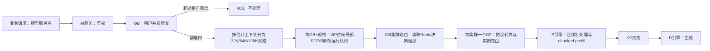

# LLM 尾延迟与吞吐优化研究指导文档

> 2026-10-29 数学线更新：chunk 当前路线、文档状态与 fork 交接统一见[研究入口](modeling/README.md)及[分工计划](modeling/CHUNK_RESEARCH_WORKSTREAMS_20261029.md)。以 DeepInfer/Ascend 运行时机制为工程起点，研究多项式低成本求解与累计 TTFT 时间约束；旧静态优先排序已被覆盖。以下按日期保留历史讨论，不能据旧段落判定当前完成状态；本次未修改入场线设计。

版本：v0.7，2026-10-20。状态：g5 现场链路/冒烟已由报告确认，A 线进入 super-p95 机制、入场分类和预算讨论；尚未实现新策略。最终目标是现网开环流量下的尾延迟与 SLO 内承载能力，AISBench 闭环为并发承载与压力验证。机制讨论见第 17 节，MaaS 背景见第 18 节；当前边界、AISBench计时及单实例UUID集群采集范围以第 19 节为准；第20节完整字段字典已降为备查，最新第21节采用9字段最小方案；本机交付离线脚本＋prompt，内网运行并仅回传总结Markdown，现场事实与勘误见 [g5 上下文](engineering/FGJSQ_REPRODUCTION_PLAN.md)；此前基线表与阶段叙述保留为历史，不能覆盖 g5。B 线数学文档维持独立。

适用环境：用户提供的 3P3D、vLLM + vLLM-Ascend v0.23.0、910B2、FGJSQ + P 侧 predictor 基线。本文承接 [super-p95 调研与 LLM 对比](references/SUPER_P95_RESEARCH_AND_LLM_COMPARISON.md)。Diffusion 源码锚点为 v0.18.0-super-p95-rewrite-dev / dd9c0895d98a73c760e9ca930d87e03198713ff7。

## 1. 核查结论与本轮建议

**研究方向成立：把引擎侧问题分成“谁获得执行机会”和“每次给多少执行量”，有源码机制和工业研究依据。但两层共同影响尾延迟与吞吐，不能分别认定为只优化一个指标。当前证据也不足以证明现有吞吐接近容量。**

2026-10-19 更新：A 线当前只研究 sacrificial/等待队列预算及入队条件；重排已有 waiting、保留 KV 的边界让行、释放 KV 的抢占全部 pending。B 线当前以数学解释为先，推导见 [Chunk size 与 KV 数学笔记](modeling/CHUNK_SIZE_KV_CACHE_MATHEMATICAL_MODEL.md)。先在本机复现 FGJSQ+predictor，再讨论双队列逻辑迁移。

长期研究命题为：

> 在固定模型、硬件、P/D 拓扑和 FGJSQ 路由策略下，利用缓存状态与批执行时间预测，联合改善请求入场及 partial prefill 的执行机会、每轮批构成和 token 分配；以全体请求 P90 TTFT 为主目标，在吞吐不下降且 P90 TPOT 达标的条件下，寻找可重复的改进。

| 原始判断或表述 | 核查结论 | 对研究的影响 |
| --- | --- | --- |
| 高并发 AISBench 是合适起点 | 是，适合测当前业务规定的并发承载能力 | 仍需确认发压模式，并补充异构长度、缓存和开环验证 |
| B 条组成一轮，等最后一条完成才发下一轮 | 与核查的公开 pressure 源码、已有内网总结均不符 | 公开实现是逐并发槽完成后滚动补发；现场版本待补齐 |
| 真实并发小于压测并发即可保证生产 SLO | 不充分 | 输入/输出长度、未缓存工作量、已有上下文和突发性改变了承载能力 |
| 双队列有助于改善 P90 TTFT | 有合理机制，尚无本环境收益证据 | 必须区分 waiting 阻塞与入场后的连续占用 |
| chunk 很短，所以不需要抢占 | 不能据此直接推出 | 小 chunk 只提供决策边界；running-first 仍可让同一个请求连续占用预算 |
| 动态 chunk 后“不再共享 Token” | 应改写为“不再按固定总预算顺序贪心分配” | 总 token、序列、KV 和异步依赖约束仍然存在 |
| 引擎无法感知 waiting 请求的 KV hit | 对原生引擎的笼统描述不成立 | 原生入场路径查询缓存；真正缺口是候选排序前的低开销、时效一致的可见性 |
| 给定分式的来源与含义 | 用户确认是自行建模 | 按自定义代理目标审查；不归因于 Dynamic Batching 论文 |
| 搜索复杂度 O(n) | 需先定义 n | 一维 G 个候选是 O(G × 单候选评估成本)；联合选请求与分配 token 更复杂 |

这里的“成立”指值得研究，**不代表双队列、最短任务优先或动态 chunk 必然同时改善吞吐和 P90**。未来性能阶段应包含固定 chunk/阈值对照；当前 B 线不以先做性能实验作为继续数学研究的条件。

## 2. 基线、证据等级与不可混淆项

### 2.1 本轮采用的部署基线

| 项目 | 基线 | 证据状态 |
| --- | --- | --- |
| 硬件与拓扑 | 3 节点，每节点 8×910B2-64G；每节点 P TP4 + D TP4，共 3P3D | 用户报告；未访问现场 |
| 模型 | Qwen3.6-27B W8A8 | 报告记载；实验前固定模型目录/权重摘要 |
| P | 自动启用 async；SchedulerWithPredictorAsync；predictor/reporter/在线训练保留 | 用户运行日志与继承链补充 |
| D | async、MTP3；g4 不注入 predictor/reporter | 用户报告 |
| 执行模式 | enforce-eager | 用户报告；需固定实际生效配置 |
| KV 交接 | Mooncake；历史窗口观察到 P→D external KV 100% 命中、无重算 | 历史观测，不是所有未来 run 的保证 |
| 路由 | P FGJSQ；D heap active_tokens | 用户报告 |
| P 调度策略 | SLO=0；SLO 过滤、EDF、降级关闭；原生调度语义 | 用户明确的 wrapper 路径 |
| P 预算 | max_num_batched_tokens=8192，max_num_seqs=24；long_prefill_token_threshold 未启用 | 报告和用户补充；“max_token≈8000”在本文指批预算 |
| 初始工作负载 | 66k/128k 档、约 50% 共享前缀、输出 1024；B=1/4/8/16；request_rate=1；pressure_time=900s | 用户本轮确认；64k 标签与实际 token 数须分开记录 |

不要把 API 的 max_tokens/max_out_len（输出长度上限）、max_model_len（上下文上限）、max_num_batched_tokens（每轮批预算）混为一个参数。

P 调度器的现场继承链为：

~~~text
SchedulerWithPredictorAsync
  → SchedulerWithPredictor
  → AsyncRecomputeScheduler
  → AsyncScheduler
  → RecomputeScheduler
  → Scheduler
~~~

SLO=0 时 wrapper 不进行请求筛除；公开 v0.23.0 的 AsyncRecomputeScheduler 只定义初始化，schedule 的实现来自 RecomputeScheduler。预测和上报仍运行，因此“调度决策沿用原生”不能扩大为“没有任何插件开销”。[Ascend 源码 L2](https://github.com/vllm-project/vllm-ascend/blob/v0.23.0/vllm_ascend/core/recompute_scheduler.py#L1124)

### 2.2 证据使用规则

本文把证据分成四种，不互相替代：

1. **版本源码事实**：vLLM/Ascend v0.23.0 的控制流与接口；能说明机制，不能单独证明性能收益。
2. **论文与厂商披露**：作者在其硬件、模型、负载上的实现和实验；能支持设计动机，收益需在 910B2 上重测。
3. **用户现场事实**：内部总结及补充日志；按报告记录，无法访问的脚本路径不当成已复核源码。
4. **本文研究假设/建议**：候选策略、目标函数和实验条件；不写成已有结论。

GitHub issue 中的用户归因、未合入 PR 中的算法主张，都不是项目维护者保证。资料较新也不代表它描述的就是 v0.23.0。

## 3. 最值得借鉴的工业披露与论文

下表是“哪些具体主张有依据”，并非按机构名气背书。阅读顺序建议：QoServe → v0.23.0 源码 → NVIDIA 调度文档 → SLOs-Serve → 其余。

| 来源 | 原文能支持什么 | 本环境迁移边界 |
| --- | --- | --- |
| **微软 QoServe，ASPLOS 2026**，§3.3–3.6、§4.1.3 [R1] | 联合研究优先级、动态 chunk、批时间预测；P/D 分离部分研究 P 节点调度 | 原文 P 节点采用 8K chunk，不受本地 decode TBT 约束；并明确其分离实验未获得混合部署中同样的动态 chunk 收益 |
| **NVIDIA TensorRT-LLM 官方调度文档** [R2] | batch 请求数与总 token 是不同约束；token 预算影响工作区与计算效率；存在吞吐/延迟权衡 | GPU 内核、内存行为和块对齐要求不可原封不动套到 Ascend |
| **NVIDIA chunked prefill 技术博客** [R3] | 官方披露 chunk 大小会影响 TTFT、decode 进展和资源使用；存在动态 sizing 实践 | 博客不是本项目 cost 函数的推导，也没有证明“取消总 token 约束” |
| **DeepSeek-V3/R1 官方推理系统披露** [R4] | P/D 分离；P 侧关注 attention 计算与输入 token 负载，D 侧关注 KV 与请求数；微批可用于计算通信重叠 | H800、MoE、跨节点 EP；其 dual-batch 是微批重叠，**不是 normal/low 双等待队列** |
| **字节跳动 AIBrix 官方发布与技术文章** [R5] | 缓存亲和需要与负载平衡共同考虑；token 服务量可用于公平性记账 | 相关实现主要在网关/路由层，不能当作引擎 chunk 算法；不是对火山内部调度器的完整披露 |
| **SLOs-Serve，Google/CMU 作者论文** [R6] | 以批执行模型规划 token 分配、动态批量与多阶段 SLO；讨论 soft admission | 采用特定性能模型及动态规划；模型内的可行性保证不等于真实 910B2 的硬保证 |
| **Memory-aware and SLA-constrained Dynamic Batching** [R7] | 用内存约束与解码时延反馈调整批内请求数 b；取内存与 SLA 允许批量的较小者 | §III-C 还提到混合 P/D 的 chunk 应用；不是当前自建 C* 分式，不能直接推导 P-only 长上下文收益 |
| **Sarathi-Serve，OSDI 2024，微软/Georgia Tech** [R8] | chunked prefill 与连续组批可改善吞吐/延迟取舍 | 主要动机含混合 prefill/decode 与流水线；本基线是 TP4 的 P/D 分离 |
| **Queueing, Predictions, and LLMs** [R9] | 预测成本、误差、批处理和内存约束使传统排队模型难以直接套用 | 综述与开放问题，不是 SRPT 或任意分式对 P90 最优的证明 |
| **FastServe** [R10] | LLM 中有多级反馈队列、token 边界抢占与状态管理的先例 | 研究含 decode 与状态迁移成本；不能证明本项目需要 KV eviction |

一个重要的反例来自 QoServe：它的 P/D 分离实验仍然改善了 P 侧 goodput，但原文把这一部分的机制归于优先级等策略，并说明大基线 chunk 限制了动态 chunk 的收益。**这给 A 方向提供了直接参考；B 方向当前先分析什么成本曲线、队列状态与缓存条件下应存在收益，硬件效率差异留待后续校准。** [R1](https://www.microsoft.com/en-us/research/wp-content/uploads/2025/10/QoServe_CC_final_v2.pdf)

2026-10-16 还检查了 [vLLM PR #49075](https://github.com/vllm-project/vllm/pull/49075)（核查时 open、未合入）与 [issue #57413](https://github.com/vllm-project/vllm/issues/57413)（用户报告长上下文调度问题）。它们提示 partial-prefill 参数存在版本和实现差异；其中因果归因不能直接接受，更不能把未合入改动算进 v0.23.0。本文关于基线的判断仍以对应版本源码为准。

## 4. AISBench 发压语义：必须先纠正实验模型

### 4.1 公开 pressure 实现是滚动闭环

本轮检查了两份公开快照：2026-06-30 当日末尾提交 **1e7cb37e3d5d2101db47fe3fe2272c965375a69c**，以及 2026-10-16 的 **da7ece4430e723e390b46b915a6122c886b06929**。两份源码的下述 pressure 控制流一致。前者是对“0630”的候选日期核查，尚不等于已确认与现场包逐字节相同：

- [icl_base_api_inferencer.py，394–512 行](https://github.com/AISBench/benchmark/blob/da7ece4430e723e390b46b915a6122c886b06929/ais_bench/benchmark/openicl/icl_inferencer/icl_base_api_inferencer.py#L394)：每个 limited_request_func 取得一个并发槽后，在 pressure 时间内循环 await do_request，再取下一条继续发；asyncio.gather 位于收尾路径。
- [官方稳态/压力测试说明](https://github.com/AISBench/benchmark/blob/da7ece4430e723e390b46b915a6122c886b06929/docs/source_zh_cn/advanced_tutorials/stable_stage.md#L203)：描述逐渐增加客户端，每个客户端持续发请求；request_rate 描述该模式下新增客户端的频率。
- [6 月 30 日源码的相同循环](https://github.com/AISBench/benchmark/blob/1e7cb37e3d5d2101db47fe3fe2272c965375a69c/ais_bench/benchmark/openicl/icl_inferencer/icl_base_api_inferencer.py#L427)同样是逐槽补发。
- 内网 SUMMARY_REPORT 第 215 行也明确写了 B 个 worker 完成后立即补发，与该控制流一致。

**因此，不能把“B=16”解释成 16 条一起完成才开始下一轮。** 它是配置的并发上限；稳态可以接近 B，并非一定严格小于 B。爬坡、补充间隙、失败、数据供应和停止阶段会使实际在途数降低。多个发压进程时还需核对总配置如何分片，不能把单进程局部 num_workers 直接当全局 B。

~~~mermaid
sequenceDiagram
    participant C as AISBench
    participant S as P-D服务
    C->>S: 槽1发送 A
    Note over C,S: 爬坡后建立其他并发槽
    C->>S: 槽2发送 B
    S-->>C: A 的 E2E 完成
    C->>S: 槽1立即补发 C
    Note over C,S: B 此时仍可在执行
    S-->>C: B 的 E2E 完成
    C->>S: 槽2补发 D
~~~

“每条间隔 1 秒”在旧报告中是爬坡速率，不能据此推导稳态持续 1 rps，也不能把它用于每轮批间隔模型。用户本轮补充 AISBench 为“0630 提交”，concurrency=1/4/8/16、request_rate=1、pressure_time=900s。具体年份、SHA 和包装器仍需随实验归档；若确有额外整轮屏障，应记录为自定义负载发生器，而不是公开 pressure 默认语义。

### 4.2 闭环为什么会改变算法比较

在足够稳定、采用一致观察边界且边界效应较小时，可用 Little 关系描述：

$$
\lambda_{\rm observed}\simeq
\frac{\overline{N_{\rm inflight}}}{\mathbb{E}[T_{\rm E2E}]}.
$$

它是观测关系，不是将到达率预设为常数的理由。相同 B 下：

- P 变快可能使完成和补发加快，P 再次承受更高到达率。
- D 变慢可能降低 P 的补发压力，使 P 侧某些等待指标反而变好。
- 延迟低优先级请求会占住客户端槽，改变后续请求到达组成。
- 相同随机种子不必然保证有限时间内两臂实际发送了完全相同的请求集合。

因此保留两类实验：闭环测业务所需的并发承载能力；固定到达计划的开环回放辅助识别调度因果。开环属于后续验证，不替代用户选定的 AISBench 主场景。

### 4.3 生产并发低于压测并发，不构成充分保证

“生产并发低于压测上限”可以是业务管控规则，但对应 SLO 的结论还依赖工作负载。建议定义条件化承载能力：

$$
B_{\rm SLO}^{*}(\mathcal W,\mathcal K,\mathcal D)
=
\max\{B:\ P90(TTFT)\le S_F,\ P90(TPOT)\le S_P\},
$$

其中 $\mathcal W$ 包括输入/输出长度与到达过程，$\mathcal K$ 是缓存状态分布，$\mathcal D$ 是部署和软件配置。有限样本扫出的最大达标档是实验结果，不是所有中间档或未来流量的数学保证。

只比“在途总 token”仍不够：cached/uncached token、已有上下文、P/D 阶段、不同请求分片方式都改变成本。更少请求也可能带来更大的未缓存工作量或 D KV 压力。此结论与 DeepSeek 对 P/D 负载采用不同量纲的工程披露一致，但具体权重必须在本模型实测。[R4](https://github.com/deepseek-ai/open-infra-index/blob/main/202502OpenSourceWeek/day_6_one_more_thing_deepseekV3R1_inference_system_overview.md)

## 5. 基线机制：为什么两层都值得研究

### 5.1 FCFS + running-first + 共享总预算

公开 Ascend v0.23.0 的 RecomputeScheduler.schedule 可概括为：

~~~text
初始化本轮 token_budget
先遍历 running：
    根据未处理进度、输出占位等求本轮需求
    有正值 long_prefill_token_threshold 时进行截断
    再受剩余 token_budget、KV 与其他约束限制
预算和槽位仍允许时：
    从 waiting / skipped_waiting 选候选
    查询本地 prefix hit 与外部 KV
    分配资源并入 running
形成 SchedulerOutput，交给异步执行链
~~~

对应源码：running 循环 [L2:210](https://github.com/vllm-project/vllm-ascend/blob/v0.23.0/vllm_ascend/core/recompute_scheduler.py#L210)、waiting 循环 [L2:441](https://github.com/vllm-project/vllm-ascend/blob/v0.23.0/vllm_ascend/core/recompute_scheduler.py#L441)、缓存查询 [L2:499](https://github.com/vllm-project/vllm-ascend/blob/v0.23.0/vllm_ascend/core/recompute_scheduler.py#L499)。

FCFS 描述等待队列的基本优先级；running-first 描述两类状态的处理顺序；共享 token 描述总量约束。三者不是同一件事。running 中可以有尚未完成的 prefill，不能笼统称为“decode-first”。原生 skipped_waiting 用于暂时不可执行等情况，也不是 super-p95 的让行队列。

### 5.2 小 chunk 不自动解决 HOL

说明性例子，不是实测：无 decode、无缓存命中、KV/槽位足够；A 剩余 20,000 token 已运行，B 需要 1,000 token 在等待。

| 调度轮 | 总预算 8192，阈值关闭时 A 获得 | B 获得 |
| --- | ---: | ---: |
| 1 | 8192 | 0 |
| 2 | 8192 | 0 |
| 3 | 3616 | 1000 |

将总预算降为 4096，A 仍可连续占满多轮。它缩短了不可中断的一轮，却未改变 B 获得机会的规则。

有正值的每请求 chunk cap 可以为同轮其他请求留下预算，所以 **long_prefill_token_threshold 的固定取值扫描应列入未来性能对照**。但多个 running 请求仍可能合计用满预算；单独设置 cap 也不等于等待时间有界。不能只依据配置字段的名字认定并发 partial-prefill 限额已经生效，应检查实际 schedule 路径。

A 方向需要回答“谁先获得空出来的机会”，B 方向需要回答“是否、以及留出多少机会”。两者存在明确耦合。

### 5.3 等待应分阶段定位

建议对每条请求记录以下事件，而不是用 TTFT 减一个平均 token/s 常数来反推全部等待：

~~~mermaid
flowchart LR
    A["客户端发送"] --> B["P 引擎收到"]
    B --> C["首次获调度"]
    C --> D["多个 prefill chunk 与轮间等待"]
    D --> E["P 完成"]
    E --> F["KV交接 / D等待 / D首次执行"]
    F --> G["客户端首个有效输出"]
    G --> H["后续输出直到E2E完成"]
~~~

图是事件定位框架；交接、计算及异步提交可能重叠，不应把重叠区间简单相加。

关键区分：

- **首次入场等待**：引擎排队到首次调度；这是 A 的直接作用区。
- **入场后未获执行的间隔**：partial prefill 后续机会；保留观测，A 对这类机会的直接干预暂缓。
- **实际批执行/提交等待**：需区分 NPU 执行与 CPU/异步队列时间。
- **P 后续到客户端首输出的延迟**：KV、D 侧、网络等；P 优化不能直接解释全部 TTFT。
- **P 资源释放与 proxy 记账释放**：历史 FGJSQ 在首个 D chunk 释放 P 账本，不等于 P 算力一直占用到该时刻。

## 6. 目标与统计口径

### 6.1 先约定真正的验收对象

按用户 2026-10-20 最新 MaaS 业务说明记录 Qwen3.6-27B 承诺，符号 $S_F,S_P$ 按请求所属档选择。128K TPOT 按最新业务描述记录为40ms，此前45ms属历史口径。用户最新明确TTFT/TPOT统一对齐AISBench：客户端HTTP POST前起点、首记录流式时间点计算TTFT，TPOT沿用同一汇总口径。研究边界为单实例UUID的GF＋XPYD集群；GF/P内部时长用于解释指标，不替代客户端指标。源码核对见第18.5节，最新采集约定见第19节：

| 业务档 | P90 TTFT 上限 $S_F$ | P90 TPOT 上限 $S_P$ |
| --- | ---: | ---: |
| 32k | 12 s | 32 ms/token |
| 64k | 27 s | 30 ms/token |
| 128k | 30 s | 40 ms/token |

必须逐档达标；合并统计不能掩盖某一档违约。当前并发扫描为 1、4、8、16；若 16 仍达标，只能称“已验证至 16”，不能称最大承载就是 16。建议验收同时报告：

| 层面 | 主指标 | 必须一起报告 |
| --- | --- | --- |
| 用户体验 | 全体请求 P90 TTFT | P50/P95/P99、最长等待、按长度/缓存命中分组 |
| 解码体验 | P90 TPOT | ITL/TBT 分布、长停顿、MTP 接受率和实际输出 token 数 |
| 系统产出 | 完成 QPS、输出 token/s | 输入 token/s、失败/超时/取消、未完成量 |
| SLO 承载 | 最大达标并发档及其吞吐 | 相同工作负载与缓存条件、重复 run 的不确定性 |
| 引擎效率 | 未缓存 prefill token/s、批耗时、空闲间隙 | cache hit、重算 token、KV 占用和调度开销 |

“总 token/s”在长 prompt 场景主要由输入贡献，可能掩盖输出性能；prefix hit 还会使逻辑输入吞吐与实际计算量分离。二者都值得记录，不能互相替代。原始请求长度和实际输出必须一致或分层比较。

每请求平均 TPOT 通常是：

$$
TPOT_i=\frac{T_{{\rm last},i}-T_{{\rm first},i}}{O_i-1},\quad O_i>1.
$$

P90(TPOT) 是这些请求平均值的分位数，**不等于 token 间隔的 P90，更不等于最大 TBT**。MTP/SSE 一次返回多个 token 时，客户端 chunk 间隔也不自动等于逐 token ITL。[指标定义的讨论 R11](https://arxiv.org/abs/2410.14257)

TTFT 与 TPOT 分别有 90% 达标，不代表同一批请求有 90% 同时达标：两个不相交的 10% 失败集合可使联合达标率降到 80%。因此可以另报

$$
G_{\rm joint}
=\frac{\#\{i:\ TTFT_i\le S_F,\ TPOT_i\le S_P\}}{T_{\rm observation}},
$$

但不能未经业务确认把联合 goodput 替换既定的两个边际 P90 SLO。

### 6.2 “吞吐不下降”如何判定

设基线完成吞吐为 $X_0$，候选为 $X_1$。用户目标仍是 $X_1\ge X_0$；测量噪声需要用配对重复和置信区间处理，不能把“不显著下降”当作“已证明不下降”。

实验前共同确定：

- 实用非劣界 $\epsilon_X$；它是事先接受的误差/损失边界，不由本文擅自设为 5%。
- TTFT 最小有意义改善量 $\delta_F$。
- 可复现性判据，例如配对 run 的吞吐比置信区间和 TTFT 改善区间。
- P90 TPOT 必须满足现有 SLO；若基线尚未达标，单列这一问题。

始终展示吞吐—P90 TTFT—P90 TPOT 的结果点及 Pareto 关系。不要只在一个点找“漂亮百分比”，也不要默认大 batch 或更高并发一定提升吞吐。

### 6.3 防止分位数改善只是样本变化

双队列研究尤其需要：

- 让行请求、失败和超时仍进入报告；不能只计算 normal 完成请求。
- 固定进入观察窗的请求 cohort，停止新请求后追踪至完成或明确截止；保留未完成/右删失信息。
- 稳态吞吐用一致的固定墙钟窗口；cohort 延迟和 drain 时间另报，不把两种口径混算。
- 每个长度/命中桶报告样本数及 P90/P95；小样本不能支撑稳定尾部结论。
- 多 run 配对；尾部存在时间相关时按 run 或时间块估计不确定性，不简单假设每请求独立。

AISBench 官方文档自身提醒稳态窗口的吞吐边界效应；本报告旧实验也混用过不同统计窗口。新实验应重新统一口径，而不是直接拼接历史汇总表。[AISBench 稳态说明](https://github.com/AISBench/benchmark/blob/da7ece4430e723e390b46b915a6122c886b06929/docs/source_zh_cn/advanced_tutorials/stable_stage.md#L22)

## 7. 方向 A：让行队列预算与入队条件

### 7.1 当前研究边界

用户本轮将重点收敛为两个问题：**允许多少请求/工作量进入 sacrificial 队列，以及哪些请求适合进入。** 双队列是承载这两个规则的结构；现在不确定跨队列取出顺序，也不实现新的服务顺序。

以下全部 pending，删除上一版把它们作为近期 A0/A1/A2 实验的建议：

| 暂缓动作 | 本轮处理 |
| --- | --- |
| 重排已经存在的 waiting | 不设计、不实现新的排序器 |
| chunk 边界让行、保留 KV | 不改变 running 的后续执行机会 |
| 释放 KV、重排/恢复请求 | 不调用新的资源抢占路径 |

区分“到达时赋予候选类别”和“改变既有 waiting/running 的执行顺序”。分类和预算可以先做定义与旁路记录；真正启用双队列一定还需要取出/服务规则，留到 FGJSQ+predictor 复现后讨论。当前不宣称仅打分类标签就能降低 TTFT。

### 7.2 入队条件：研究可推迟的代价与价值

把 sacrificial 定义为“允许在预算内推迟的请求”，不等于必然超时或永久让行。以下是分类特征候选，尚未选定规则：

| 特征 | 研究作用 | 局限 |
| --- | --- | --- |
| 剩余未缓存 prefill 工作 | 区分同长度、不同缓存状态的请求 | token 数不能单独表示 attention 成本 |
| 预测剩余 P 完成成本 | 估计该请求占用未来服务的程度 | 当前单批 predictor 不能直接提供多批完成时间 |
| 已等待年龄、剩余 SLO 裕量 | 约束“还能推迟多久” | 需要客户端起点、后续 KV/D 时间和误差 |
| 选入当前候选的边际批成本 | 比较该请求对其他请求的附加延迟 | 需定义参考批，不把孤立服务时间相加当真实批时间 |
| 缓存复用/有效 KV ready | 区分便宜请求与仍需传输/计算者 | 热点优待可能使冷请求长期处于劣势 |
| 已承受的推迟量 | 约束重复牺牲同一类/同一请求 | 当前只定义记账，晋升和出队机制尚未研究 |

“长请求进 low”只适合当待检验的简单假设，不能成为默认结论。近乎等长且等命中的 AISBench 请求可能缺乏可利用的异质性；需要研究的差异可能来自实际未缓存量、剩余进度或年龄。

批服务时间依赖请求组合，传统短任务优先的平均延迟结论不能直接推广为本部署的 P90 最优。[排队与预测研究 R9](https://arxiv.org/html/2503.07545v1)

### 7.3 预算必须区分流入、库存与时间

| 预算对象 | 候选定义 | 它不能单独保证什么 |
| --- | --- | --- |
| 入队流量 | 某窗口内允许归入 low 的数量/比例，或带突发额度的信用预算 | 不能保证 low 不积压 |
| 队列库存 | 当前 low 请求数 Q_s；同时记录剩余 token/预测工作量 W_s | 请求数上限不能代表服务时间上限 |
| 时间与个体债务 | 最老年龄、累计额外等待、重复分类次数 | 若无服务保证，记录本身不会阻止饥饿 |
| 类别分布 | 各长度档/缓存桶进入 low 的比例 | 全局小比例可能集中伤害单一业务档 |

一种可讨论的信用记账形式是：每到达一个请求获得 ρ 单位分类信用，决定把请求 i 放入 low 时消耗 v_i；信用上限 b_max 限制累积突发量。取 v_i=1 是数量预算；若使用预测工作量，信用补充也必须改为相同工作量单位。ρ、窗口和突发量都属于待研究参数，不从 P90 自动推成 10%。

队列守恒关系可先写为：

$$
\frac{dQ_s}{dt}=\lambda_s(t)-a_s(t),
$$

其中 λ_s 为进入 low 的流量，a_s 为从该队列获得服务/离开的速率。只有流入预算、没有 a_s 的定义，就无法证明等待有界。当前保留 a_s 为后续服务机制接口，不借此提前设计重排/抢占。

研究预算时需要一起回答：如何处理信用不足、库存达到上限、某类请求长期累积债务。可以先定义“停止进一步划入 low”的准入条件；已有 low 如何得到服务，留到迁移阶段统一设计。

**P90 不意味着可以任意牺牲 10%，P95 也不意味着可复制 diffusion 的 5% 累计配额。** 到达比例、排队库存、执行成本份额和尾部分位数是不同变量。super-p95 的累计配额和 low LIFO 仅作机制参照；不把它们当作默认迁移方案。

### 7.4 与 FGJSQ+predictor 的关系

二者在接口上有兼容空间：FGJSQ 选择 P 实例；引擎内分类/预算处理到达该 P 的请求；predictor 提供成本信息。但真正兼容还取决于事件记账：

- 请求进入 low 后仍是该 P 的未完成工作，不能从 proxy 负载账本中消失。
- 预测值应包含明确定义的剩余工作；不能把一个批的预测时间重复记给所有请求。
- 同一请求在路由、入队、batch 执行、P 完成、D 首输出及取消时，要有一致 ID 和去重规则。
- 现场 P 的 async、SLO=0 原生语义、D 的配置均作为复现基线保留。

因此下一步先复现上述数据流和状态机，完成后再讨论何种预算/分类规则值得移植。当前未实现双队列，也未建立其收益结论。

## 8. 方向 B：动态批量与每请求 token 分配

### 8.1 先把四个变量拆开

对一次调度动作 $a=(\mathcal B,\mathbf c)$：

- $\mathcal B$：本轮实际执行的请求集合。
- $b=|\mathcal B|$：本轮 batch size；不等于客户端并发 B，也不必等于 running 长度。
- $c_i$：请求 i 本轮分配的新计算 token 数，即它本轮的 chunk。
- $U=\sum_i c_i$：本轮总新计算 token；受安全上限 $U_{\rm hard}$ 限制。

若研究混合 P/D，还需显式区分 decode/speculative 预算；当前第一阶段以 P 节点为对象，不应预设其批中有与混合实例相同的持续 decode 集合。

建议研究“动态选择 $\mathcal B,\mathbf c,U$”，而不是取消总量约束。同一 $U=8192$，单请求 8192 与四请求各 2048 的已有上下文、attention 工作、KV 分配和 CPU 开销可能不同。总 token 相同不代表批时间相同。

### 8.2 waiting 的 KV 信息：已有能力与真正缺口

原生路径在 waiting 请求入场时调用 get_computed_blocks，随后查询 connector 的外部匹配信息。vLLM KVCacheManager 通过 block hash 寻找已缓存前缀；全命中也可能需要重算最后 token/块以得到 logits。[L2](https://github.com/vllm-project/vllm-ascend/blob/v0.23.0/vllm_ascend/core/recompute_scheduler.py#L499)，[L3](https://github.com/vllm-project/vllm/blob/v0.23.0/vllm/v1/core/kv_cache_manager.py#L196)

应把待解决问题改成：

> 如何在最终入场和分配之前，以低开销获取一组候选的有效缓存/未缓存状态，并在实际提交时校验其仍然成立？

需要分别处理：

1. **本地 prefix hit**：已经在本 P 可复用的 KV。
2. **外部 KV 可命中**：可能涉及查询、传输、异步 ready；不能当成本地立即可读。
3. **候选探测与资源保留**：探测成功不是 pin/reserve，稍后可能失效或被其他请求影响。
4. **统计副作用**：get_computed_blocks 会记录 prefix-cache stats；直接对大量候选反复调用会污染查询/命中统计，应设计旁路探测或独立记账。
5. **共享块的真实内存增量**：多个候选的 KV 增量不能总是简单相加，需考虑共享、引用和各 cache group。

“P→D external KV 100% 命中”与“P 侧待入场请求命中了多少本地共享前缀”不是同一个比例。

### 8.3 predictor 可以复用，但必须扩展验证范围

现有 LightGBM 预测的是一个 prefill batch 的执行毫秒数。它不是端到端 TTFT 预测器，更不是未来多批计划的无误差 oracle。

动态搜索至少要求模型能区分：

- 每请求新增 token、已有有效上下文/命中长度、剩余 prompt。
- batch 请求数与构成；同总量下的长短请求组合。
- 本地与外部 KV 状态、内存压力、可能的重算。
- 实际执行模式、TP4、W8A8、Ascend 内核路径；若有异构 attention/state cache，以模型实际实现为准。
- 调度/输入准备/提交间隙与纯执行时间。

旧报告的 8 个聚合特征可以作为起点，但不能预先认定它们足以外推到新的 chunk/batch 形状。例如相同均值和总 token 的两个批，attention 成本与最长请求可能不同。

**数学阶段要显式表达反事实误差与可微性。** 基线若主要产生固定 8192 附近的批，不能预设模型可准确外推到 512、2048、多路 partial prefill。当前先研究光滑成本代理、误差项和最优条件；未来落地阶段再校准候选性能面、检查 shadow 决策，继而启用调度。普通 LightGBM 常值叶不直接提供可用于解析寻优的平滑导数，详见第 9 节。

预测需要误差上界或分桶高分位残差的校准，不能把平均误差小直接当作 P90 SLO 保证。跨多步累计误差还可能相关。

### 8.4 P/D 分离改变了约束位置

P 节点没有持续 decode 干扰时，不应该直接给 P 的每个 batch 套“业务分档 TPOT/TBT 上限”。用户给的是 **D 输出体验的每请求 P90 TPOT**，不是 P batch 的执行期限。

P 优化主要受端到端 TTFT 预算、KV/序列/执行资源限制；D 侧 TPOT 通过全链路验证约束。P 完成更快或更集中会改变流入 D 的节奏，可能增加 D 活跃序列和 KV 压力，所以不能因此把 D 从评估中删掉。

采用端到端 TTFT 的剩余裕量时，可先定义一个估计量：

$$
s_i^P(t)=S_{F,i}-{\rm age}_{i,\rm client}(t)
-\widehat R_{i,\rm handoff+D+network}(t).
$$

它是用于决策的研究变量；后项需测量/建模，不能把几个阶段的 P90 直接相加当总 P90。若客户端起点不可观测，应保存明确的代理时间戳及误差。

## 9. 用户自建 C*：保留双时间函数，优先数学研究

完整推导见 [Chunk size、预测器与 KV 缓存数学笔记](modeling/CHUNK_SIZE_KV_CACHE_MATHEMATICAL_MODEL.md)。本节保留结论与待定义项。公式是用户自建模型，不归因于 Dynamic Batching 或其他论文。

### 9.1 本轮纠正及原型场景

用户明确：分母第二项 d_1,…,d_2 与其他项 d_1,…,d_k 的区别是有意的。上一版将两个函数合并为 T(C) 不成立，本版恢复两者。

用户补充的 Optimal Prefill Chunker：先形成 decode 候选批，然后枚举长 prefill 请求的 chunk，利用成本预测选择效用最大的候选。它描述了混合 P/D 场景；当前 3P3D 的 P-only 形式需另行定义。补充说明尚未解释第二个函数为什么只含两个 decode 请求，因此保留这项语义待讨论。

令 $T=T_k(C,h,z)$、$U=T_2(C,h,z)$，两者均保留用户给出的各自参数集合；$P_b=\sum p_i$、$W_q=\sum w_j$、$N=1+m+n$、$\ell=E[L]$。原式为：

$$
F=\frac{A}{D},\qquad
A=C+P_b+W_q+\lambda T\ell,\qquad
D=NT+\frac{\lambda}{2}U^2.
$$

这里 U 是时间函数，不是总 token。C 是本次唯一寻优变量；若其他请求分配也随 C 变化，需增加相应导数。

### 9.2 保留两个函数后的最优条件

固定候选集合、h、z、λ、ℓ，设两个成本函数可微且 D>0，则：

$$
F_C=
\frac{(1+\lambda\ell T_C)D-A(NT_C+\lambda UU_C)}{D^2}.
$$

内点候选解满足：

$$
(1+\lambda\ell T_C)D=A(NT_C+\lambda UU_C).
$$

这表达边际效用与边际累计时间代价的平衡。还需二阶条件、边界比较及可行性检查；不能仅凭一阶方程宣称唯一/全局最优。数学笔记第 4 节给出一个可解析的二次成本例子，说明何时存在内部最优、何时原分式会偏向最小 chunk。

### 9.3 平方项的排队解释仍要定义

一般的新到达等待代价是 $\int\lambda(s)w_C(s)\,ds$。当到达率恒定、所有新到达者被阻塞到某个确定窗口 U 结束时，得到 λU²/2。

若所有在完整批 T 内到达者都必须等到 T，则该机制给出 λT²/2。若只计入 U 内的到达、却都等到 T，且 U≤T，则得到 λ(TU−U²/2)。因此可以保留原式，但需要说明原型属于哪一种窗口机制。

同样，NT 需要明确被累计的是哪些请求。当前分式包含本轮未处理的 waiting 和未来到达 token，因此它是工作量/累计时间效用，不能直接等同完成吞吐。单批局部效用对 P90 的作用仍需请求级随机模型。

### 9.4 predictor 与缓存如何进入数学模型

1. **成本接口**：以候选特征 φ 输入批执行预测器，得到 μ_k、μ_2。现有报告预测的是 batch 执行时间，不是完整请求 TTFT；收到 patch 后核对标签。
2. **可微成本**：普通 LightGBM 常值叶是分段常数；用它提供校准点，再构造有适用范围的光滑代理，才可讨论 T_C、F_CC。[官方参数](https://lightgbm.readthedocs.io/en/stable/Parameters.html#linear_tree)
3. **不确定性**：若平方项的等待解释成立，随机耗时应使用 $E[T_2^2]=\mu_2^2+v_2$。对应分母为 $N\mu_k+\lambda(\mu_2^2+v_2)/2$；预测波动自然进入成本，而不是被均值平方抹去。
4. **缓存个体状态**：当前候选用真实命中/未缓存量和已有上下文；新 token 仍可能关注缓存中的上下文，不能用 (1−h) 缩放整个批时间。
5. **缓存宏观状态**：h 采用 token 加权有效命中率。时间演化需要写入、ready、正常缓存淘汰/失效与热点状态；容量曲线需要另列假设。

在同质两状态近似中，令 κ 是可复用输入份额上限，a/e 是缓存转为可用/失效的强度：

$$
\dot h=a(C,z)(\kappa-h)-e(C,z)h.
$$

这描述缓存生命周期，不是在 A 线实现释放运行请求 KV 的抢占；它也是本文的闭合近似，不是 vLLM 的精确命中率定律。[缓存实现依据](https://docs.vllm.ai/en/v0.23.0/design/prefix_caching/)

进一步，若固定其他状态，F 足够光滑，C* 是满足 F_C=0、F_CC<0 的严格内点局部最大分支：

$$
\boxed{
\dot C^*=-\frac{F_{Ch}}{F_{CC}}\dot h
=-\frac{F_{Ch}}{F_{CC}}
[a(C^*)(\kappa-h)-e(C^*)h].
}
$$

这就是本轮提出的微观 cost 与宏观 KV 状态的连接。它是最优分支敏感度，不是从任意初值收敛的控制算法；边界、离散 chunk、多解切换、异步状态和闭环 λ 变化需另处理。

### 9.5 数学阶段的工作顺序

先明确两个时间窗口与 token 口径，再选成本族和缓存状态，随后推导最优点、敏感度及稳定性，最后建立请求级 P90 约束。当前不要求先进行硬件实验。

网格搜索 G 个候选的复杂度为 $O(G(K_{\rm feature}+K_{\rm predict}+K_{\rm feasible}))$。单候选常数成本才可简写 O(G)；查表若是 O(log M)，则为 O(G log M)。大 O 不能证明在线毫秒预算一定满足。C=0 在混合批可表示仅推进 decode；纯 P 无其他工作时则需排除无限空转的解释。

本轮不再用一个未定权重的综合经验打分替代原式；优先把其假设、导数、概率意义和宏观反馈解释清楚。

## 10. 初步场景优先级：把新 SLO 与历史数据对齐

仅按用户提供的历史 g4 汇总作初步定位，尚未重测：

| 档位、并发 | 历史 g4 数据 | 当前承诺 | 初步研究重点 |
| --- | --- | --- | --- |
| 名义 64k/历史 66k 档，B16 | P90 TTFT 13.1519s；P90 TPOT 13.29ms | 27s / 30ms | 两项有余量；研究降低尾部同时提高吞吐，或后续验证更高达标并发 |
| 128k，B16 | P90 TTFT 47.2075s | 30s | TTFT 未达标；达到 30s 需要约 36.5% 降幅，不能预设小改动足够 |
| 128k，B16 | 摘要只有平均 TPOT 12.20ms | P90 TPOT 40ms（最新业务口述） | 缺少对应 P90，不以平均数代替验收 |

名义档位与实际 token 数、统计窗口仍需统一。64k 在 B16 达标不证明它已经到容量，128k 的违约也不证明算法没有空间。对 128k 必须查清可削减等待和不可避免服务成本分别有多大；若理想调度估计仍无法到 30s，应诚实说明当前拓扑/负载下的可行边界，而不靠丢弃慢请求过线。

## 11. 最小观测集与待验证假设

### 11.1 先补这些记录

| 记录 | 用途 |
| --- | --- |
| request_id、长度档、实际 input/output token、客户端发送/首输出/结束 | 保持请求 cohort 与业务指标一致 |
| P 收到、首次调度、每次获 token、生效 batch、P 完成 | 区分入场等待、轮间等待与完成 |
| 各批实际请求集合、每请求 c_i、已有上下文、cached/uncached | 评估批构成，而不只看总量 |
| waiting/running/skipped 状态、跳过原因、token/slot/KV 限制 | 判断策略真正能影响哪个瓶颈 |
| 本地命中、外部命中、KV ready、分配失败、释放/重算 | 识别缓存状态与资源代价 |
| 预测值、候选值、模型版本、真实标签、决策耗时 | 校准反事实预测与优化器开销 |
| 异步提交/完成事件、inflight batch 数、CPU/NPU 间隙 | 防止把提交进度或 CPU 时间误当计算完成 |
| P→D 交接、D 接收/首执行/输出节奏、MTP 接受情况 | 验证 P 改动是否把压力转移到 D |
| low 分类候选、预算信用、队列库存与年龄；未来启用后的实际出队 | 当前研究预算与分类；出队机制启用后再检查服务保障 |
| proxy 路由结果、P/D 账本更新、各实例流量分布 | 检查引擎变化对 FGJSQ 反馈的影响 |

需重点核对内部 predictor 标签插桩：在 async 的实际 step/step_with_batch_queue 路径上，训练样本是否与正确 batch 对齐，是否测得预期执行区间。这是核查项，不是已经发现的 bug。计时优先使用同进程单调时钟；跨机器关联需时间同步或因果事件，不直接相减未经校准的墙钟。

### 11.2 后续实现与性能阶段的可证伪假设

| 编号 | 假设 | 支持它的观测 | 若不成立如何调整 |
| --- | --- | --- | --- |
| H1 | P90 TTFT 有较大比例来自首次入场等待 | 尾部请求 first_schedule-P_arrival 占比高 | 先查轮间等待、执行、KV/D，缩小 waiting-only 范围 |
| H2 | waiting 中存在成本异质性 | 相同档位内未缓存量/预测服务时间明显不同 | 不强行按长短分队；考虑年龄/机会分配或主要做 B |
| H3 | running-first 连续耗尽预算阻止新入场 | 多轮 token 剩余为零且 waiting 非空，KV/slot 尚足 | 区分 token 与 slot/KV 限制；当前只观测，不引入抢占 |
| H4 | 分类预算与库存预算足以控制 low 的流入和积压 | 分类信用、队列占用及等待年龄的联合时间线 | 若缺出队保障则不能推导等待有界；服务规则留待迁移阶段 |
| H5 | 当前批构成存在可提升的效率区间 | profiling 中不同 U/b/c 组合有可重复差异 | 固定最优点可能已经足够，不为动态而动态 |
| H6 | predictor 足以支持反事实搜索 | 未参与训练的候选形状误差和排序准确度可接受 | 扩数据/特征，使用保守查表或限制搜索范围 |
| H7 | P 改善能转化为端到端收益 | P 等待下降，D TPOT 与交接不恶化，完成吞吐上升 | 检查 D 瓶颈/完成突发，不能只宣称 P 更快 |
| H8 | 双队列收益不是闭环压低负载造成 | 同 B 全链路产出不降，固定到达辅助实验仍有效 | 改分类/保护策略，并报告自节流效应 |

这张表不会预先宣布 NPU 算力、KV、CPU 或引擎调度中的任何一个是唯一瓶颈。

## 12. 当前推进路线：先复现逻辑，B 线并行开展数学讨论

### 12.1 已准备的源码起点

2026-10-19 源码与研究文档已集中到 /home/zhangxiyue/llm-slo-scheduler。当前源码提交与检出状态见 [版本清单](../env/sources.lock.json)；早期目录保留作历史来源。

| 项目 | 路径与版本 | 当前状态 |
| --- | --- | --- |
| vLLM | /home/zhangxiyue/llm-slo-scheduler/upstream/vllm-v0.23.0；v0.23.0；0fc695fc6d1d82e9a5ac6835ac8e4e1c83703665 | 从已有本地仓库 clone，禁用硬链接；tag SHA 与官方 ref 核对一致；detached HEAD、干净工作树 |
| MindIE Motor | /home/zhangxiyue/llm-slo-scheduler/upstream/motor；f203263d9742dd6fa76eaef658e0ff3a0f380301 | 从用户指定 GitCode 仓库 clone 并固定提交；detached HEAD、干净工作树 |
| vLLM-Ascend | /home/zhangxiyue/llm-slo-scheduler/upstream/vllm-ascend-v0.23.0；v0.23.0；5cb98caaadeff42b5b62b996e34bb2aaa29d20fd | 固定公开标签；与 DOC1 的短提交号一致，现场镜像及差异仍待核验 |
| FGJSQ/predictor patch | 等待用户提供 proxy 代码和引擎 patch | 尚未复现，不把公开 Motor 的负载均衡当作内网 FGJSQ |

Motor 该提交的版本配套文档列出 vLLM v0.23.0、vLLM-Ascend releases/v0.23.0，作为选择起点的依据；这不证明当前本机已具备 CANN/NPU 运行环境。[版本配套源码](../upstream/motor/docs/zh/release_note_motor.md)

本轮只准备源码，未安装推理运行时、未构建 Motor wheel、未运行 910B2 服务。MindIE Motor 的来源为 [指定提交](https://gitcode.com/Ascend/MindIE-Motor/tree/f203263d9742dd6fa76eaef658e0ff3a0f380301)。

### 12.2 复现要先对齐的接口

| 模块 | 公开源码入口/待对齐内容 | 第一阶段验收 |
| --- | --- | --- |
| Motor 路由选择 | coordinator/scheduler/policy/load_balance.py、scheduler/runtime/scheduler_client.py | 找到可接入 FGJSQ 的策略与原子记账位置 |
| P/D 生命周期 | coordinator/router/strategies/unified_pd.py、router/workload.py | 还原 reserve、update、release、cancel 的完整生命周期 |
| 请求/实例账本 | coordinator/domain/request_manager.py、instance_manager.py、workload_calculator.py | 重复/乱序事件不会双扣、漏扣或永久残留 |
| P predictor | 用户 patch 中的批特征、预测、真实标签、在线更新 | async batch_id、时间单位、模型版本可追踪 |
| 引擎调度载体 | SchedulerWithPredictorAsync 与 Ascend RecomputeScheduler MRO | SLO=0 时保持原生调度决策；预测和上报可单独复现 |

已读 Motor 该提交的 LoadBalancePolicy：有 endpoint/instance 复合负载评分和 top-k 选择；coordinator 中检索未发现 fgjsq 或 predicted_exec_ms 字样。该结果只说明尚未识别出同名实现，不证明所有语义都不存在，更不能直接把默认策略叫作现场 FGJSQ。[源码入口](../upstream/motor/motor/coordinator/scheduler/policy/load_balance.py:35)

先约定事件数据：request_id、instance_id、batch_id、event_id/顺序、事件时间、cached/uncached、执行进度、predicted_exec_ms、预测模型版本及完成/取消原因。字段以实际 patch 调整，不把建议 schema 当既有协议。

公开 Motor 使用共享负载账本。适配必须尊重其实际并发/原子性接口，不把单进程内存字典替代后误称为全链路等价。

### 12.3 分阶段交付

1. **R0：源码与协议比对。** 已完成两个源码起点；收到 patch 后记录原始文件、版本及依赖，识别核心决策和环境胶水。
2. **R1：无 NPU 的逻辑复现。** 以确定性模拟批事件/可注入预测接口，重放 route→reserve→batch→P_done→D_first_output→release/cancel；验证 FGJSQ 选择、账本守恒、异常清理与事件幂等。模拟器结果只用于逻辑验证，不代表性能收益。
3. **R2：接入公开引擎接口。** 按 v0.23.0 的实际 Ascend async 继承链适配 predictor/reporter；确认 SLO=0 决策与原生一致，保留 D 基线。
4. **R3：讨论双队列迁移。** 在复现可审查后，讨论预算、入队条件、队列出口与服务保障，再选迁移策略。重排/保留 KV/释放 KV 仍需后续明确恢复研究范围。
5. **M：B 线数学研究。** 与 R0–R2 同期讨论双时间函数、光滑成本、缓存 ODE、最优条件与 P90 分布模型；不依赖恢复内网环境。
6. **E：后续性能验证。** 策略和实现确定、环境可用后，再进行固定配置对照、A/B/AB 和泛化实验。当前不启动该阶段。

用户提供部分代码即可推进 R0/R1；不要求完整内网路径可达。不足以确定的行为会记录为本机复现的假设或差异。

### 12.4 保留给未来性能阶段的约束

继续使用第 6 节 SLO 与全体请求统计口径。未来对照至少包括原生基线、最佳固定 chunk/token 配置、预算/分类策略及动态模型；当前不规定 waiting 重排或 KV 抢占实验臂。

保持路由规则、D 配置、模型数据、缓存初态、predictor 初始状态及更新协议一致；记录实际到达序列和路由结果。闭环下改变完成时间会改变后续流量，不能把自节流误报为吞吐与尾延迟双赢。

原报告的 900s、B=1/4/8/16 是未来性能起点，不是现有吞吐已接近容量的证据。

## 13. 后续两个研究副本的边界与公共接口

当前仍在共同迭代文档，本轮不创建 fork。

| 研究线 | 当前重点 | 后续交付 |
| --- | --- | --- |
| A：入场分类与预算 | 哪些请求可以让行，允许多少流入/积压/时间债务；先复现 FGJSQ+predictor | 分类与预算定义、明确取出接口；迁移策略需后续讨论 |
| B：batch/token 数学模型 | 双时间函数、批预测成本、宏观 KV、导数与最优条件、尾部约束 | 成立假设、解析结果/反例、可计算的目标与约束 |
| 公共基础 | 原生调度、异步状态、缓存事实、事件 schema、SLO、吞吐统计 | 两条线复用同一状态快照与预测定义 |

~~~mermaid
flowchart TD
    R["先复现 FGJSQ 路由与请求账本"] --> E["接入 P predictor / reporter / async 事件"]
    E --> S["共享状态：队列 / KV / 年龄 / committed进度"]
    S --> A["A：预算与入队分类研究"]
    S --> B["B：成本函数与缓存数学模型"]
    A --> D["后续讨论迁移与服务规则"]
    B --> D
    D --> I["策略确定后实现与性能验证"]
~~~

未来 A 输出分类、预算余量与服务债务，B 输出给定候选上的成本与 token 分配。两者可能冲突：B 分配 0 token 会影响服务机会，A 的保护条件会改变 B 可行域。因此正式组合时需要共同定义动作边界；当前不提前决定谁重排 waiting 或谁中断 running。

## 14. 下一轮讨论与材料

本轮确认：

- A 线聚焦 sacrificial 预算和入队条件；waiting 重排、保留 KV/释放 KV 的抢占全部 pending。
- 先复现 FGJSQ+predictor，再讨论 diffusion 双队列中值得迁移的逻辑。
- Motor 固定到用户指定 f203263d9742dd6fa76eaef658e0ff3a0f380301；vLLM 固定 v0.23.0。
- 两个 T_mix 的参数集合有意不同；不能再次统一成同一函数。
- Chunker 的原型先有 decode 候选批；需要为当前 P-only 部署重述。
- B 线当前重在数学推导，具体性能实验属于后续阶段。

优先补充的材料/定义：

| 对象 | 最有用的内容 |
| --- | --- |
| proxy 代码 | FGJSQ 评分/候选选择、P/D 账本更新、首输出/取消释放逻辑 |
| engine patch | patch_runtime、scheduler wrapper、predictor/reporter、模型/特征/训练配置 |
| 复现入口 | 最小启动/注入方式、少量去敏事件样本及预期结果 |
| 两个时间函数 | d_1,…,d_2 的两个对象或状态、为何其时间窗口用于新到达等待 |
| 宏观 KV | 主要研究随时间演化，还是容量/占用与命中率关系；当前数学笔记分别给出 |
| F 的工作量口径 | L、p_i、w_j 是总输入还是未缓存剩余，目标长请求是否已从其他集合排除 |

不需要内网完整运行环境才能开始逻辑复现；也不把公开版本默认行为当成内网 patch 的完整替代。

## 15. 一手资料索引

原有资料及 issue 状态核查日为 2026-10-16；本版新增缓存数学、LightGBM、Motor 源码资料核查日为 2026-10-19。文中以编号区分来源。论文/工业实验的收益百分比未作为本项目预期收益。

- **R1** — Goel 等，微软研究院，*QoServe: Breaking the Silos of LLM Inference Serving*，ASPLOS 2026；重点 §3.3–3.6、§4.1.3、§4.2。[微软公开论文](https://www.microsoft.com/en-us/research/wp-content/uploads/2025/10/QoServe_CC_final_v2.pdf)
- **R2** — NVIDIA，*Paged Attention, IFB, and Request Scheduling*；总 token、batch size、chunked context 及调度器。[官方文档](https://nvidia.github.io/TensorRT-LLM/features/paged-attention-ifb-scheduler.html)
- **R3** — NVIDIA，*Streamlining AI Inference Performance and Deployment with NVIDIA TensorRT-LLM Chunked Prefill*，2024-11-15。[官方技术博客](https://developer.nvidia.com/blog/?p=92052)
- **R4** — DeepSeek，*Day 6: One More Thing, DeepSeek-V3/R1 Inference System Overview*，2025-02。[官方 open-infra-index](https://github.com/deepseek-ai/open-infra-index/blob/main/202502OpenSourceWeek/day_6_one_more_thing_deepseekV3R1_inference_system_overview.md)
- **R5** — AIBrix 团队，2025-02 官方发布说明与 2025-05 v0.3.0 技术说明。[字节来源及架构](https://vllm-project.github.io/2025/02/21/aibrix-release.html)，[缓存/负载/公平路由](https://aibrix.github.io/posts/2025-05-21-v0.3.0-release/)
- **R6** — Chen 等，*SLOs-Serve: Optimized Serving of Multi-SLO LLMs*，本轮检查 arXiv:2504.08784v1；§3.1.1 性能模型、§3.2 token 分配、§4 soft admission。[原文](https://arxiv.org/html/2504.08784v1)
- **R7** — Pang、Li、Wang，*Optimizing LLM Inference Throughput via Memory-aware and SLA-constrained Dynamic Batching*，arXiv:2503.05248v1；§II-B、Algorithm 1/2、§III-C。[原文](https://arxiv.org/html/2503.05248v1)
- **R8** — Agrawal 等，*Taming Throughput-Latency Tradeoff in LLM Inference with Sarathi-Serve*，OSDI 2024。[USENIX 论文页](https://www.usenix.org/conference/osdi24/presentation/agrawal)
- **R9** — Mitzenmacher、Shahout，*Queueing, Predictions, and LLMs: Challenges and Open Problems*，arXiv:2503.07545v1。[原文](https://arxiv.org/html/2503.07545v1)
- **R10** — Wu 等，*Fast Distributed Inference Serving for Large Language Models*（FastServe）。[作者论文](https://arxiv.org/abs/2305.05920)
- **R11** — Wang 等，*Revisiting Service Level Objectives and System Level Metrics in Large Language Model Serving*，arXiv:2410.14257v2。[原文](https://arxiv.org/html/2410.14257v2)
- **L1** — [vLLM v0.23.0 Scheduler](https://github.com/vllm-project/vllm/blob/v0.23.0/vllm/v1/core/sched/scheduler.py)
- **L2** — [vLLM-Ascend v0.23.0 RecomputeScheduler / AsyncRecomputeScheduler](https://github.com/vllm-project/vllm-ascend/blob/v0.23.0/vllm_ascend/core/recompute_scheduler.py)
- **L3** — [vLLM v0.23.0 KVCacheManager](https://github.com/vllm-project/vllm/blob/v0.23.0/vllm/v1/core/kv_cache_manager.py)
- **L4** — [vLLM v0.23.0 AsyncScheduler](https://github.com/vllm-project/vllm/blob/v0.23.0/vllm/v1/core/sched/async_scheduler.py)，[EngineCore](https://github.com/vllm-project/vllm/blob/v0.23.0/vllm/v1/engine/core.py)，[指标统计](https://github.com/vllm-project/vllm/blob/v0.23.0/vllm/v1/metrics/stats.py)
- **L5** — [AISBench 2026-06-30 候选快照](https://github.com/AISBench/benchmark/blob/1e7cb37e3d5d2101db47fe3fe2272c965375a69c/ais_bench/benchmark/openicl/icl_inferencer/icl_base_api_inferencer.py#L427)，[2026-10-16 快照](https://github.com/AISBench/benchmark/blob/da7ece4430e723e390b46b915a6122c886b06929/ais_bench/benchmark/openicl/icl_inferencer/icl_base_api_inferencer.py#L427)，[官方压力模式说明](https://github.com/AISBench/benchmark/blob/da7ece4430e723e390b46b915a6122c886b06929/docs/source_zh_cn/advanced_tutorials/stable_stage.md#L203)
- **L6** — [vLLM PR #49075](https://github.com/vllm-project/vllm/pull/49075)，[issue #57413](https://github.com/vllm-project/vllm/issues/57413)。仅作工程线索；未合入提案和用户归因不作为基线语义。
- **U1** — 用户粘贴的 *SUMMARY_REPORT —— 3P3D FGJSQ 实验全景总结（10.9–10.14）*，生成日 2026-10-15；以及 P 自动 async、MRO、SLO=0 路径和本轮 SLO/发压参数补充。
- **D1** — [已完成的 super-p95 源码调研](references/SUPER_P95_RESEARCH_AND_LLM_COMPARISON.md)，包含 diffusion 两队列结构、时序与迁移边界。

- **L7** — [MindIE Motor 固定提交](https://gitcode.com/Ascend/MindIE-Motor/tree/f203263d9742dd6fa76eaef658e0ff3a0f380301)，[本地配套版本说明](../upstream/motor/docs/zh/release_note_motor.md)。已 clone 并核对 HEAD；未构建运行环境。
- **M1** — [LightGBM linear_tree 官方参数](https://lightgbm.readthedocs.io/en/stable/Parameters.html#linear_tree)，[vLLM v0.23.0 Prefix Caching 设计](https://docs.vllm.ai/en/v0.23.0/design/prefix_caching/)，[Jiang 等 TTL/LRU 近似论文](https://arxiv.org/html/1707.06204)。
- **D2** — [Chunk size、预测器与 KV 缓存数学笔记](modeling/CHUNK_SIZE_KV_CACHE_MATHEMATICAL_MODEL.md)。本轮推导及假设单独列明；不是已有工业算法的转载。

## 16. 修订记录

| 版本 | 日期 | 内容 |
| --- | --- | --- |
| v0.1 | 2026-10-16 | 建立研究指导；核查 pressure 发压语义、两层方向、缓存可见性与自建目标函数；录入用户确认的 SLO 与压测参数；划定后续 A/B 研究边界 |
| v0.2 | 2026-10-19 | A 收敛为预算与入队条件，重排/抢占全部 pending；准备 vLLM 与指定 Motor checkout；路线改为先复现 FGJSQ+predictor；修正两个 T 被合并的问题，增加独立数学笔记、预测不确定性与 KV 耦合方程；B 优先数学推导 |

| v0.3 | 2026-10-20 | 接收 g5 基线；区分现网开环目标和 AISBench 闭环容量；拆分 super-p95 机制，记录分类与预算的讨论假设，未决定实现方案 |
| v0.4 | 2026-10-20 | 接收 AI/GB/GF MaaS 结构，收敛为规格池内异质工作与首次入场；补充最小采集项，区分业务限额与压测施压范围；录入32K与最新128K TPOT口径 |
| v0.5 | 2026-10-20 | 研究边界明确为单实例UUID的GF＋XPYD；指标统一AISBench；GF与P双队列位置保持开放；撤回GB采集要求，提出按场景、队列状态与预算需求组织的集群采集草案，待审批 |
| v0.6 | 2026-10-20 | 用户确认数据库有对应信息；给出按记录粒度分开的SQL导出逻辑字段、单位、时序/关联要求，SQL由用户编写，本机未查询或采集 |
| v0.7 | 2026-10-20 | 收敛为9字段生产CSV，接收EXP_10.9/10.12等待研究；区分proxy等待估计与真实排队。内网持有CSV，本机交付标准库离线脚本、测试和单Markdown回传prompt |

工作区更新（2026-10-19）：后续维护入口为本项目；[目录约定](architecture/WORKSPACE_LAYOUT.md)与[FGJSQ 复现计划](engineering/FGJSQ_REPRODUCTION_PLAN.md)记录当前工程安排。原始 SUMMARY_REPORT 和 DOC1 已复制到 evidence，原 proxy/slo_patch 源码待接收。

## 17. 2026-10-20 讨论：super-p95 机制与开环/闭环目标

本节区分用户确认的目标、源码事实和待验证研究假设，不构成实现方案批准。本节为补充 MaaS 结构前的讨论；业务背景见第18节，最新研究边界与采集草案以第19节为准。本轮不改引擎或插件代码。

### 17.1 两种承载能力应分开验证

用户确认最终目标是现网开环业务；AISBench 采用完成后补发的闭环压力模式，目标是在同 B 下改善全体请求 P90 TTFT，或在相同 P90 TTFT/TPOT SLO 下提升最大可承载 B。生产侧对应同一外生到达轨迹下的尾延迟，以及满足分档 SLO、成功率和队列稳定性约束的到达率范围。两个结果不能直接换算。

稳定、并发槽持续填满、无独立限速瓶颈的闭环可用 X≈B/(E[E2E]+Z) 理解反馈，Z 为补发等待；实际存在 request_rate 等约束时需使用实测到达。P 首输出变快未必意味着 D 完成/E2E 同幅变化。少量请求被延后会长时间占用客户端槽，改变后续到达与在途请求组成；固定测量时间若漏掉未完成请求还会产生截尾偏差。

现网业务入口按开环建模，但 P 引擎看到的是经过网关限流、应用队列、FGJSQ、重试和背压处理后的流量，不能直接假设各 P 是独立泊松到达。若长期输入工作量超过给定策略与配置的服务能力，仅重排不能同时实现稳定队列和所有请求完成；这不是对当前是否饱和的判断。

来源：[Open Versus Closed，NSDI 2006](https://www.usenix.org/legacy/event/nsdi06/tech/full_papers/schroeder/schroeder_html/) 讨论开闭环对调度收益的影响；[NVIDIA AIPerf 负载选项](https://docs.nvidia.com/aiperf/benchmark-modes/load-generator-options-reference) 区分并发驱动、速率驱动和固定时间回放，也明确并发上限会阻塞计划到达。引用其测量原理，不要求替换 AISBench。

### 17.2 super-p95 的机制拆分与证据边界

依据 dd9c0895 的 [scheduler](../upstream/vllm-omni-super-p95/vllm_omni/diffusion/sched/super_p95_step_scheduler.py)、[dispatcher](../upstream/vllm-omni-super-p95/benchmarks/diffusion/super_p95_dispatcher.py) 与 [历史实验审查](references/SUPER_P95_RESEARCH_AND_LLM_COMPARISON.md)：

| 机制 | 可能起作用的原因 | 当前迁移判断 |
| --- | --- | --- |
| 高成本分类＋普通优先 | 减少高成本请求对多个等待请求的阻塞 | 主要研究假设；不是全体请求的 SJF/SRPT |
| step 边界让行、恢复状态 | 普通请求到达时，可打断已 running 的让行请求；已完成工作保留 | 原 diffusion 的独立能力；当前首次 admission 范围无法完整覆盖 |
| 每20到达给1名额 | 限制累计降级次数，非滑窗5%、非队列上限 | 借鉴有限预算，不能照搬参数或认为有 P95 保证 |
| sacrificial LIFO | 源码意图是将更长等待集中于最老尾请求 | 可能改变分位数，缺乏独立收益证据且有饥饿风险；不作为初版默认建议 |
| 路由折扣、反馈 | 改变长短工作在 backend 间的分布 | g5 先保留 FGJSQ；不同时引入0.1折扣以混淆作用来源 |
| 可选小图 batch2 | 改变实际批处理效率 | 与双队列分开归因，不能拿其吞吐收益证明分类预算有效 |

最强的机制假设是“限制少数高成本请求造成的等待扩散”。双队列只是表达它的方式；预算管理代价，step 让行决定对已开始请求是否有效。已有 Qwen 历史组合有 P95 改善同时吞吐下降，Wan 组合混有拓扑变化，未获得严格消融来确定哪个模块贡献最大。原 diffusion 指标是请求完成延迟 P95，不是 LLM TTFT。

单服务器、所有请求同时到达、每请求成本固定的解释例：1个20ms任务和9个1ms任务，长先执行时短任务在21..29ms完成；短先时在1..9ms完成，长任务在29ms完成。短任务各提前20ms，长任务多等9ms，总完成时间仍29ms。这个例子展示等待重分配，不证明连续批处理吞吐不变或 P90 必然改进。

### 17.3 g5 兼容边界与适用场景

- 保留 P 异步 MRO、predictor/reporter、FG 关联与释放、running-first 和共享 token 预算，D 维持 g5；优先独立门控和回退。停用新策略应恢复 g5，不关闭整套 predictor。
- 原生存在 waiting/skipped_waiting，两者是执行状态机制，不能直接当 normal/sacrificial 两种业务优先级。旧 EDF prefilter 仅提供 hook 位置参考。
- running-first 且每请求可用完8192预算时，短 chunk 不等于其他请求获得机会。长请求若已 running、后续才来短请求，仅入场重排无法消除其后续占用；若两者尚在 waiting，入场选择才有直接空间。
- 最有希望：同一个 P 的 waiting 内有成本差异，突发期间可选候选多，P 首次入场等待占尾延迟较大，且不靠空闲 NPU 维持优先级。
- 空间有限：等长且相似命中的流量、几乎无 P waiting、延迟由 D/KV 交接主导、长请求在突发前已入场。B16 是客户端全局在途上限，不是每个 P 的 waiting 深度。
- 高命中长 prompt 可能仍有较高上下文注意力、传输或调度成本；不能简单用输入长度或未命中 token 数作为精确服务时间。g5 predictor 是 batch 级代理预测，单请求成本排序有效性尚待验证。

工业依据：[NVIDIA Dynamo 分离部署说明](https://docs.dynamo.nvidia.com/dynamo/knowledge-base/concepts/system-architecture/disaggregated-serving) 指出 prefill 效率及最优边界依赖模型、硬件、后端和长度分布；[Sarathi-Serve，OSDI 2024](https://www.usenix.org/conference/osdi24/presentation/agrawal) 说明 chunk 与调度需要联合考虑，但其混合 prefill/decode 收益不能直接迁移成 g5 P-only 结论。

### 17.4 请求分类与预算讨论候选

分类的对象建议是“本次获得首次入场机会是否会显著推迟其他可服务请求”，而非永久把长请求定义为低价值。候选条件：尚未开始计算、成本相对其他候选明显更高、有实际可受益候选、未触及老化保护、预算允许。高成本依据不足时不依据不可靠预测强行降级。按业务/SLO 档分别观察效果，防止所有128K或特定租户被长期牺牲。

初版讨论倾向 normal/deferred 各 FIFO＋老化保护，暂不引入 LIFO。无 normal 可执行而 deferred 可执行时不故意空转；在资源允许的下一入场点恢复被保护请求，而非承诺无条件完成 deadline。未知未来短请求是否值得为其主动留空是另一种策略，本轮不默认采用。

预算至少区分三项：

1. 新分类额度：按唯一请求到达补充的有界 token bucket，容量限制突发额度；不无限累计，不按每个 chunk 重复扣账。若采用这类计数，区间保证形如 N_defer(s,t)≤q*N_arrival(s,t)+b，不是每滑窗严格比例。
2. 让行存量：当前 deferred 请求数上限，必要时加估计工作量上限；低比例但极高成本仍可能形成持续积压。
3. 时间/服务保护：请求可被额外延后多久、被越过几次或队首最老年龄；用老化恢复机会，观察整个队列能否持续排空。

q 不是业务可无条件牺牲的比例。对同一到达群体，设两类请求的 TTFT 分布为 F_N,F_L，则 F(t)=(1-q)F_N(t)+qF_L(t)。若让行类全超 TTFT 阈值，满足 P90 需要 F_N(T)≥0.9/(1-q)；q=5%时普通类仍需约94.74%达标，q=10%时需100%。这只是分布恒等式下的示例，不是新的 SLO 策略；还必须约束失败、饥饿和各档公平性。

### 17.5 机制识别与 MaaS 最小建模输入

后续方案确定后，优先区分 g5、等价透传插件、同预算随机分类、成本分类＋有界让行的作用；是否再加入纯 SJF 参照待讨论。本轮不创建实验代码。开环比较使用相同外生到达轨迹/请求组成/初始缓存及模型状态；闭环比较同 B 与 SLO 下最大 B，同时记录实际到达、输出工作量、未完成数和排空结果。实际命中变化可能是策略效果，记录而非人为强制一致。

固定未饱和开环 λ 下完成吞吐接近 λ 是正常现象，改进应表现为同 λ 更低尾延迟，或更高可持续 λ 仍满足 SLO；闭环中允许的 B 提升也须同时核查 E2E、TPOT 和真实完成吞吐。不能仅凭固定窗口的成功请求 P90 判定收益。此目标与 [DistServe，OSDI 2024](https://www.usenix.org/conference/osdi24/presentation/zhong-yinmin) 的 SLO 内服务能力思路一致，但不直接采用其硬件结果或指标定义。

本节原列待补项（业务结构已在第18节补充，分布数据仍待采集）：业务入口→网关/限流队列→路由→P/KV/D 的位置；租户/业务类型与64K/128K池规则；输入输出长度及共享前缀/会话关系；到达突发、客户端并发、重试；SLO计时边界、超时与取消。最小表示为带标记的到达序列 (arrival, class, prompt_len, output_len, prefix_group, SLO, timeout)，先保留相关性，不预设泊松、独立长度或固定缓存命中。入口工作流可能开放到达，单会话仍有顺序依赖；需按观测位置区分。

## 18. MaaS 结构补充：围绕机制的最小观测（2026-10-20）

以下保留此前MaaS背景与初版分析，业务描述尚非源码/运行取证。**本节采集建议已被第19节收敛替代：GB仅作背景，不采集或研究GB；正式指标采用AISBench；双队列位置开放比较GF与P引擎，尚未决定。** 第18.3节的GB旁路与GB/引擎长度配对不再是本轮采集要求；第18.5节的独立首有效输出口径也不作为主指标。

### 18.1 已知链路和业务契约

- 用户选择模型服务，不能直接感知规格标签；GB分流后，32K/64K/128K按三个独立逻辑模型进行集群和实例路由，部署方案相同、流量不同。物理资源具体隔离程度未进一步核实。
- GB有多个副本用于分摊压力。租户并发超额直接403；各租户均未超额、但总需求超过模型并发时进入GB队列。每GB、每规格独立维护等待/运行队列，VIP优先，仅局部FCFS，非全局FIFO。
- GB按原始JSON进行tokenization，不套chat template。GF转换为OpenAI协议并路由到P，订阅vLLM kv_event/metrics，将信息存Redis。协议转换和模板化后的真实输入长度可能与分流估计不同。
- 用户进一步确认：B=16是对整个3P3D集群施加的总并发，覆盖请求P和D阶段，不能再乘3个P得出该集群容量48。此前“16×3=48”例子中的容量换算已被本条澄清；只有另有独立准出的服务集群及相应证据，才讨论跨集群容量相加。
- 每个GB自行维护运行请求计数，从Redis读到请求E2E完成后自行减一。因此“运行名额”就是GB本地尚未减账的运行请求；Redis提供完成信息不等于存在全局原子并发额度。多个GB面向同一规格/集群时的额度配置、分摊或协调仍未知，不据此断言限流缺陷。
- 不包含GB等待、包含引擎连续批处理等待；用户已确认重点是GF/调用方收到首个有效输出，TTFT起点仍待二次确认。GF收到和调用方收到是不同测量点，后续要固定一个正式口径并保留分段观测；首HTTP字节、首SSE事件与首有效生成内容不可自动等同。重试、超时、取消规则尚未知。
- 最新口述SLO：32K为P90 TTFT<12s、TPOT<32ms；64K为<27s、<30ms；128K为<30s、<40ms。40ms为最新值，此前45ms记录保留历史来源，不反写原始现场报告。

### 18.2 对前一轮假设的收敛

1. 研究对象是GF/P所见的**经并发门控、排队和路由整形的到达流**。业务入口仍以开放到达为研究目标；GB未积压时主要由外部到达驱动，GB有积压时放行又受E2E完成反馈驱动。多GB局部计数并未证明单个全局固定B闭环；无需给整条链路强行套单一排队模型。
2. 并发上限限制在途数量，不等价于限制小时间窗口的到达数或token工作量。即使全局名额正确控制，同步释放/多GB汇聚也可能导致局部成簇；用户认为大幅请求数突发不常见，当前不将其作为必需场景，而用数据核查。
3. GB已做长度隔离，不能继续把跨32K/128K请求混排作为默认收益场景。重点转为同规格、同一P waiting中的真实成本差异：规格内长度分布、模板/协议导致的估算偏差、实际prefix命中、上下文计算与批组成。
4. 不套template是长度不一致的来源，但“原始JSON token数必然低估”尚不能由描述证明，需对同请求配对L_GB和L_engine；还需区分超规格却成功处理、截断、拒绝三种结果。仅增加元信息或控制token是否足以形成大幅成本差异也待测。[Hugging Face chat template说明](https://huggingface.co/docs/transformers/v4.48.0/chat_templating)说明角色/模板格式与实际token化有关，不提供该业务误差分布。
5. 按已确认的GB减账规则，引擎让行期间请求继续占GB本地运行计数；若使E2E延长，就可能推迟该GB后续放行。是否实际延长E2E要测，不能由TTFT变化直接推断。即使业务SLO不计GB等待，也观察GB积压或等待是否伴随改善而上升；不把算法范围扩展到改GB策略。Redis完成信息读取滞后还可能使本地运行数暂时高于已在服务的请求数，二者分别命名。
6. VIP是已有业务优先级，需要确认其是否传到GF/P。没有可信字段就不能声称引擎保留了VIP保证；初期不改变GB契约，是否在同等级内分类留待设计。engine内的normal/deferred不能复用GB等待/运行队列的业务语义，也不能直接等同原生waiting/skipped_waiting。

### 18.3 初版采集清单（已由第19节替代）

优先一个目标规格池、覆盖其全部P实例的一段连续完整窗口。复用已有GF/引擎记录，先覆盖稳态和较高负载；若需新增打点，后续单独给实验机低开销、可关闭的实现，本轮没有发起生产采集或部署。

| 层面 | 最小字段 | 判定问题 |
| --- | --- | --- |
| 关联与配置 | 稳定脱敏请求ID、attempt、GB来源（有则记录）、规格、集群/P实例、租户等级或VIP（有则记录）、run配置和计时定义 | 分组、重试去重、事件关联；未知字段不猜造 |
| GF每请求生命周期 | 接收、派发P、首有效输出、完成/取消/失败；实际输出token数 | 在途数量、实际到达/完成节奏、TTFT/E2E和D占槽影响；首HTTP bytes与首有效输出分别定义 |
| 长度与缓存 | 同请求L_GB估计、L_engine真实prompt、实际admission时本地命中token（可得时）、实际输出长度 | 池内异质性、分流偏差；不把D external hit或legacy剩余率当P命中 |
| P每请求首次入场 | engine enqueue、首次获得scheduled tokens、P prefill结束/HANDOFF（可得时） | first-admission等待是否是尾部主要来源；schedule不等于NPU开始 |
| P调度点/窗口 | waiting/running数量、候选真实长度/年龄、scheduled token总数与每请求分配、batch预测/标签及epoch/seq | 有无同时可选候选、token预算是否被running消耗、候选成本是否有差异 |
| 必要的阻塞原因 | 现有日志能区分的token用尽、序列上限、KV不足、connector等待、暂停/抢占；不可得标记unknown | 避免将所有等待解释为FCFS顺序；不从单一utilization指标推断 |
| 一项上游旁路观测 | 每GB×规格队列长度或排队时间聚合、本地运行计数与配置限额；完成减账延迟有现成指标则保留 | 判断是否把等待转移到SLO计时范围外；本地计数不自动等于集群真实在途，不要求完整GB追踪 |

请求级生命周期优先保留完整窗口，不能只抽最慢10%。初始1s聚合适合看占用趋势，不足以排除亚秒成簇；成簇统计用已有逐请求到达时间。批日志采用代表窗口或抽样，记录抽样方法，不默认永久全量debug；先评估开销。跨节点monotonic不能相减，P等待在同进程计算，GF时延在同测量点计算。

kv_event描述缓存块事件、metrics通常是聚合统计；它们不自动提供每请求prefix命中或每次未入场原因。没有现成字段时先标缺口，不要求反复对waiting调用缓存分配API取证。

### 18.4 初版机制统计（当前范围以第19节为准）

优先获得五个结果：

1. 每规格、每P的真实prompt/实际命中/输出分布，以及L_engine-L_GB的配对分布、跨规格阈值比例和对应处理结果。
2. 尾部请求的首次入场等待分布，及其与服务端TTFT的关联；不能用两个群体P90相减分解时延。
3. 有剩余入场预算时，是否同时存在两个以上可行waiting候选，以及其成本代理差异；平均waiting深度本身不够。
4. token耗尽、KV/connector、D/传输等瓶颈的可观测证据。长请求已running并持续耗尽预算时，首次入场策略不自动解决。
5. 完成吞吐/错误/未完成请求、让行后的名额占用与GB积压；按规格和已有业务等级观察，不合并掩盖退化。

这些统计只用来选择场景和分类/预算方向，不以拟合某个到达分布为目标。输入接近同质、P首次等待很少时应承认策略空间有限；存在waiting成本异质性时再讨论“高成本且可有限延后”的分类器。短chunk、低NPU利用率或高请求并发单独都不足以证明收益。

### 18.5 计时源码核对（用户最新采用AISBench口径，见第19节）

2026-10-20只读核对AISBench公开候选快照 `1e7cb37e3d5d2101db47fe3fe2272c965375a69c`；它是前文对“0630”的日期核查对象，尚未证明等同现场 `benchmark_0630_release`。以下结论限于该快照的BaseAPI流式路径及默认汇总器：

- `models/api_models/base_api.py:282-308`：在 `session.post` 前记录初始时间；收到非空、非注释、非DONE的数据行时，先记录时间，再解析JSON和响应内容。因此起点在压测客户端发出HTTP请求之前，包含后续连接/网络及服务路径耗时，不是P引擎开始计算时刻。终点事件并未先通过“有效生成内容”过滤。[固定源码](https://github.com/AISBench/benchmark/blob/1e7cb37e3d5d2101db47fe3fe2272c965375a69c/ais_bench/benchmark/models/api_models/base_api.py#L282)
- `models/output.py:121-128`：性能模式以 `time.perf_counter()` 记录时间点。[固定源码](https://github.com/AISBench/benchmark/blob/1e7cb37e3d5d2101db47fe3fe2272c965375a69c/ais_bench/benchmark/models/output.py#L121)
- `summarizers/default_perf.py:167-177`：TTFT=`time_points[1]-time_points[0]`；TPOT为首事件之后的记录时长除以输出token数减一（输出不超过1时置0）。因此首SSE若仅含role等元数据，该路径TTFT就不等于首有效生成内容延迟；这是条件性口径风险，不是已经证明现场发生错误。[固定源码](https://github.com/AISBench/benchmark/blob/1e7cb37e3d5d2101db47fe3fe2272c965375a69c/ais_bench/benchmark/summarizers/default_perf.py#L167)

现场只需补实际adapter/汇总器、上述相关函数短片段或hash，以及一个脱敏流式样例的事件类型和时间；不要求完整代码包。保留AISBench原有指标用于基线可比性，明确首有效输出旁路指标是否将非空reasoning计入；若日后修正指标，则同口径重算/重测基线和新策略，不能拿不同计时口径作收益比较。GF与调用方的时钟/接收位置分别定义，不直接混算。

剩余取证项：多个GB对同一规格/集群的本地限额如何分配/协调；正式TTFT起点与首有效输出规则；VIP传递、重试、超时和取消后的减账。B的集群级范围、各GB本地计数和E2E完成减账已由用户说明，不再作为未答问题。最新128K TPOT先按业务描述40ms记录，旧45ms保留为历史值。这些缺口不阻塞本轮分类与预算机制讨论。

## 19. 当前约定：单集群双队列研究与采集草案（2026-10-20，待审批）

本节记录用户最新纠偏，覆盖第17—18节冲突的范围和采集要求。只更新研究上下文与初步计划；本轮未查询数据库、采集流量、增加打点、改调度或启动实验。下一轮由用户提供现有数据库字段并审批，再确定可执行采集方案。

### 19.1 研究边界与指标

- 研究单元：一个**实例UUID对应的GF＋XPYD集群**，当前为GF＋3P3D。GB及更上游仅提供背景，不要求GB日志、排队、计数、限额协调或长度配对。集群外对流量的影响由GF实际到达序列体现，本轮不追溯来源机制。
- 指标：严格沿用AISBench TTFT/TPOT。TTFT从压测客户端HTTP POST前记录起点，减至首记录流式时间点；TPOT使用现场AISBench同一汇总器。GF接收/转发和P内部耗时是分段观测，不冒充客户端TTFT，也不引入另一个首有效输出达标口径。线上若无客户端时间戳/同口径日志，就标记指标不可得，不以GF时间伪装替代。
- 主目标：全体请求P90 TTFT改善，完成吞吐提升或不下降，同时满足分档P90 TPOT；P95补充。B16为整个3P3D总压测并发。完成吞吐至少同时报完成请求/s与输出token/s，保留失败、取消、窗口末未完成和排空信息。
- 双队列位置尚未决定：GF（Motor/proxy）做发送前入场控制，或P引擎做首次scheduled tokens前的入场选择。研究的是chunked prefill连续批处理的入场顺序，不是GB调度。当前仍不实现已有waiting重排、running/KV抢占或动态chunk；D代码与D路由保持g5。
- 候选分类和预算：选择哪些尚未入场请求可以有限让行、限制让行进入速率/比例、积压数量/估计工作量、年龄/越过次数。具体分类器、预算单位、阈值以及是否需要调度控制点，都留待讨论和验证。

### 19.2 场景与能力边界：用可观测条件描述

用户给出的FGJSQ适用/失效例子是有价值的研究假设。需要验证的核心是“实例之间是否存在可被路由决策利用的剩余工作差异”，而不是是否满足某个分布名称。泊松过程描述到达计数，独立指数间隔描述其间隔；两者不是两个独立前提。闭环AISBench到达受完成反馈影响，也不意味着稳态间隔必然固定。

| 具体流量或系统状态 | FGJSQ相对简单均衡的可能空间 | 双队列首次入场的可能空间 | 需要看到的证据 |
| --- | --- | --- | --- |
| 极稀疏，合格P基本空闲，长度/缓存/能力接近 | 通常很小；仅总并发<3不能保证上述条件成立 | 没有同时可选候选时很小；故意积攒请求属于另一策略 | 各P忙闲/可服务状态、同时候选数、到达间隔 |
| 长短/命中错落，P剩余工作不均，路由时其他P有可用能力 | 值得研究；无需先要求P队列很短或到达必须泊松 | 若每P仍无竞争候选，额外收益可能小 | 路由决策时各P负载及其差异、反馈新鲜度、真实处理结果 |
| 请求近同质、命中相近、实例对称、到达节奏规则，简单均衡已能均摊 | 难拉开差距的候选场景；不是所有AISBench运行的定论 | 分类依据弱；优先级可能只转移等待 | 请求成本/批成本离散度、负载差异、队列年龄与尾延迟 |
| 多个P持续有waiting，路由后仍有成本明显不同的未入场候选，存在入场机会 | 路由仍可均衡，但消除不了总工作积压 | 主要研究场景：有界延后高成本候选，使其他候选更早入场 | 同时可行候选、running之后的剩余token/序列/KV预算、首次入场等待 |
| 高成本请求已running，后续chunk持续占预算，新短请求才到达 | 可影响后续请求的目标P，不能撤回已执行工作 | 仅首次入场策略受限；GF也不能直接调整已提交请求的chunk | 当前running构成、每请求token分配、waiting等待原因 |
| 延迟主要来自KV交接、D排队/生成、连接或CPU处理 | P负载均衡的收益未必转化为TTFT/TPOT | P入场策略通常触及有限，错误让行可能增加延迟 | P完成、KV/D阶段已有耗时及集群最终指标 |

“减少空泡”需区分缺少输入、跨P分配不均、KV/connector阻塞等原因；不能仅凭设备利用率低就归因于路由。总集群在途数含D阶段，不能据此直接推出P忙闲程度。均匀长度或固定并发也不保证成本同质：prefix状态、批组成和实例性能仍可能不同。

工业参照：[NVIDIA Dynamo KV-aware routing](https://docs.dynamo.nvidia.com/dynamo/knowledge-base/concepts/system-architecture/kv-aware-routing)将缓存复用和当前负载共同用于节点选择，支持研究这两个维度；它不证明本项目FGJSQ已具备同样的缓存感知或在相同场景必然获益。开闭环会改变调度收益的证据见[NSDI 2006原论文](https://www.usenix.org/legacy/event/nsdi06/tech/full_papers/schroeder/schroeder_html/)，不能将其传统服务系统的定量结论直接当成本项目结果。

### 19.3 流量建模的用途、必要程度与排队论

**可以并且适合用排队论；当前先建立单集群的经验模型，不要求先拟合一个完整解析模型。** 建模只服务三项决策：寻找双队列能改变的等待；判断部署GF还是P；确定分类与预算应该依据什么状态。它不以解释整个MaaS或复刻GB为目标。

第一层为带标记的GF到达序列：到达时间、请求实际输入长度、已知输出上限/最终输出长度、规格、已观测缓存状态及路由目标。保留这些量的相关性与时间顺序，避免只用平均rps＋平均token数描述。最终输出长度、实际入场后命中和后验批耗时是分析标签，不能泄漏为入场时已知特征；缓存命中依赖目标P、缓存历史和策略，不是始终不变的请求属性。

第二层为同一集群内的路由排队网络：3个P服务单元、KV交接及3个D服务单元，P具有随批组成/缓存/上下文变化的批服务时间与资源约束。单实例UUID是统计边界，但保留P/D实例ID和时间序列；只存集群汇总均值无法区分一个P积压、其他P空闲与三个P都积压。TP4的一个P是一个服务单元，不能把4张卡当4个独立队列。

经典M/G/1-FCFS在泊松到达、独立同分布服务时间、单服务台且稳定等假设下，平均排队时间为：

\[
\mathbb E[W_q]=\frac{\lambda\mathbb E[S^2]}{2(1-\rho)},\qquad \rho=\lambda\mathbb E[S]<1.
\]

这个简化式说明工作成本的离散度值得观测，但它给出的是平均等待，不直接给出P90，也不代表双队列已降低服务时间方差。连续批处理中的批耗时随状态变化，多个请求共享一批；FGJSQ令各P到达与系统状态相关，故不能直接用一个固定S分布和M/G/1公式算本系统P90。可逐步使用一般到达、优先级/有限缓冲、状态相关批服务的排队模型；复杂度需要为具体决策服务。[MIT 6.262讲义](https://ocw.mit.edu/courses/6-262-discrete-stochastic-processes-spring-2011/444d1c582426b279a044253f2d116d41_MIT6_262S11_lec13.pdf)给出Little定律与上述公式的假设和推导。

Little定律可用于稳定、统计边界一致时核对平均在途/吞吐/平均逗留时间，不要求泊松；不能将平均时间替换成P90。有限窗口应处理起止时已有请求与未完成请求，不能直接把窗口成功样本套入稳态关系。这里不做长期容量已饱和的假定。

完整参数化分布拟合或闭式P90公式**不是**讨论/实现双队列的前置条件。必要的最低工作是观测候选是否竞争、成本是否可区分、首次等待是否可改变及代价是否可控。后续若构造回放/离散事件模型：开环固定GF输入轨迹仅评估给定集群输入；闭环须保留固定B和完成后补发反馈。缓存/批服务状态也应随策略演变；基线时间戳与已选P命中不能被当成另一策略下的真实反事实性能。

### 19.4 初步采集计划：概念字段，待映射现有数据库

下表是信息需求，不是新增埋点清单，不假设数据库已有这些字段。不采GB，不要求文本正文或完整流式内容。下一轮逐项标记“现有可取／可可靠推导／缺失／暂不需要”，再讨论少量必要打点及开销。

| 层面 | 初步所需信息（概念字段） | 为什么需要／支持什么决策 | 初期优先级 |
| --- | --- | --- | --- |
| 关联与配置 | 实例UUID、request/attempt关联ID、目标P/D ID、模型/规格、拓扑、版本、调度配置、路由策略、压测或现网标记；AISBench的B/request_rate/pressure_time | 确定同一集群同一配置，避免将不同请求重试、不同池或不同负载模式混合 | 基础必需，缺字段先标注 |
| 集群入口与结果 | GF接收/发送P时间；已有客户端AISBench同口径TTFT/TPOT/E2E或对应时间点；结束状态、最终输出token、窗口末未完成 | 重建到达/完成和在途数，计算目标指标；区分GF停留与引擎等待；客户端指标缺失时GF观测仅作内部指标 | 优先用现有请求级记录 |
| 请求成本构成 | 实际模板化prompt tokens、请求输出上限与最终输出tokens；可获得的P本地prefix命中token/比例及来源、观测时刻；候选预测及版本 | 判断长短/命中是否有差异，构建分类特征；区分入场时可知特征与后验标签；不能拿D external hit或legacy cache_hit_rate冒充P命中 | 长度优先；命中/预测按可用程度补充 |
| GF决策与P间状态 | 路由时被选P及各候选P已有FG负载、可用状态、反馈时间/新鲜度；各P waiting/running/在处理工作量的已有快照 | 识别跨P负载不均和路由余地；比较GF是否具有足够及时的信息实施入场控制 | 已有快照优先；缺失时不能作精确路由归因 |
| P入场与批次 | enqueue、首次获得scheduled tokens、prefill结束/HANDOFF；代表窗口的候选数量/长度/年龄、running占用与剩余token/序列/KV条件、每请求scheduled tokens、batch预测/训练耗时及batch标识 | 判断第一次入场等待是否主导、同一决策点能否选不同请求；支持GF/P放置与让行预算、预测可用性判断 | 时间点优先；调度详情先短窗口取证，待审批 |
| KV/D及结束闭环 | 现有KV传输、D等待/在途、P/D完成和取消/失败信息；不改D实现 | 排除主要瓶颈在其他阶段，检查P改进是否传到TTFT/TPOT/E2E；避免只改善成功完成样本的P90 | 只复用现有可得观测 |

采样原则：先一个UUID、同配置连续窗口，覆盖其全部3个P和3个D；按负载状态选稀疏、存在竞争等待等代表片段，现网与AISBench分别保存，不拼成一个分布。请求级基础数据尽量完整，调度级详情先选短窗口并记录抽样规则；频率、时长、字段和查询方式待数据库清单后决定，不预设永久全量debug。

每个字段附单位、时钟、来源和时间语义。首次schedule是主机调度决定，不等于NPU真正开始；跨节点monotonic时间不可直接相减。统计后验命中可帮助选场景，但若分类决策时不可见，必须承认信息缺口。只记录被选P的命中不能推断未选P命中；batch predictor不是现成的单请求剩余TTFT预测器。没有直接阻塞原因时标unknown，不用高waiting或低利用率代替因果证据。

### 19.5 数据如何帮助选择GF或P

| 候选位置 | 能直接控制的边界 | 需要核对的信息与接口 | 潜在代价/边界 |
| --- | --- | --- | --- |
| GF（Motor/proxy） | 请求发往P之前的释放顺序，可保留集群级候选 | 目标P是否还有真实入场能力；反馈新鲜度；是否能感知真实token/命中；FG预留与取消释放何时发生 | 无法直接更改已送入P的chunk顺序；过度保留可能饿空P；过量预提交会把顺序控制权交回引擎；路由前/后的排队还影响负载记账 |
| P引擎 | 未入场请求首次获得scheduled tokens的边界 | waiting可行候选、running-first后剩余预算、KV/connector条件；异步scheduler/predictor兼容性 | 仅看到本P候选；GF路由已决定请求分布；无抢占时无法回收running的后续chunk机会；尚未确认接入方式 |

判断不预设胜者：若GF掌握足够及时的入场能力且有共同候选，可以研究轻量GF控制；若收益强依赖每轮局部预算、候选与KV可行性，P侧控制值得优先研究。两处都必须保持无可受益候选时可服务请求继续推进，并把实际新增等待计入既定AISBench口径。候选机制是否满足这些条件须由接口和数据验证，不能仅凭部署方便决定。

源码依据：[固定vLLM v0.23.0 scheduler](../upstream/vllm-v0.23.0/vllm/v1/core/sched/scheduler.py)先遍历running消耗共享token预算（约378—516行），再在剩余预算/序列等条件下处理waiting（约566—844行）；现场g5还需保留Ascend异步继承链和predictor包装，不能用核心文件单独代替现场行为。GF选择发送顺序并不等于直接控制上述每轮分配。

### 19.6 首轮分析交付物与审批边界

审批后，第一轮希望得到四项结果，而非先产出复杂模型：

1. **场景画像**：GF到达间隔及相关性、输入/输出/命中差异、P间工作量差异、同时waiting候选及入场机会的联合分布；均值和边缘分布不能代替联合状态。
2. **作用空间**：按同一请求关联其TTFT与首次入场等待，找出尾部是否集中在可改变的入场阶段；统计代表窗口中存在多个成本不同且可执行候选的机会，不用不同群体P90相减。
3. **放置建议**：GF已有信息是否足以控制入场，哪些决策必须看到P本轮状态；明确必要缺失字段、反馈延迟和接入风险，仍经讨论确定。
4. **分类与预算依据**：候选成本差异是否能提前辨识，等待年龄/存量/可服务工作量如何变化，哪些边界应停止让行；提出待验证参数范围，不凭P90直接认定可以牺牲10%。

下一轮：用户提供现有数据库字段、口径及样例，逐项缩减本草案并人工审批。届时再编写查询/采集prompt或低开销打点方案。本轮不做数据库访问、采集部署、代码包或算法实现。

## 20. SQL导出逻辑字段字典（2026-10-20，现为备查）

**用户最新反馈完整字段难以获取。本节不再是数据采集前置条件，当前以第21节的9字段CSV及离线处理包为准，不要求补齐路由、step和候选日志。**

用户确认第19节需求在数据库中均有对应字段，并要求提供字段及解释，由用户自行编写SQL。本节定义**建议的导出别名**，不声称它们是数据库原始列名；具体语义仍以字段映射为准。本机未查询数据库、运行SQL或实施采集。范围仅一个实例UUID对应的GF＋3P3D；不要求GB数据。

### 20.1 公共口径与记录粒度

- 时间戳建议Unix微秒（`*_ts_us`）或保留原精度并说明时区/单位；耗时统一毫秒（`*_ms`），长度为token数。若原始时钟为monotonic，保留clock_id/进程epoch和原值，不能伪装成Unix时间。跨进程耗时优先导出源端已计算的duration，或使用已校准墙钟；按时间相近猜配对不替代关联ID。
- `cluster_uuid`是用户所说的集群实例UUID；`p_id/d_id`标识TP4逻辑引擎，不是NPU卡号。多rank重复上报要保留rank并按逻辑事件去重，不将TP4重复计算四次。
- `request_id + attempt_id`标识一次服务尝试；重试保留各attempt，同时关联原请求。GF、P、D ID不相同则另给映射，包含原始ID、统一ID和epoch；不直接以不相关的ID等值连接。
- `config_id`指向一次配置快照；同UUID的重启、配置或权重/路由版本变更应分段。`engine_epoch`区分引擎重启后的step/batch序号重复。
- 未知保留NULL，真实零值保留0。保留源字段名、单位、统计语义；ratio需注明分母，capacity需注明tokens/blocks/bytes。已存在字段的精确口径优先于强行套用本字典。
- 六类逻辑记录分别导出（P调度拆为汇总和候选，共七张表/文件），不强制在SQL中拉平成一个大表。请求、路由候选、step候选多对多JOIN会把计数、tokens和吞吐重复放大。静态配置只需单独一份，无需每条请求重复完整JSON。

### 20.2 配置表 `run_config`：每配置区间一行

| 导出别名 | 含义／单位 | 分析用途 |
| --- | --- | --- |
| `cluster_uuid`, `config_id` | 集群标识、配置版本/快照标识 | 固定研究单元，关联其他表 |
| `valid_from_ts_us`, `valid_to_ts_us` | 此配置生效区间；时间戳 | 区分重启/配置改变前后的样本 |
| `workload_type`, `run_id` | 现网或AISBench；实验运行标识 | 分开开放到达与闭环压力结果 |
| `model_name`, `context_spec`, `topology` | 模型/权重标识、32K/64K/128K、P/D数量及TP配置 | 分档SLO与同条件比较 |
| `runtime_versions`, `routing_policy`, `predictor_version` | 镜像/软件版本、FGJSQ等策略、预测器版本 | 识别g5和后续对照；版本信息可用JSON |
| `scheduler_config` | 真实生效配置：token预算、max_num_seqs、chunked prefill、long_prefill阈值、async、prefix cache等；配置JSON及原参数名 | 确定调度资源边界，不能只依据默认值 |
| `concurrency`, `request_rate`, `pressure_time_s` | AISBench参数；现网为NULL | 解释发压方式；B是整个集群并发 |
| `metric_definition`, `clock_metadata` | AISBench版本/adapter/汇总器与TPOT分母口径；时间字段来源、单位、时钟及同步说明 | 确保TTFT/TPOT一致；解释时间戳可否相减 |

### 20.3 请求表 `requests`：每请求尝试一行

公共键：`cluster_uuid, config_id, request_id, attempt_id`。若一个attempt内部又发生重新路由/多次P执行，另保留其route/engine attempt，不应覆盖成仅最后一次执行。

| 导出别名 | 含义／单位 | 分析用途 |
| --- | --- | --- |
| `p_id`, `d_id`, `request_id_map` | 实际P/D逻辑引擎及GF/P/D原请求ID映射；映射也可独立表 | 将集群结果与局部排队、批次关联 |
| `gf_receive_ts_us` | GF收到该attempt的时间 | 集群实际到达序列、到达间隔与在途数 |
| `gf_dispatch_p_ts_us` | GF向P发送该attempt的时间 | GF停留时间；GF控制入场的位置 |
| `client_start_ts_us`, `client_first_stream_ts_us`, `client_metric_end_ts_us` | AISBench发送POST前起点、首记录流式事件、汇总器采用的结束时间点；有直接指标可同时保留 | 审核TTFT/E2E口径；metric_end不自动等同连接关闭时间 |
| `ttft_ms`, `tpot_ms`, `e2e_ms` | AISBench同口径的逐请求原始结果 | 计算整体及分组P90/P95；不使用GF内部延迟替代 |
| `gf_end_ts_us` | GF记录完成/取消/失败、请求退出集群处理的时间；说明具体事件 | 重建GF视角在途数及终止情况；与client_metric_end分开 |
| `prompt_tokens` | 模板化后实际输入token数 | 判断同规格内长度差异；作为工作量特征 |
| `max_output_tokens`, `output_tokens` | 请求允许的输出上限、实际生成输出token数；说明reasoning计数口径 | 已知上限与后验结果分开；计算输出吞吐与D工作量 |
| `p_prefix_hit_tokens` | 该P实际复用的本地prefix token数，优先首次入场时数值 | 衡量实际P工作差异；不是D收到的external KV量 |
| `prefix_hit_observed_ts_us`, `prefix_hit_source` | 上述命中的观测时间、方法、阶段/层级；若比例则另保留分母或原始计数 | 判断命中是否入场前可知；不得将后验信息当在线分类特征 |
| `p_enqueue_ts_us`, `p_first_schedule_ts_us` | P加入waiting、首次分配正数scheduled tokens的时间 | 首次入场等待；首次schedule并非NPU真正开始 |
| `p_first_admission_wait_ms` | P同进程记录或可靠计算的首次schedule减enqueue | 主机时间域不一致时优先用此时长 |
| `p_prefill_done_ts_us`, `p_handoff_ts_us` | P报告prefill完成、HANDOFF事件时间，注明事件定义 | 分离首次等待与后续处理，定位P侧尾部来源；不能强制两个事件相同 |
| `kv_transfer_start_ts_us`, `kv_transfer_end_ts_us`, `kv_transfer_ms` | 现有记录的KV交接时点/时长及测量端 | 排除或识别KV交接主导；如果与计算重叠不直接相加 |
| `d_enqueue_ts_us`, `d_first_schedule_ts_us`, `d_first_schedule_wait_ms` | D收到/入队到首次调度，标注remote KV ready等状态 | 识别D侧等待；只复用现有信息，不改D |
| `terminal_status`, `error_code`, `finish_reason` | 成功、失败、取消或截至观测仍未完成；原因码 | 保留全部结果，避免仅导出成功完成样本 |
| `observed_until_ts_us`, `carry_in` | 该attempt观测截止时间；是否窗口开始前已在集群内 | 明确右截尾/窗口初始存量；可由查询生成 |

若现有库只保存原始时间点或只保存同口径duration，可导出已有项并注明推导关系，不需要造出两份“独立观测”。不要求正文、逐token文本或额外首有效content计时。

### 20.4 路由候选表 `routing_candidates`：每次路由决策×候选P一行

公共键：`cluster_uuid, config_id, request_id, attempt_id, route_decision_id, candidate_p_id`。

| 导出别名 | 含义／单位 | 分析用途 |
| --- | --- | --- |
| `route_ts_us`, `candidate_p_id`, `selected`, `eligible`, `ineligible_reason` | 路由时间、所有候选P、是否选中/可选及不可选原因 | 比较当时的选择空间；3P均可选时每决策3行 |
| `fg_load_value`, `fg_load_unit`, `fg_score_components` | 路由实际使用的负载/评分值、单位与已有组成项；原始字段JSON也可 | 识别工作量差异与决策依据，不假定负载就是请求数或毫秒 |
| `reported_waiting`, `reported_running`, `reported_work_tokens` | GF当时收到的各P队列/运行/工作量信息，注明原始含义 | 判断负载与真实可服务能力是否一致；并非新增估算字段 |
| `state_observed_ts_us`, `state_received_at_gf_ts_us`, `state_seq` | 该状态在源端产生、被GF收到的时间和已有事件序号 | 评估反馈新鲜度；同GF时间域可计算接收到使用的间隔 |
| `incoming_cost_estimate`, `estimate_unit`, `estimate_source` | 当时确实用于该候选P评分的请求成本/命中估计（若有）；无则NULL | 判断GF是否有分类依据；不事后补算并称为当时输入 |

只导出选中P不足以证明路由当时还能选谁。若由独立快照关联，必须是决策前GF已收到的快照（as-of），不能用之后的更新或未来最近快照。此类关联需标记为重建结果，不假装原始决策日志；缺失的候选估计不可用实际完成耗时填充。

### 20.5 P调度表：决策汇总 `p_steps` 与候选明细 `p_step_requests`

`p_steps`每P调度决定一行，公共键为 `cluster_uuid, config_id, p_id, engine_epoch, schedule_seq`。没有实际提交计算的调度决定也有价值，`batch_id`可为NULL。异步模式中schedule/提交/完成可能错位，保留原始关联，不能用最近时间拼预测和标签。

| `p_steps`导出别名 | 含义／单位 | 分析用途 |
| --- | --- | --- |
| `schedule_ts_us`, `batch_id`, `predictor_batch_id` | 调度时点及实际提交批/预测训练批关联标识 | 关联当轮状态与正确预测/执行标签 |
| `waiting_count`, `running_count` | 调度前waiting/running请求数；原始执行状态口径 | 判断是否存在入场竞争，区分预先状态与结果 |
| `token_budget_before_running`, `token_budget_after_running`, `scheduled_tokens_total` | 分配running前、running后且waiting前的剩余token预算，以及本轮总分配 | 判断新请求是否有入场机会；最终剩余预算不能冒充after_running |
| `running_capacity`, `running_slots_after_running` | 真实运行序列上限及处理running后可接纳的序列槽数 | 排除序列槽耗尽导致的等待；不是GB额度 |
| `kv_free_blocks`, `kv_used_blocks`, `kv_block_size_tokens` | 调度点KV资源；注明cache group/rank/聚合方式 | 判断是否存在KV约束；不同组/卡容量不能盲目相加 |
| `predicted_batch_ms`, `prediction_ts_us`, `predictor_version`, `predictor_features` | 当时batch预测、时间/版本和实际输入特征（可JSON） | 检查预测质量与分类/预算的可用信息；不是单请求剩余TTFT |
| `batch_submit_ts_us`, `batch_complete_ts_us`, `actual_batch_ms`, `label_scope` | 实际批次关联时点和训练标签；label_scope说明主机观察/NPU等计时区间 | 对齐预测标签、识别批服务时间；不能把主机标签称为纯NPU时间 |
| `blocked_reason` | 已记录的调度整体阻塞原因；没有直接记录则NULL/unknown | 区分token、序列、KV、connector等阻塞；不凭利用率猜原因 |

`p_step_requests`每调度决定×当时请求一行，键增加 `request_id, attempt_id`；保留waiting候选（包括未被选中）和running，不仅是已入批成员。若只记录已检查的候选或做过抽样，需说明覆盖范围。

| `p_step_requests`导出别名 | 含义／单位 | 分析用途 |
| --- | --- | --- |
| `state_before`, `queue_position_before` | 原生请求状态、在所属队列中的位置；包括blocked/skipped状态 | 重建候选顺序与执行状态，不冒充normal/deferred分类 |
| `enqueue_ts_us`, `waiting_age_ms` | 此请求首次入队时间与本轮候选等待年龄；重入队需说明口径 | 确定年龄保护/越过预算的依据 |
| `prompt_tokens`, `num_computed_tokens_before`, `remaining_prefill_tokens` | 本轮之前调度器所见输入/已计算/剩余prefill数量；说明推导及缓存处理 | 区分未开始与partial prefill、长短计算量；异步computed可能包含已分配未执行工作，不能当NPU完成量 |
| `known_prefix_hit_tokens`, `cache_observation_ts_us` | 该轮决策前确实已知的本地prefix命中及观测时间；未知NULL | 判断在线分类能否利用命中；不从请求最终统计倒填 |
| `scheduled_tokens`, `is_first_admission` | 此轮分配token数，未选中为0；是否首次获得正数分配 | 区分running续算与新入场，计算实际预算分布 |
| `eligibility_checked`, `eligible`, `not_selected_reason` | 是否检查过可执行性、检查结果、未选原因；未知与false分开 | 区分“有候选但未选”与“资源不可行/根本没检查”；不要求新增探测 |

如果现有数据只能提供队列计数而没有未选候选明细，就保留这个限制；不能由已入批成员倒推完整waiting。这仍可支持第一轮画像，但不足以精确重建入场选择。

### 20.6 实例状态表 `instance_state`：每逻辑P/D×观测时间一行

公共键：`cluster_uuid, config_id, instance_id, role, engine_epoch, observed_ts_us`。沿用数据库原采样频率，保留缺采间隔，不要求新增D打点。

| 导出别名 | 含义／单位 | 分析用途 |
| --- | --- | --- |
| `role`, `instance_id`, `observed_ts_us`, `source_seq` | P或D、逻辑实例、快照时间和已有序号 | 还原全部3P3D的状态轨迹 |
| `waiting_count`, `running_count`, `inflight_count` | 实例局部等待/运行/在途；注明是否含connector等待、原生状态是否互斥 | 判断局部积压、稀疏与系统瓶颈；不能不加区分求和 |
| `active_prefill_tokens`, `active_decode_requests`, `kv_transfer_waiting_count` | 已有prefill工作量、decode请求数及等待KV的请求数，保留字段原语义 | 区分请求数相近但工作量不同，识别P/KV/D阶段压力 |
| `kv_used_blocks`, `kv_free_blocks`, `kv_block_size_tokens` | 实例KV资源快照及分组口径 | 区分计算调度空间与缓存瓶颈 |
| `device_busy_metric`, `device_metric_unit`, `sample_interval_ms` | 如已有设备忙碌/利用率指标，保留设备/rank和时间窗口；可选辅助 | 观察空闲/阻塞；不能单独证明空泡原因或推导服务能力 |

### 20.7 SQL筛选、导出和后续分析约定

1. 固定 `cluster_uuid` 和配置区间，定义GF到达窗口 `[T0,T1)`、观测截止 `Tc`（`Tc>=T1`）。先选窗口内到达的**全部attempt**，再关联其生命周期至Tc；不要增加“必须在T1前完成”的过滤，也不要仅取成功/高TTFT样本。
2. 补充T0时仍在集群中的请求为 `carry_in=true`，用于还原初始在途/队列；与窗口内到达的分析群体分开，避免重复统计。Tc尚未完成者保留状态和截止时间，不将NULL延迟改为0。
3. 请求表按到达群体计算尾延迟及后续结果；窗口吞吐按明确时间区间内的完成数/输出计量，不能用“最终排空后的到达群体总数/T1-T0”冒充窗口吞吐。输出token只有最终总量时可报告完成请求的输出量率，说明边界计量方式。
4. P调度明细可先取完整的代表性短窗口，并保留其相关请求/配置。不要SQL先GROUP BY成P90/平均值；需要逐请求、逐路由候选、逐step原始记录。设备/状态已有周期采样可直接导出。
5. 关联优先ID/epoch/seq；异步预测标签必须关联真实batch。路由快照按GF决策时已接收状态做as-of关联；跨主机耗时保留源端duration及clock metadata，不用时间接近制造精确配对。
6. 首批可按6种逻辑表导出，其中P调度包含汇总/候选两个文件，共7个数据文件；另附简短字段映射：导出别名→原表.列、单位、时钟、事件定义、NULL含义、是否派生。配置也可以一份JSON代替表。格式CSV/JSONL/Parquet均可，文本正文不需要。
7. 全部数据只用于单集群场景、GF/P放置、分类/预算依据分析。数据库有对应字段是用户报告，字段口径与覆盖仍需映射核对；本轮不宣称已完成实数验证，不新增调度算法。

## 21. 当前最小方案：9字段生产CSV＋内网离线分析（2026-10-20）

本节覆盖第20节的完整字段获取要求。用户指出上一版字段过多难以获取，当前只用已有9字段。用户进一步明确：CSV只在华为内网可读，本机负责规划和脚本编写，实验机负责执行及输出总结文档。本机未访问数据库，也没有真实CSV；不要求恢复完整链路日志。

### 21.1 数据、配置与语义

用户描述本批为真实生产开环、64K规格、3P3D、TP4、24张910B2、Qwen3.6-27B W8A8、v0.23.0、原生proxy、8192 token预算、最大运行序列16。记录为本批配置；历史g5报告的max_num_seqs=24不被反写，本批也不能仅凭拓扑/镜像相近就标为Motor g5或FGJSQ臂。

| 原字段 | 本轮采用的含义 | 可以派生或分析 |
| --- | --- | --- |
| instance_uuid | 唯一集群标识 | 单集群过滤；不同UUID不混合 |
| hash_id | 唯一请求标识 | 去重；冲突记录先明确语义 |
| appid | 租户 | 分组检查尾部集中程度，不自动降级某租户 |
| model_handle_start_time | 模型开始处理时刻，UTC；用户声明对齐AISBench TTFT起点 | 处理起点序列及间隔，不能自动当作另一个未导出字段request_time |
| prompt_tokens | 套template后的实际输入token数 | 输入长度分布及到达群体工作量 |
| completion_tokens | 历史用户口径为输入＋输出；2026-10-21报告发现与本批CSV系统性冲突，见第22节 | 暂停使用派生输出量，待字段定义核对；不自动改为输出token |
| cached_tokens | 用户定义的prefix命中token数 | hit=cached/prompt；uncached=prompt-cached，不等于精确服务时间 |
| model_ttft | 逐请求TTFT，单位待现场表头/说明确认 | 统一单位后统计TTFT和27s SLO |
| model_tpot | 逐请求平均TPOT，单位待确认 | 统一单位后统计TPOT和30ms SLO |

用户确认request_time是**请求到达时间**，原SQL按该字段过滤2026-09-24 07:00—09:00；它不在九列输出中，且该字段/查询字面值时区尚未说明。已知UTC仅指model_handle_start_time。不会要求增加列作为前置条件，也不会将处理起点无条件等同GF接收/业务到达时刻。

SQL最小建议：保留这9列；增加`instance_uuid = '目标UUID'`；时间过滤采用`request_time >= '2026-09-24 07:00:00' AND request_time < '2026-09-24 09:00:00'`避免相邻窗重复；按model_handle_start_time/hash_id排序可选。原时间筛选保持“到达群体”口径，不改成按完成时间筛选。查询时区由实验机记录。脚本按UTC模型处理起点分析，默认保留目标UUID全部导出行。

### 21.2 本轮处理内容与明确的能力边界

当前工具不需要再补字段。先产出：输入/输出/实际命中/未命中token的总体和联合分布；1s/10s/60s处理起点计数和工作量；TTFT/TPOT及SLO比例；尾部在长度×命中×时间/租户中的构成；尾部与前10秒工作量的描述性对照。

先检查完成token是否小于prompt、cached是否大于prompt、空值、单位、重复/冲突hash、多集群混入和时间范围。异常原值不强制截断到0，保留质量计数；一个字段异常不抹掉其他字段的有效观测。事件重试/状态不全时不声称掌握所有业务请求或成功率。

输入token或uncached token作为成本代理，但真实成本还依赖上下文与批组成；实际cached是后验日志，不证明GF或P入场前可获得。租户标签仅作分组分析；对分类和预算只提出候选方向，不据此确定上线阈值。

没有P ID、逐请求真实queue_time、batch及调度候选，不能据本CSV精确恢复入场机会或决定GF/P位置。不计算真实完成吞吐、总在途并发或ρ；请求起点率和token群体量单独命名。TTFT−下包络不作为真实排队标签。即便用TPOT公式反推E2E，也需确认分母与日志覆盖；它不是独立完成观测，本版脚本不采用。

### 21.3 接收已有等待研究：可用线索与纠偏

原件：[EXP_10.9/10.12等待与running报告](../evidence/huawei/2026-10-20-waiting-study/WAITING_RUNNING_OPEN_CLOSED_REPORT.txt)，SHA256 `20092b4b9e7fc32c5b5ad6a27a3f79532d40cd0a7ae344bc1b336d4de1dd82b7`。仅有摘要，本机没有其CSV、逐秒原始gauge或直方图。EXP_10.9是生产trace原速重放，EXP_10.12是闭环AISBench；均与待处理的9月24日生产CSV分开。

| 报告列出的观测 | 对双队列研究的价值 | 证据边界 |
| --- | --- | --- |
| EXP_10.9 F臂TTFT p90=15.44s；聚合queue_time p50≈0.29s、p90≈7.81s；waiting非零52.5% | 支持在开环重放中研究入场等待尾部，不要求必须出现明显短窗突发 | queue_time是聚合直方图，不能映射到本CSV每个请求；覆盖与聚合方法待原始材料核实 |
| 开环waitproxy p50=3.81s、p90=11.09s；按长度桶p10作为基线 | 说明相似输入长度下首响应仍有明显差异，可结合cached再分层 | waitproxy包含基线误差、cache、批干扰和其他阶段，非真实等待，也没有严格上下界保证 |
| 66k_B16：wait_est p50=4.67s，但引擎queue_time p50≈0.5s、p90≈0.8s | 提示仅首次入场可能覆盖有限，值得与执行段/批预算方向分开 | 不可将两个p50相减宣称每请求有4.2s running内等待；还需关联同请求、同时间和计时边界 |
| 128k_B16：报告queue_time约20—30s，waiting长期非零 | 可作为入场排队明显的历史压力场景 | 不直接转移到当前64K生产流量，也不以同样阈值解释其SLO |
| B≤4大部分queue_time很小，B8/B16不同形态 | 为闭环选场景提供历史候选；总B不等于P侧活跃请求数 | 有个别尾部例外，closed小B不等于任何配置都无排队 |

应修正的推断：

1. “前10s未达到1.8倍中位突发阈值”不等于“没有历史积压/成本变化”，也不能证明ρ≈1或容量耗尽。running/waiting是请求状态，不是设备忙碌率、剩余token或所有资源饱和的证据。
2. 报告开环前因表的C类在没有逐秒引擎对齐时定义为“无本地突发”，不能再解释为已观测到平稳满载。30s gauge对60s窗口只能提供粗旁证，不能解释每个等待事件。
3. 摘要84%与分类表87.4%不一致；66k_B16的8窗wait_p50表内包含3.54s，摘要“全在4.1—5.1s”不准确。保留原件，只在引用时说明口径差异，不将这些数值当作新数据验证。
4. Erlang-B描述无等待位置的损失系统，不能直接拟合允许排队的连续批处理服务，更不能从它推出闭环B16“队列无界”；固定B的在途总数本就受限。[MIT多服务台/损失系统讲义](https://www.ocw.mit.edu/courses/6-263j-data-communication-networks-fall-2002/8e7e4eb24a92a964c6185b607331ec13_Lectures5_6.pdf)区分M/M/m和M/M/m/m。
5. B/E[E2E]在闭环充分填槽且补发等待可忽略时可解释平均速率；不能据此把到达间隔的中位数视为恒等于E[E2E]/B，也不能把[send,send+TTFT]直接当作纯P驻留或硬件利用率。
6. 引擎直方图P90不是逐请求排队记录；跨实例应先按正确窗口聚合bucket再取分位，不能平均已有分位值。[Prometheus官方说明](https://prometheus.io/docs/practices/histograms/)解释聚合与误差；报告没有提供该查询，不能假定其实现一定正确或一定错误。

当前保留的机制判断：开环入场尾部值得研究，66k高B的TTFT残差不应全归因waiting。具体哪个super-p95模块有效、GF/P放置以及让行预算，仍需结合有限数据提出可检验假设。上述纠偏不否定报告中已经记录的等待现象，也不要求先补齐完整事件链。

### 21.4 本机交付与内网执行

- 工具：[profile_cluster_csv.py](../scripts/collect/profile_cluster_csv.py)，Python3.10+标准库，默认拒绝覆盖非空输出目录，输入hash前后核对。
- 文档：[九字段分析交付说明](C:/Users/ALIENWARE/Desktop/CLUSTER_FLOW_PROFILE_DELIVERY.md)。
- 执行prompt：[华为实验机prompt](C:/Users/ALIENWARE/Desktop/HUAWEI_AGENT_PROMPT_CLUSTER_FLOW_PROFILE.md)。
- 测试：[离线合同测试](../tests/unit/test_profile_cluster_csv.py)，8项合成数据测试通过；不代表现场数据或性能已验证。
- 交付包：[cluster-flow-profile-0.1.0-20261020.tar.gz](C:/Users/ALIENWARE/Desktop/cluster-flow-profile-0.1.0-20261020.tar.gz)。2026-10-21按用户要求，包、运行prompt和使用说明均已移动到Windows桌面，移动前后SHA256一致；源码和测试保留在WSL项目内。只包含分析脚本、测试、说明和prompt，无服务补丁或安装钩子。包SHA256：`42a11def7ade380a7c18578117011899e622d18d82ac742a0d0c4b0d3a641963`；已验证解包后MANIFEST与命令行合成CSV冒烟。
- 华为机回传：单份`CLUSTER_FLOW_PROFILE_REPORT.md`，附实际命令、单位来源、CSV/脚本hash、数据质量、主要发现和限制；CSV及中间结果留在内网。

单位不明时脚本不猜测：先按表头/来源明确s/ms/us；仍未知则输出流量/token分析，相应延迟和SLO统计标NA。脚本当前处理起点观测跨度不冒充SQL完整到达窗口，窗口内输入token量不冒充设备执行吞吐；不生成排队代理或调度收益预测。

## 22. 生产流量原报告接收与核对（2026-10-21）

原始资料：[实验机完整回传](traffic/CLUSTER_FLOW_PROFILE_REPORT_20260924.original.md)；核对与研究含义：[流量分析](traffic/CLUSTER_FLOW_PROFILE_ANALYSIS_20260924.md)。原文按用户要求存docs/traffic，字节保留；SHA256为`b42c5fe3ad7fa58f7f7373e421fb6e3673d263936a58c24f979f02c6ace5ae63`。接收记录见`evidence/manifests/cluster_flow_profile_report_20261021.json`。本机未获取CSV；现场数据和测试执行均按实验机报告引用。

报告选UUID `9a1c5866-aab8-4229-ae4c-51686b863d6e`，2026-09-24约两小时UTC处理起点序列，共5,549条。多UUID导出与用户“一个UUID对应一个集群”的定义不冲突，原SQL未加UUID过滤。选择依据为历史重放可比性，不能代表所有集群。

当前可保留的画像：

- 输入<8192占20.33%，≥32768占72.91%；零命中占45.50%，命中率≥90%占12.58%。同长度桶的未命中token均值可差约13.6—16.0倍，不能等同耗时倍数。
- ≥32768且零命中应为1,268条（22.85%），约贡献47.7%的uncached；原报告的1,235条仅对应[32768,65536)，该子组贡献按表内均值估算约45.9%。
- 处理起点率0.7712次/s、群体uncached约17.2K token/s，均不能作为完成吞吐或容量利用率。1/10/60s Fano=1.218/1.281/3.122仅描述多尺度计数变化，不证明泊松或饱和。
- 前两租户占请求84.59%；成本分类可能集中影响某租户，应检查分组损益，不能直接以租户降优先级。

必须保留的口径限制与勘误：

1. 延迟单位仍unknown，有效TTFT/TPOT数量均0。表格中的0违约、0尾部是空有效集合计数，不表示达标；本批无P90/P95、SLO或尾部关联结论。
2. 5,548/5,549条completion<prompt，历史“输入＋输出”的口径对本导出不成立或映射有误；真实输出暂未知，不能靠数值形状强行改语义。第21节的派生公式对此批暂停使用。
3. 8192是每轮组批token预算，不是请求输出上限。原报告把completion≥8192判为硬异常有误；依据为锁定vLLM的SchedulerConfig和SamplingParams，详见分析文档源码链接。
4. 3,143条空UUID骨架行无法归给本集群；21条带其他UUID骨架行也不能转入本集群。与繁忙分钟重叠不等于日志因高负载退化，不能据此删除同分钟有效请求。
5. 实验机仅在独立副本添加D/M/Y时间解析，报告8项原测试及补充断言通过。本机原脚本hash与报告吻合；补丁hash仅由报告提供，本轮不改代码。

机制判断：本批给出了请求成本异质性的实数依据，支持继续研究决策时可用的工作量估计；它未给出同P候选竞争、入场等待或反事实结果。双队列候选机制是对部分高成本请求施加有界额外等待、让其他候选提早入场，不能把整组22.85%视为可无限牺牲。让行预算仍区分队列存量、时间/越过次数与最低服务机会；GF/P放置、具体分类和阈值均未确定。running/KV抢占和动态chunk继续pending。

下一次分析最小补充是两个延迟字段的单位来源、completion的赋值语义；确认后仍用同CSV和UUID在内网重跑，返回修订Markdown即可。单位修复与输出语义修复可分别推进，不要求补齐全量事件日志，也不以完成流量分布拟合作为双队列讨论前置条件。

## 23. 最后一次历史等待证据核对，随后转入算法讨论（2026-10-21）

用户明确负载建模不是重点。本次以EXP_10.14_TRACE已有等待时间、running/waiting及等待分布研究为主，以EXP_10.9核对生产重放原始资料，进行最后一次流量/环境的既有材料调研。执行prompt见[最终只读等待证据调研](engineering/HUAWEI_AGENT_PROMPT_FINAL_WAITING_REVIEW.md)。

仅读取现存数据与相关源码，允许离线核对，禁止新实验、重放、压测、环境修改或在线补数。回传单份FINAL_WAITING_AND_ADMISSION_EVIDENCE.md；关键源码、指标起止定义、查询/汇总过程和原始证据须直接嵌入正文。来源不可读或未记录时写明并停止该项，不要求补全。

核心是分清首次入场等待、running后的延迟与其他阶段，并记录实际调度接口、决策前信息可见性及FGJSQ/predictor事件契约。仅凭聚合分位、周期计数和TTFT残差不能作逐请求因果分解。

本节收敛第22节的补充建议：单位、completion和其他配置疑问只在上述已存材料中核对，不另开采集任务。报告回传后无论缺项是否全部解决，都进入super-p95有效机制、双队列请求分类、让行预算及GF/P兼容点讨论；缺项作为设计假设与能力边界保留，不再把完整流量模型或环境调查作为前置条件。尚未授权实施waiting重排、running/KV抢占或动态chunk。

## 24. 集中调研闭合：进入双等待队列讨论（2026-10-21）

已接收[最终等待/入场原报告](traffic/FINAL_WAITING_AND_ADMISSION_EVIDENCE_20261021.original.md)，按用户要求作为流量建模原始资料完整存docs/traffic，SHA256 `29a964d3342d94a72e8c9f73cfa2783a67610e82e10e4128d91b6729a28b301a`。配套[核对与采用范围](traffic/FINAL_WAITING_AND_ADMISSION_REVIEW_20261021.md)保留勘误；[双等待队列讨论底稿](admission/DUAL_WAITING_QUEUE_DISCUSSION_BRIEF.md)合并本报告与第22节生产流量报告，作为下一轮主入口。

**本轮结束集中调研，不发起补数据、环境复刻或实验。** 第23节任务已完成；第22节的单位/输出语义等未决项转为接受的边界，不继续追索。下一轮讨论super-p95机制、请求分类、让行预算与GF/P兼容，不先实现代码。

本次采用的新增材料：

- EXP_10.14_TRACE是EXP_10.9/10.12的二次分析，不是独立采集；生产九字段、g2重放/闭环、g5 Motor基线分开引用。
- 历史开环F相对N，TTFT P90为15.444s对16.859s，P首次queue P90为7.811s对8.746s；F仍有等待尾部。只描述此历史对照，不宣称g5收益、吞吐保持或显著性。
- F臂52.5%是126/240个三P池化快照waiting>0的比例，不是等待请求比例，更不是生产零命中组工作量的同名52.5%。
- 126k_B16的首次queue P50报告约20—30s，waiting三P合计10s稳态窗均值6.94；旧5.87不可复现，不继续引用。该场景有首次调度前等待，不等于已证明全部等待可被排序消除。
- 66k_B16首次queue P50≈0.5s/P90≈0.8s与更高客户端延迟可作能力边界对照；不能从两个分位相减定位4.2s running等待。

必须屏蔽原报告中重新出现的越界推断：waitproxy非真实等待下界；ρ≈1不作为默认工作假设；边际等待分布不能证明同P长短请求同时竞争；小D首次queue不排除D其他耗时；FG 5% retention及首D body释放都不是最低服务保证；FG账本waiting项不等同低优先级队列存量。

本机有限核对的现有代码：queue_time=首次QUEUED至首次SCHEDULED，完成时observe；policy无事件时全额记账、只对scheduled部分做预测衰减；snapshot仅发scheduled请求；native/FG分别释放；旧SLO入场开关非零拒绝。源码hash及报告前缀匹配范围记录于接收manifest，不能代替历史容器实际加载验证。

合并后四类预算讨论：分类额度、队列/工作量存量、驻留/越过次数、最低服务机会；这些均不是已批准参数。GF应同时比较预留前与预留后，P侧比较首次入场前的实际机会；延后入场与FG保留负载构成路由反馈。所有新增等待仍计入客户端TTFT，D保持基线。running/KV抢占、waiting重排实现及动态chunk继续pending。

## 25. GF普通FIFO＋让行LIFO主候选（2026-10-21）

用户本轮优先借鉴super-p95，提出将双等待队列放在GF、P引擎保持FCFS＋running-first＋共享token预算。完整讨论与源码定位见[GF方案讨论](admission/GF_SUPER_P95_DESIGN_DISCUSSION.md)。这是研究主候选，未批准代码实现或新实验。

本轮核对与设计收敛：

1. Motor固定commit f203263d有请求token IDs/套chat template编码、Conductor按实例/DP查询前缀覆盖、NPU/CPU/Disk互斥层级信息。因此“GF只有body/4”只适用于当前自有FGJSQ绑定的estimated_tokens，不代表Motor能力上限。查询用于分类与启用另一套affinity路由是不同改动，首版保持FG路由语义。
2. 用户补充XPYD已池化KV。可复用CPU KV与目标NPU已驻留的成本不同；分类保留真实prompt长度、未命中量与加载量，不把cache hit直接等同零成本。appid可作历史先验，当前可靠前缀查询优先。
3. 原型核心可解释为有额度地分类高成本请求、普通优先、让行类LIFO将更多等待集中到较旧请求，原型step暂停使优先级能作用于已运行任务。历史结果支持优先研究，但尚无LIFO单项因果证明，也不保证吞吐不降。
4. 推荐GF在P预留前等待，放行后调用既有FGJSQ。GF需要控制向P前送的工作量；否则过早进入P FCFS会失去后续排序机会。保留少量前送避免设备断粮，具体阈值未定。
5. 分类credit、让行数量/工作量存量、放行窗口、年龄/越过保护分别记账。原型5%分类额度、FG的5%retention及P90的10%尾部不是同一预算；不能自动互换。
6. 批级predictor继续提供批耗时线索，不能直接当请求剩余TTFT。FG事件身份、预留和双释放不变；门控不把scheduled当完成。P/D无改动，running/KV抢占及动态chunk保持pending。

下一步聚焦GF前送深度、LIFO放行条件与分类/预算的组合，不重启流量和环境调查。

第25节同日补充：用户建议按各P的FGJSQ负载拟合排队压力，用于LIFO释放与预算，采纳为后续工程候选，详见[讨论稿第9节](admission/GF_SUPER_P95_DESIGN_DISCUSSION.md#9-澄清原型出队规则采用fgjsq压力反馈方向)。原型已定义“需要新active时先普通、无普通才LIFO”，分类credit不控制出队。GF新增压力条件用于弥补普通请求已派发但仍在P内的状态差。上版统一前送窗口是可选方案；首版可保持普通派发，仅对LIFO门控。committed_tokens/score是FG账本估计，曲线与阈值尚未拟合，本轮无新采集或实现。

## 26. g5 GF双等待队列工程设计初稿（2026-10-21）

用户要求面向实现agent和评审同事的初步设计，已沉淀[g5工程设计 v0.1](admission/G5_GF_DUAL_QUEUE_IMPLEMENTATION_DESIGN.md)：目标、核心概念、进程架构/类图、状态图、请求生命周期时序、活动图、独立包与窄补丁接入、组件/RPC/错误处理、运行回退和单元/集成测试矩阵。源码定位与hash见[evidence清单](../evidence/manifests/gf_dual_queue_design_sources_20261021.json)。

推荐而未实施：Mgmt权威FIFO/LIFO与credit；worker保留HTTP上下文；OrderedDict支持按ID取消，期限heap管理年龄/租约；每worker共用有界wait通道；与FG共享锁完成逐候选压力复核和CAS预留。Motor单RPC dispatch有5s超时，不能让原RPC承载整个长等待。g5 HANDOFF为P-first且延后D，直接在P allocate创建reserve命令前接入；先D的TRIGGER不在支持范围。

首版独立gf_admission包，少量motor_adapter hook与显式启停钩子，不替换slo_patch、不改FG公式、P/D引擎与D路由；保留现场NM修复和engine_files.json。QUEUED无原生资源；异步READY已预留但必须claim；claim后回归原g5生命周期，避免租约错误释放正在执行的请求。参数/压力曲线待标定，文档中的接口均为设计，本轮没有代码实现、测试执行或交付包。

## 27. 架构批准、三会话与本机/华为机分工（2026-10-22）

用户批准“独立 gf_admission 包＋少量 g5 显式钩子”。normal pending FIFO、sacrificial pending LIFO；P 保持 g5 的 FCFS/running-first/共享 token，D 保持基线。Session 1 完成 g5 基线修复、与现场对齐、版本整理和 GitHub 推送后，可以基于工程设计编写第一版。分类阈值与预算仍待细化/标定，本轮没有实施算法。

三会话共享一个 worktree：Session 1 负责 Motor/g5 对齐；Session 2（本会话）负责入场与让行；Session 3 负责数学建模，当前不修改运行代码。编码留在当前会话、fork 还是新开会话等选择留到下一轮讨论，本轮不创建或调度新会话。详细职责、共享文件规则和进度见[研究协作约定](architecture/RESEARCH_COLLABORATION_AND_HANDOFF.md)。

本机主导设计、代码、单元/适用接口测试和迭代；华为机负责部署、debug 和完整压测。每轮现场实验回传一份自包含 Markdown，关键源码、现场修改/diff、配置、实验结果及证据直接嵌入正文；不能只有不可访问路径，也不要求完整目录外传。本机依据报告吸收现场修复、对齐版本与进度，再交付下一版。

最终目标是现网单卡吞吐与尾延迟改善；高并发 AISBench 是极端验证场景。入场线研究谁获得执行机会，数学线研究每批执行量；用户报告数学模型 1.0 与权重优化已完成，下一步 predictor 与 KV 宏观微分模型仍属研究计划。保留自建公式中 d_k/d_2 的区别，不将它改为笔误或论文结论。当前工程基线以最终冻结报告及 Session 1 本机审查为准，旧 rc1 为历史；不把 E2 工程通过当成业务 SLO 或十档最终验收已完成。
