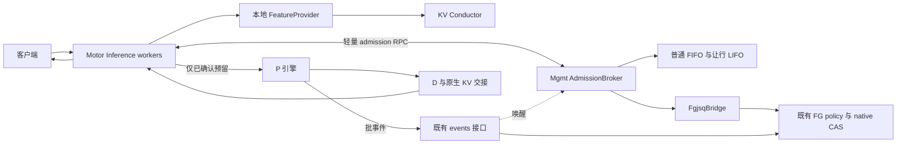
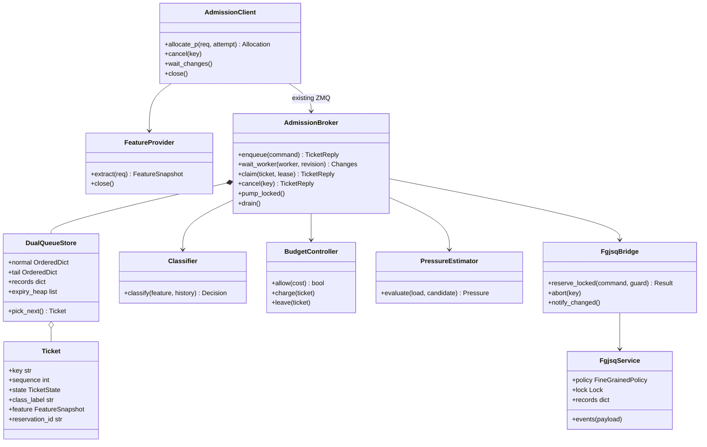
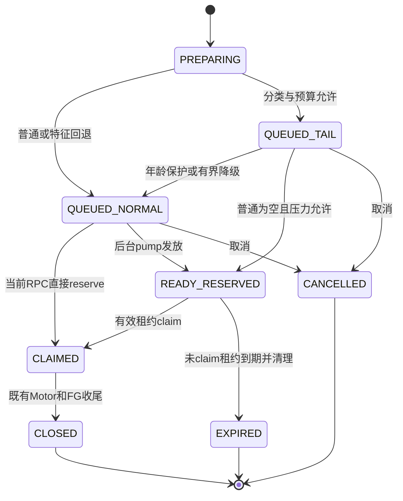
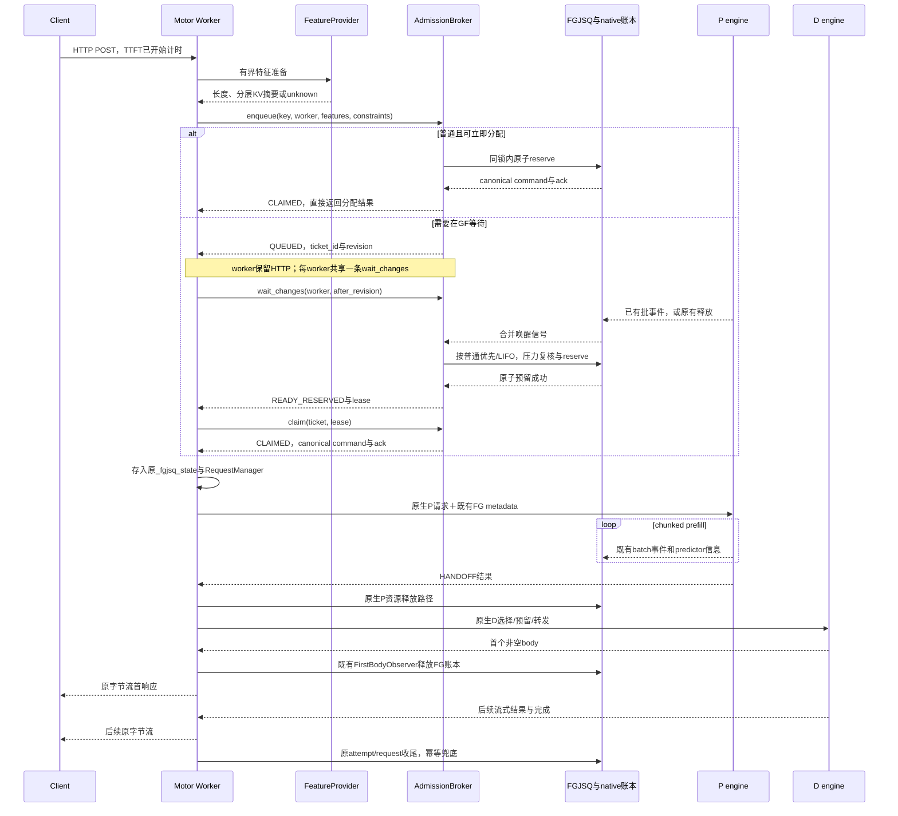
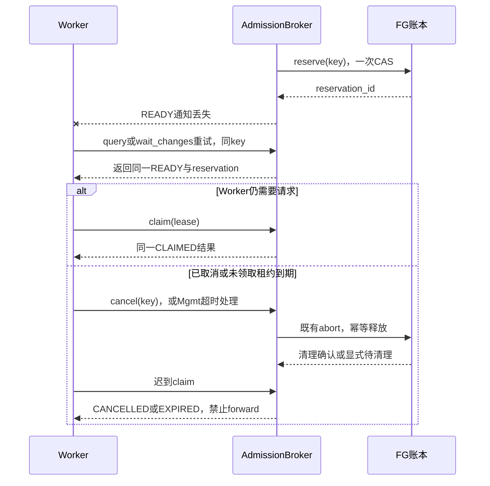
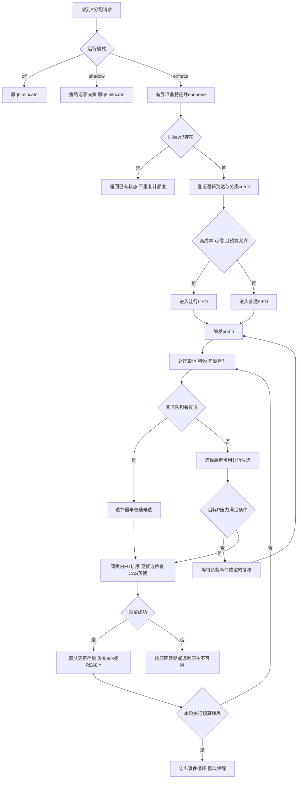

# g5 Motor＋FGJSQ 双等待队列工程设计

> 2026-10-30 当前状态：本文是初版设计快照；rc2 已实现并通过[本地复评](../engineering/GF_ADMISSION_0.1.0rc2_REVIEW_20261022.md)。用户已批准作为[研发基线](../engineering/DEVELOPMENT_BASELINE_20261030.md)合入 main；正式性能仍待现场验证。下文“未实施”保留为当时状态。


版本：0.1；设计日期：2026-10-21；状态更新：2026-10-22，**独立 `gf_admission` 包＋少量 g5 显式钩子已获用户批准，尚未实施。**

实施状态（2026-10-22）：Session 1 已完成 g5 修复、对齐及 GitHub 推送，基线 commit 为 `3b63b00546e7a6ffb2526dafc341969cebe22359`。用户选择新增独立编码 session 实现本设计，Session 2 保持设计/评审职责；阅读顺序与执行约定见[编码启动 prompt](../engineering/GF_ADMISSION_CODING_SESSION_PROMPT.md)。详见[研究分工与现场回传约定](../architecture/RESEARCH_COLLABORATION_AND_HANDOFF.md)。本轮仅同步状态与基线身份；第 3 节源码行号/hash 属 10-21 设计快照，编码前在交接 commit 上核对接入点，不能当成当前部署 allowlist。

已批准的架构：在 GF 的 P 分配入口接入独立 `gf_admission` 包；Mgmt 统一维护普通 FIFO、让行 LIFO、分类额度及压力判断；Inference worker 保留 HTTP 上下文，以异步方式等待。放行与 FGJSQ 的原子预留衔接，P 引擎与 D 路由沿用 g5。

**阅读约定：**“源码事实”由第 3 节定位支持；“本设计”是拟实现行为；示例接口、配置、文件名均不是已经存在的功能。算法阈值与压力曲线未标定，本文不声称吞吐或尾延迟收益已经验证。不重新开展流量/环境调查，不要求外传完整实验机代码。

## 1. 目标、范围和验收原则

### 1.1 目标

- 在单个 `instance_uuid` 对应的 GF＋XPYD 集群中，降低全体请求的 P90 TTFT；P95 为补充，同时保持或提升吞吐并满足 P90 TPOT SLO。
- 面向生产开环流量；高压 AISBench 闭环用于验证相同并发下的延迟，或相同 SLO 下的并发承载能力。B 是整个 3P3D 集群并发，不能乘以 P 数。
- 借鉴 super-p95 的成本分类、分类额度、普通优先与让行 LIFO；通过 P 的 FGJSQ 负载估计决定 LIFO 释放及预算。
- 提供默认关闭、兼容检查明确、可独立回退的包。关闭时保留现有 g5 调用路径。
- 工程实现避免阻塞异步循环、长时间持锁、每请求高频轮询、重复 tokenization、跨进程传递大请求正文。

### 1.2 本版不做

不修改 P 的 FCFS、running-first、8192 共享 token 预算、chunk size、KV 分配及抢占；不修改 predictor 特征/训练标签和 reporter 协议；不改 D 引擎、D 原生 CAS 路由；不移植 diffusion step 抢占、alpha 路由折扣或 batch2。动态 chunk 数学研究独立。

“双队列”只影响尚未预留/发往 P 的请求。请求进入 P 后不撤回、不重排、不释放其 KV。客户端 TTFT 包含 GF 等待，不能用 P 的 queue_time 变短作为收益。

### 1.3 验收口径

| 维度 | 要求 |
| --- | --- |
| 正确性 | 同一逻辑尝试至多一个有效 P 预留；取消/重复消息不重复扣额度或释放；请求与响应内容保持兼容 |
| 关闭回归 | off 模式不查询 Conductor、不启动 admission 等待任务，FG 路由/事件/释放和 D 路径通过原测试 |
| 功能 | 普通优先、让行 LIFO、压力门控、年龄保护、取消、重试、epoch 隔离均有确定性测试 |
| 性能 | 本机测算法/IPC/循环开销；910B2 实验测吞吐与延迟。队列容器复杂度不能代替性能结果 |
| 统计 | 全体成功请求延迟与失败/取消/未完成数量一起报；保留旧 LIFO 请求，不能只统计普通类或先完成的请求 |

最新业务口径为 64K P90 TTFT 27s / TPOT 30ms，128K 30s / 40ms；这些是端到端业务阈值，不直接作为新增 GF 等待预算。历史 g5 报告中的 128K 45ms 保留为历史。

## 2. 基线与兼容边界

| 项目 | 本设计依据 |
| --- | --- |
| g5 现场 | 最新冻结 `vllm-ascend:g5-g4base-motor-20261021-r1`（正式版 g4 底座＋Motor）；3P3D、TP4、24×910B2、Qwen3.6-27B W8A8。旧 rc1 是初稿历史依据，不再是开发目标 |
| Motor 公开锚点 | `f203263d9742dd6fa76eaef658e0ff3a0f380301`；现场构建串不能代替文件核验 |
| 原型 | vllm-omni `dd9c0895d98a73c760e9ca930d87e03198713ff7` |
| 已交付包 | slo_patch 0.2.0，含 `fgjsq`、`motor_adapter`、`slo_patch`；g5 报告称这三者源码零修改 |
| P 引擎 | 异步 SchedulerWithPredictorAsync；旧 SLO 入场开关硬关；predictor/reporter 保留 |
| P 参数 | g5 报告为 max_num_seqs=24、每轮 token 预算8192；生产画像的16不是本基线的自动替代值 |
| 现场修复 | 保留 Motor node_manager 的 lookup_rpc_port 兼容修复、冻结启动配置和规程；engine_files.json 以最终基线实测为准，不能照抄报告中的 hash 笔误。修复与版本整理由 Session 1 负责 |
| 初版范围 | UnifiedPDRouter、vLLM、HANDOFF、每 P 一个 endpoint、单 Mgmt 权威；Chat/scalar Completion、n=1，沿用 g5 限制 |

源码补充：HANDOFF 分支先 P，且相应 adapter 延后 D 分配至 P 完成；先分配 D 的是 TRIGGER 分支，g5 明确禁止。因此，**本版在 `bindings.allocate()` 的 P 路径、创建 reserve 命令前等待即可**，不必改 `_create_attempt()`。preflight 必须确认该顺序与 HANDOFF 契约；若未来顺序改变，不得让长期等待持有 D 资源，应另作接入评审。

2026-10-22 接收的最终冻结报告显示 g5 的 E2 128K B16 双轮通过工程阈值；报告截止十档及最终验收未完成，P90 TTFT 仍未达到 128K 的 30s 业务阈值。该结果不是双队列收益证据。本设计不覆盖其现有异常自动修复，也不要求重装 P/D 或重建原环境。 Motor固定源码提供Conductor查询能力，但本文不把它当成g5已接通的现场事实；provider未配置或无法确认协议时走显式unknown回退。

当前依据：[g5 最终冻结报告](../engineering/G5_FROZEN_BASELINE_HANDOVER.md)、[本机对齐审查与勘误](../engineering/G5_LOCAL_BASELINE_ALIGNMENT_REVIEW.md)。初稿历史依据：[早期 g5 原报告](../engineering/G5_BASELINE_HANDOVER.md)、[早期基线勘误](../engineering/FGJSQ_REPRODUCTION_PLAN.md)、[前序讨论](GF_SUPER_P95_DESIGN_DISCUSSION.md)。

## 3. 源码依据与迁移取舍

行号针对本机固定副本；接收文件 hash 见 [本次设计源码清单](../../evidence/manifests/gf_dual_queue_design_sources_20261021.json)。

| 编号 | 来源与定位 | 源码事实／本设计含义 |
| --- | --- | --- |
| S1 | [super_p95_dispatcher.py](../../upstream/vllm-omni-super-p95/benchmarks/diffusion/super_p95_dispatcher.py)，571—610、690—697 | 到达补 credit；成本双阈值；分类在 async lock 内计账；分类后路由 |
| S2 | [super_p95_step_scheduler.py](../../upstream/vllm-omni-super-p95/vllm_omni/diffusion/sched/super_p95_step_scheduler.py)，38—65、145—215、327—351、439—441 | dataclass 元数据、两个 heap；普通正序/让行负序；已有 active 继续；新 active 普通优先；普通可抢占让行 |
| S3 | 同 S1，324—359、361—393、664—688 | 复用 AsyncClient；锁内更新状态、锁外 HTTP；失败清理。不是现成的 GF 长等待实现 |
| S4 | [policy.py](../../src/fgjsq/policy.py)，39—97 | 预测衰减、rank、reserve、release、snapshot；本版保持公式 |
| S5 | [service.py](../../src/motor_adapter/service.py)，56—132、134—186 | Mgmt 共享锁、幂等预留、native/FG 双释放、事件身份检查、epoch |
| S6 | [bindings.py](../../src/motor_adapter/bindings.py)，15—94、97—151、222—235 | g5 显式扩展入口、ZMQ RPC、分配与收尾；原 `_rpc` 只对 reserve 特判失联查询 |
| S7 | [motor_backend.py](../../src/motor_adapter/motor_backend.py)，30—78 | 按 FG 排序的候选、SHM schema4 CAS、generation 检查；D 不经过该适配器 |
| S8 | [unified_pd.py](../../upstream/motor/motor/coordinator/router/strategies/unified_pd.py)，677—727、2103—2156 | HANDOFF P-first、延后 D；allocate 结果再登记 RequestManager；不是仅返回 ack 就已发往引擎 |
| S9 | [scheduler_server.py](../../upstream/motor/motor/coordinator/scheduler/runtime/scheduler_server.py)，698、719—748、884—927；[scheduler_client.py](../../upstream/motor/motor/coordinator/scheduler/runtime/scheduler_client.py)，332—420 | 服务端 dispatch timeout=5s；每 RPC task；客户端有超时与取消结果。不能用一个普通 RPC 悬挂数十秒 |
| S10 | [kv_cache_affinity.py](../../upstream/motor/motor/coordinator/scheduler/policy/kv_cache_affinity.py)，266—325、344—385 | token IDs / chat template；分层原始覆盖和加权分数不同 |
| S11 | [conductor_api_client.py](../../upstream/motor/motor/coordinator/api_client/conductor_api_client.py)，411—482；[KV Conductor](../../upstream/motor/motor/kv_conductor/README.md) | 同步 HTTP、3s timeout、msgpack/JSON、索引快照；不能直接在调度锁内调用 |
| S12 | [g5 Motor 七文件补丁](../../patches/motor/f203263d-p-fgjsq.patch) | 已有 P 钩子、metadata、observer 接线；新包叠加，不重复覆盖现场 Motor |

原型有效机制的解释是：有额度地推迟高成本请求，普通优先，再以 LIFO 将更多等待集中到较旧让行请求。历史组合收益不是 LIFO 单独的消融证据。本版用压力门控替代原型能直接观察执行位置的条件，并且没有运行中暂停能力；收益不能直接复制。

## 4. 核心概念、身份与不变量

### 4.1 概念

| 概念 | 定义 |
| --- | --- |
| PoolKey | 受管理的集群 UUID＋逻辑模型规格；来自受信配置，不取任意客户端字段 |
| normal FIFO | 已完成入队准备的普通候选，按 Mgmt 接收序号服务；通常立即完成分配，不施加新增压力阈值 |
| sacrificial LIFO | 已明确主动让行、尚未 reserve 的候选，最新的资源可用项优先 |
| classification credit | 首次标记让行的累计额度；不等于出队许可，不在请求完成时退款 |
| ticket | 只含调度元数据的票据；不是 HTTP 请求副本，也不是 FG reservation |
| W_p / N_p | FG committed_tokens / 未释放 FG 请求数；均为账本估计，不是 GPU busy 或真实 running gauge |
| pressure | score 阈值或已标定的排队压力函数；必须携带单位和模型版本 |
| reserve / claim | reserve 创建真实 native＋FG 预留；claim 把异步发放的预留交给 worker；均不等于引擎已入场 |
| age promotion | 超过允许让行驻留时移到普通 FIFO 尾部，之后不再降级；不是 KV 抢占 |

FIFO 指 `admission_enqueue` 到达 Mgmt 的顺序；tokenization/KV 异步准备可能使它不同于 HTTP 物理到达顺序。本版明确此边界，不能宣传严格 HTTP-arrival FCFS。普通请求均经过同一个 admission 入口，避免多 worker 绕开普通优先；它们不额外等待“低压力”。off 模式仍走原调用顺序。

### 4.2 身份

- 逻辑请求：沿用 `_fgjsq_state.nonce`，不以可重复的用户 req_id 作唯一键。
- 尝试：`key=nonce:attempt_seq`；与 g5 一致。传输重试复用 key，实际新 attempt 才换 attempt_seq。
- admission：`ticket_id`、`ticket_revision`、Mgmt `admission_epoch`、worker `worker_epoch`。初版 admission_epoch 与当前 coordinator epoch 绑定。
- 已预留：沿用 reservation_id、coordinator_epoch、instance_id、endpoint_id、generation；不重写 P 事件 identity。
- credit 按逻辑请求只计一次。为支持真实新 attempt 不重复耗额度，保留有界的逻辑请求记录到原请求结束；不能靠猜测 req_id 后缀去重。
- 每次 enqueue 的不可变字段形成规范化 fingerprint；同 key 同内容返回当前状态，同 key 不同内容拒绝。租户标签仅辅助观测，不直接决定让行。

### 4.3 必须成立的不变量

1. QUEUED 状态没有 native/FG 预留；所有已提交工作完整进入既有 FG 账本，无折扣、无提前 release。
2. 同 key 至多一个有效 FG reservation；不因 RPC timeout 创建第二个 key。
3. 检查压力的 P 与实际 reserve 的 P 一致；CAS 失败转下个候选时必须重新检查，不能先验检查 P0 后实际分到 P1。
4. 队列、credit、票据状态和预算变更只由 Mgmt 在统一临界区内执行；worker 不另造局部算法状态。
5. 锁内无外部 I/O、等待、sleep、tokenization、模型训练或文件写入。
6. 取消有终态/墓碑；迟到 enqueue、ready、claim、批事件不得复活请求。
7. admission 的队列计数和 FG 的两类释放分别管理；S/V 扣除不是 release_fg。
8. 原有 P/D body、KV 传输参数、FirstBodyObserver 和训练链保持兼容。

## 5. 算法设计

### 5.1 分类与特征

FeatureSnapshot 包含 L、每候选 P 的互斥 NPU/CPU/Disk 覆盖、来源版本、置信度、观测时间与 endpoint generation。未知不是零命中；加权 affinity 分数不是实际 cached_tokens。

候选成本可先用一致单位的 `c_p = u_p + beta_cpu*h_cpu + beta_disk*h_disk`，`u_p=max(0,L-h_npu-h_cpu-h_disk)`。这是分类代理，不是精确服务时间；完整 prefix 命中仍有末 token/块边界、attention 与加载成本。beta 未标定，不设伪造的默认值。可选纯 uncached 模式须显式声明其加载成本盲区。

参考原型以当前可用 P 中 `min(c_p)` 分类；FG 最终选另一个 P 的差异记录为 `classified_cost` 与 `selected_cost`，不默默替换为 cache-affinity 路由。特征快照在入队时冻结用于预算，V 表示估计量；不在每个调度 tick 重查 KV。过期刷新作为可选、有限次数的 worker 操作，不在 Mgmt 持锁执行；低置信度回退普通。

初版分类器保留原型双条件：`c >= threshold_ratio*c_max` 且 `c >= long_request_ratio*c_min`；可信且正值样本才更新 min/max。每 m 个首次逻辑请求增加 b credit，初始0；普通与未知特征请求也计入到达分母。参考值 m=20、b=1、ratio=0.8/1.5 来自原型，不是本集群最优参数。

进入让行类还需：Q>0、S<S_limit、V+c<=V_limit、尚未年龄保护、请求支持当前契约。有条件失败则普通处理，不拒绝业务。首次进入扣1 credit；派发/取消/晋升释放S/V但不退款。加入有限 credit 上限是本设计的突发保护，须在配置和实验中注明它不同于原型无上限累计。

### 5.2 压力与出队

保持 g5 的 `score_p=W_p*(ceil(N_p/max_seqs_p)+1)/2`。两种压力模式：

- `score_threshold`：直接对 score 限制，单位是 FG 分数，不能显示成毫秒。
- `queue_delay_curve`：`q_hat=f(W_p,N_p)` 或 `f(score_p)`，来自版本化查表/分段线性曲线，单位 ms；验证定义域、有限性、单位、基线配置、插值规则。越界/过期不能无声外推。

曲线的标签应是派发状态对应的首次入场等待或明确指定的压力标签；整段 TTFT 不等于排队。当前资料没有足够配对样本，本文保留接口而不生成拟合结果。

一次选取按以下顺序：

1. 处理取消/租约到期；到龄让行请求晋升普通 FIFO 尾部，标为 protected，永不再次降级。
2. 普通队列非空，按 FIFO 调用既有 FG 选择/预留，不应用让行压力阈值。native 无可用实例时按 g5 失败/重试契约处理，不能偷偷换算法。
3. 普通为空，取 LIFO 最新资源可用候选；只在 FG 排序候选的压力满足阈值时 reserve。P 不需要完全空闲。
4. 每条 reserve 后更新账本并重新判断。每次 pump 有数量/时间预算，释放锁并让出事件循环后再处理下一批。
5. 无法放行时由负载变化或定时复核唤醒，不忙等；FG 预测随时间衰减，不能只等待新批事件。

严格 LIFO 适用于同等可执行资格。带 target_instance 约束的队顶不可用时，可有界扫描最新 K 项，跳过仅因资源资格不满足的项；不因成本高而偷偷改成短作业优先。K 为配置，测试必须覆盖；无可用项保留等待直到恢复、晋升或请求期限。

保护后的普通请求不再受让行压力阈值，但仍受 native 资源约束；恢复优先级不保证硬时限。首次版本用最大让行驻留保护，保留 bypass 统计接口，不必为每次越过遍历整个 LIFO。

### 5.3 预算反馈

分类Q、即时数量S、工作量V、驻留上限分别配置。先支持固定上限＋压力出队；扩展接口 `BudgetController.limit(pressure_snapshot)` 可返回动态S/V上限，函数应有硬上限和变化速率限制。低压少积压，竞争时允许保留部分高成本请求；持续高压不能无限积压。

上限降低时停止新增让行，不把已有请求一次性倒进 P，也不修改已发请求。动态分类额度与动态存量上限属于不同实验开关，首轮不同时改变全部参数。未知压力或事件陈旧时，停止新增让行，并有界地将已等请求晋升普通；资源仍走 g5，不能一键清空到 P。

## 6. 架构、类图和运行拓扑

### 6.1 进程与数据流



同一 pool 的多个 worker 共用一份 Mgmt 队列。HTTP正文、token ID 大数组、流式 socket 留在 worker；Mgmt 只保存长度/分层覆盖等摘要。Conductor 查询可携带token IDs，但不额外经 admission ZMQ 搬运。

### 6.2 类图



`gf_admission` 的纯算法模块不 import Motor、torch、vLLM、Ascend；宿主相关转换仅在 adapters/ 中。先保持 Python 实现，避免为容器 arm64 增加编译依赖；是否使用原生扩展由后续 profile 决定。

## 7. 请求生命周期与时序

### 7.1 票据状态

| 状态 | admission 队列 | 真实 P 预留 | 资源责任 |
| --- | --- | --- | --- |
| PREPARING | 未入队 | 无 | worker；特征准备有时限 |
| QUEUED_NORMAL | 普通 FIFO | 无 | Mgmt ticket；正常请求通常立即选取 |
| QUEUED_TAIL | 让行 LIFO | 无 | Mgmt ticket；计S/V |
| READY_RESERVED | 已离队 | 有，尚未交给 worker | Mgmt 持短期交付租约；S/V已释放，FG完整计账 |
| CLAIMED | 不在队列 | 有，worker已取得或可幂等查询领取结果 | 原 Motor attempt/FG 生命周期；不再由排队租约自动回收 |
| CANCELLED / EXPIRED / UNAVAILABLE | 不在队列 | 无，或已确认清理 | 保留有界墓碑；清理未确认须显式记录 |
| CLOSED | 不在队列 | 原 attempt 已结束且资源已释放 | 仅保留去重/诊断摘要，按TTL清理 |

普通 fast path 可以在当前 enqueue RPC 内完成原子reserve并直接进入 CLAIMED，返回 g5 canonical command＋ack，省去额外 claim RPC。其失联处理与 g5 一样：同 key 查询/abort，不能自动释放后让迟到 worker 使用旧 ack。已经等待的请求由后台 pump 发放时进入 READY_RESERVED，必须显式 claim 后才能交给 Motor。



CLAIMED 仅表示责任交给 worker，不代表 P 已接受/执行。若要记录实际 forward，使用已有生命周期日志或独立观测字段，不据此改变资源所有权。

### 7.2 正常与让行请求时序



该图表示逻辑先后，不用跨节点时钟推算阶段耗时；native/FG release 的实际代码仍以 g5 为准。两个释放允许到达顺序不同，不能写成依赖彼此的单一计数。

### 7.3 确认丢失与取消时序



claim 与租约到期在同一锁下决定胜负；若 claim 先成功，不能再因这条交付租约到期而扣除正在执行的资源。worker 在 claim 成功但响应未知时查询同 key，不得重新分配。

## 8. 活动图：分类与出队算法



示意图中的“压力判断”在实际 reserve 临界区内再次核验，不能把图中的两个方框实现为存在竞态的两个独立事务。protected 已进入普通队列，其路径与普通一致。

## 9. 组件详细设计

### 9.1 AdmissionClient：worker侧薄适配

接口建议：`allocate_p(client, req_info, attempt_seq, constraints)`、`cancel(key)`、`close()`。

- 在 g5 既有输入验证之后接入，保留 n=1、非batch prompt、HANDOFF、原生OpenAI transport限制。
- 复用原 nonce/attempt_seq；在 `_fgjsq_state` 的独立 `admission` 命名空间记录ticket，不能改写已有 attempts/tasks 含义。
- features准备失败转unknown普通类；admission返回canonical command/ack后写入原 `record['command']` 和 `record['ack']`，返回原 Instance/Endpoint/Workload类型。已取得插件返回的预留后不再重发原reserve RPC；保留RequestManager后续登记与失败回滚。
- **长等待前不生成 `reserve_deadline`**。由Mgmt即将reserve时生成 g5有效期限，成功后冻结同一command；重试query返回原command，不能随每次重发改deadline。
- queued等待使用本地Future；每worker只有一个WaitHub驱动远端变更，不为每条请求启动轮询循环。
- 新RPC适配用 `send_request_result()`区分取消与timeout。S9中transport会把CancelledError转换成CANCELLED结果；必须重新传播取消，不能按普通None重试而复活请求。
- 成功claim之前不返回分配结果、不forward。控制面结果未知时不回退原生P分配。

### 9.2 FeatureProvider：有界开销与协议复用

优先复用已有engine_token_ids/token_ids；无缓存时用Motor相同的tokenizer/chat template参数。保留实际chat template配置，不能退回原始JSON长度后声称是真实token数。

优先实现复用连接的异步Conductor适配器，协议沿用S11的model/block_size/token_ids、msgpack/JSON和返回结构；TLS、证书、认证、tenant命名空间从Motor配置取得，不用 `verify=False` 或硬编码匿名HTTP简化。`tenant_id`不自动等同appid。只在请求支持、实例表与block size可用时查询。

同步tokenizer或兼容调用放入**有容量上限的专用executor**；不要让 `asyncio.to_thread()` 无界排队。协程超时不代表后台线程停止，执行permit要在线程真正结束时释放。避免多个线程并发修改req_info，先生成只读输入，完成后在worker事件循环写回缓存；必要时单独串行保护不保证线程安全的tokenizer对象。

每worker复用一个HTTP客户端、限制最大在途查询/连接数、请求准备时限、短期缓存条数与字节数。超限/失败/不支持返回显式unknown，普通路径继续；不为补齐特征阻塞请求至Conductor原生3s上限。配置中的时限是实验参数，本文不预设生产值。

高优先级优化顺序：复用token IDs → 复用连接 → 有界并发 → 合并相同在途查询。完整128K token数组不作为长寿命缓存key；若使用摘要，需绑定模型/tokenizer/template版本、tenant、block size与instance generation。缓存快照不保证未来仍命中。

依据：[HTTPX异步客户端生命周期](https://www.python-httpx.org/async/)、S10/S11。原型复用AsyncClient的思想可迁移，原型将response.content整体返回的行为不适用于LLM流式路径，本版完全保留Motor流转发。

### 9.3 DualQueueStore：数据结构与复杂度

| 状态 | 建议结构 | 操作 |
| --- | --- | --- |
| normal | `OrderedDict[ticket_id, Ticket]` | append；`popitem(last=False)` FIFO；按ID取消 |
| tail | `OrderedDict[ticket_id, Ticket]` | append；`popitem(last=True)` LIFO；按ID取消 |
| 身份索引 | dict(key→ticket)、dict(ticket→record) | 平均O(1)查询、幂等检查 |
| 年龄/租约 | 最小堆 `(deadline, revision, ticket_id, kind)` | O(log n)插入/取到期；过期revision惰性失效 |
| worker通知 | 每worker有界变更索引＋revision | 合并同ticket多次状态变化，只通知有变化worker |
| credit/存量 | 整数与有限浮点标量 | O(1)更新，禁止NaN/负计数 |

原型heap是O(log n)取序，并支持step抢占回插。本版没有运行任务回插，FIFO/LIFO主操作可用OrderedDict简化，同时比list/deque按ID取消更直接。其内存常数可能高于deque；这只是工程候选，须与原型heap在相同取消率/队列规模下microbenchmark，不能宣称必然更快。[Python OrderedDict说明](https://docs.python.org/3.12/library/collections.html#collections.OrderedDict)

年龄晋升先从tail删除、S/V扣减，再插normal尾部，保留原到达时间但更新普通队列插入序。新普通请求排在其后，避免晋升后仍被持续新到达越过。过期heap条目定期有界清理；当stale/live超限时在有限队列规模下重建，记录耗时，避免长期取消导致堆无限增长。

不得把请求正文、完整token数组或httpx.Response塞入Ticket。Ticket建议 `dataclass(slots=True)`，只保存必要标量/小元组。P数很小，保留线性候选扫描即可，不增加复杂索引。

### 9.4 AdmissionBroker：全局顺序与异步pump

- 与g5 FgjsqService位于同一Mgmt进程和事件循环；复用 `_workload_commit_lock`。启动时校验loop ownership，禁止跨线程直接await同一Lock/Future。[asyncio同步原语](https://docs.python.org/3.12/library/asyncio-sync.html)
- `enqueue`、`claim`、`cancel`在短临界区修改状态；`wait_worker`在同一锁内读取revision并登记waiter，然后释放锁等待Future/Event；生产者同锁更新revision，避免检查与登记之间丢唤醒。等待期间不持FG锁。单次long-poll超时只注销本次waiter，不能取消票据或别的worker共享的完成状态。
- `enqueue`可执行一次有界pump以实现普通fast path；后台只保留一个pump task，事件通过pending flag/Event合并。
- `events`成功更新FG后、release/abort后、入队、取消、到龄、租约到期以及预测衰减复核timer触发唤醒。重复/无效事件可不触发额外工作。
- 每pass最多处理 `pump_max_items` 或 `pump_budget_ms`；候选检查、队列操作及CAS在锁内，通知回包、日志序列化在锁外。边界检查放行期间不await。
- 只有存在待发请求才启动压力复核timer；计时至最早到龄/租约期限与下一压力复核点，避免永久空转。
- 长等待不增加FG reservations；已发放READY则占真实FG工作量，防止通知尚未到达时重复超发。

### 9.5 FgjsqBridge：最小原子扩展

推荐给 `FgjsqService._reserve` 增加默认None的内部参数 `candidate_guard`，在每个ranked candidate的 `backend.reserve()`之前调用同步guard。off/normal的guard为空时执行与g5相同的分支。

该guard只读当前压力与配置，返回ALLOW/DEFER；不改变FG score、候选排序、预留token初值、tie-break或D策略。当前候选因压力拒绝时返回admission延期，不能以“换个P更好”暗中加入新路由。native CAS失败按g5继续检查下一候选，但该候选也要过guard。明确区分“压力延期”“暂无原生资源”“非法配置”。

`reserve_locked`在已持共享锁的上下文调用 `_prune()` 与 `_reserve()`，不再调用会二次加锁的 `service.command()`，避免死锁。副作用结果与ticket的READY/CLAIMED发布在同一临界区完成。记录成功的canonical request供query返回；失败且确认未创建reservation时才能重新生成期限。

复用当前FG initial body/4估算与首次事件校正，分类特征不在本版改写FG accounting。否则路由和入场同时变化，难以归因。`policy.py`、event schema、retention以及两个释放点保持字节/逻辑对照。

现有rank/recompute遍历FG活跃请求，`_prune`遍历墓碑，不能宣称整个调度O(1)。新wait/query不得通过原FG command的每次全表prune；压力快照每pass复用，真正每次reserve仍重新核验。若这些既有操作成为瓶颈，另提语义等价优化，不在首版悄改公式。

### 9.6 Classifier / PressureEstimator / BudgetController

全部为可注入纯函数/小状态对象，接受FakeClock和固定snapshot以便重放。Classifier维护正值历史min/max和逻辑到达credit；PressureEstimator返回 `{value, unit, valid, reason, model_version}`；BudgetController输出S/V硬约束并记录原因。

队列容量不可动态扩展到无界。算法参数热更新不列为首版必需功能；修改配置需drain并重启Coordinator，避免多worker看到不同版本。压力model应为校验过的JSON查表或系数，首版不加载不受控pickle执行代码。

## 10. RPC协议、异步等待与生命周期管理

### 10.1 复用现有通道

复用 `fgjsq_v1` 的ZMQ request_type，通过独立 `admission_*` op分派到插件；不新增对外推理入口，不再部署一层代理。新op必须在进入原 `FgjsqService.command()` 之前分流，避免wait持FG锁及每次触发全量prune。

| op | 内容 | 语义 |
| --- | --- | --- |
| hello | 现有epoch＋admission capability/version/config digest | worker验证Mgmt与自身版本/模式一致 |
| admission_enqueue | key、logical_nonce、attempt、worker_epoch、feature摘要、native/FG初始估算、原constraints、剩余等待期限 | 幂等创建ticket；立即返回READY/CLAIMED或QUEUED，不长等待 |
| admission_wait | worker_epoch、after_revision、wait_ms | 每worker至多一个；有状态变化立即返回，超时返回空changes与新revision |
| admission_query | key或有上限的keys列表 | 恢复失联结果；返回canonical command与ack，不能创建资源 |
| admission_claim | ticket_id、lease_id、expected_revision | READY转CLAIMED；幂等重复领取同结果 |
| admission_cancel | key、owner identity、reason | 原子去队/墓碑；如已预留，幂等清理；未知key也记录取消，防迟到enqueue |
| admission_finish | logical_nonce、terminal reason | 原request收尾，允许清理逻辑分类记录，幂等 |

若某次分配明确返回UNAVAILABLE且确认没有FG预留，原Motor可能再次调用同一attempt的分配；须支持显式的 `submission_round` 递增，沿用同一FG key、重新入队但不再次计逻辑到达/扣credit。单纯传输重试只查询原round，不自动增加round；已有reservation或结果未知禁止此路径。attempt_seq由Motor管理，不能为了重试绕过去重。集成测试应覆盖“首次无资源、同attempt后续资源恢复”，若现场调用契约不支持，按原失败路径终止而非猜测重试。

原 `release_native/release_fg/abort` 与P批事件schema不变。需要在队列取消与FG取消同锁完成时，从g5 `command()`提取等价的 `_command_locked()` 内部helper，public command仍只负责加锁后调用；Bridge复用helper而不是复制释放逻辑。该重构必须通过原有确定性对照，不改变原返回值。

示意响应（设计schema，不是已部署接口）：

```json
{
  "admission_schema": 1,
  "coordinator_epoch": "...",
  "ticket_id": "...",
  "ticket_revision": 3,
  "state": "READY_RESERVED",
  "claim_required": true,
  "lease_id": "...",
  "lease_remaining_ms": 1000,
  "reserve_command": {"op": "reserve", "key": "nonce:1"},
  "ack": {"reservation_id": "..."}
}
```

其中1000仅说明字段单位，非建议租约值；真实reserve_command/ack必须含原g5完整字段。QUEUED不含reservation。普通fast path返回CLAIMED、claim_required=false。响应中的identity由服务端生成，不采信请求正文中的同名字段。

### 10.2 WaitHub

- 本地 `dict[ticket_id, Future]` 将结果通知对应HTTP协程；一个共享task执行wait_changes，避免每请求QPS随等待长度增长。
- 服务端为每worker保留revision和有界未确认变更，重复wait不会丢READY；超过保留窗口返回 `resync_required`，worker分批query自己的pending keys。
- 初版以有界long-poll复用已有RPC。`wait_ms + 处理余量 < min(服务端5s dispatch timeout, 客户端transport timeout)`；启动时验证，不把两种timeout改成无限大。
- 一个长poll只占一个RPC task，不持共享锁；返回后重发即可，允许请求在GF等待比单RPC长得多。
- wait/query/enqueue活跃信息更新worker租约。租约时限需覆盖正常long-poll和重试间隔；所有deadline计算用本进程monotonic，跨进程只传剩余时长/序号。
- worker无pending时不保留轮询；disconnect取消WaitHub、收尾tracked tasks、关闭FeatureProvider连接/执行器。

### 10.3 租约与超时

区分四个时限：客户端剩余请求期限、最大主动让行驻留、单RPC超时、READY交付租约。分类credit与这四个时限无换算关系。

QUEUED时worker失活：移除票据并记取消墓碑，无需释放原生资源。READY未claim租约到期：禁止后续claim，调用原abort释放，失败则进入CLEANUP_PENDING并重试/报警。CLAIMED后：不能仅因worker租约过期就释放FG/native，因为P可能已经执行；使用原Motor取消/清理或基线重启对账规程。此限制是g5现有进程故障边界，不能假装内存票据实现了HA。

最大让行驻留到期采用晋升普通，不直接丢弃请求。原客户端/服务请求期限到期则按原协议取消/报错，不能改成无限等待。不能从27s/30s的P90承诺给每请求分配同样长的额外等待。

取消处理使用有上限的shielded cleanup（例如AnyIO带shield的超时scope），清理任务强引用并收集异常；随后继续传播取消。不能无限shield拖住服务退出。[Python任务取消与强引用说明](https://docs.python.org/3.12/library/asyncio-task.html)

## 11. 即插即用的集成与文件级变更

### 11.1 包与目录

推荐独立wheel名 `gf-admission`，导入名 `gf_admission`，不注册vllm.general_plugins。依赖复用镜像已有Python/HTTPX/AnyIO/Motor；纯Python跨x86开发机和arm64现场，测试Python3.10与3.12，不依赖3.11专属TaskGroup。

以下为拟新增路径；本文未创建实现文件：

```text
src/gf_admission/
  __init__.py
  config.py                 # 严格schema与参数校验
  models.py                 # Ticket / FeatureSnapshot / Pressure
  queues.py                 # OrderedDict及期限heap
  classifier.py             # 原型双阈值与credit
  budget.py                 # S/V与动态预算接口
  pressure.py               # score阈值、曲线查表
  broker.py                 # Mgmt权威状态与pump
  client.py                 # worker client与WaitHub
  features.py               # tokenization与Conductor有界访问
  adapters/motor_g5.py       # g5对象转换、兼容与共享锁桥接
  protocol.py               # admission RPC schema
  metrics.py                # 有界指标与日志
  compatibility.json        # 支持文件/符号/schema清单
packages/gf_admission/pyproject.toml
patches/admission/g5-0.2.0-admission-hooks.patch
configs/experiments/gf_admission.example.json
scripts/validate/preflight_gf_admission.py
scripts/package/build_gf_admission_release.py
tests/unit/test_admission_*.py
tests/integration/test_g5_admission_*.py
tests/replay/test_admission_event_replay.py
```

不直接将新包并入现有slo-patch wheel后重装全包，避免覆盖现场engine_files.json。单独wheel仍需要显式宿主钩子，**pip install本身不等于已接通算法**。新补丁以现场已应用g5的文件为基准，不再次应用旧七文件全量补丁。

### 11.2 最小宿主改动表

| 文件 | 拟改动 | off模式及兼容要求 |
| --- | --- | --- |
| `src/motor_adapter/bindings.py` | init_dispatcher挂载broker；dispatch分派admission op并通知FG变更；allocate在创建command前接插件；events成功后通知；finish_request/attempt补票据清理；提供close函数 | 入口快速检查独立开关，off不import新包或改变原业务分支；原输入验证/metadata/observer保留 |
| `src/motor_adapter/service.py` | command锁内逻辑提取helper；_reserve添加默认空的逐候选guard；必要的已接受事件通知钩子 | 原公式、request dict、ACK、幂等与双释放语义不变；通知只携带已接受更新，不能用无效批刷新健康时间 |
| `motor/.../scheduler_server.py` | stop中显式await关闭broker，再关闭transport/SHM | 仅生命周期钩子；startup懒初始化在正确loop，不在模块import时create_task |
| `motor/.../scheduler_client.py` | AsyncSchedulerClient.disconnect先关闭AdmissionClient/WaitHub | 不修改D选择/释放实现；off no-op |
| 其余文件 | 不修改P引擎、slo_patch、policy.py、body_observer.py、unified_pd.py、NodeManager修复 | preflight输出这些关键文件hash，安装后对照 |

这些是明确可审查的增量，不推荐无版本边界的sitecustomize、全局monkey patch或覆盖整个site-packages。若实现阶段确认两个生命周期钩子可以由宿主已有lifespan注册完成，可减少补丁，但不得缺失关闭测试。

### 11.3 兼容检查

启用前验证：g5基础hooks存在、HANDOFF与P-first成立、SHM schema4、每P单endpoint、原g5禁用项仍禁用（TRIGGER/Render/HA等）、P/D实例类型、函数签名、协议版本、配置digest一致、当前旧SLO开关为0。新功能不应为了通过检查关闭原g5保护。

对于现场已知文件差异使用按组件的manifest和精确patch上下文。保留现场fix1与engine_files.json，不使用宽泛“版本号相同就通过”或“任意hash都接受”。不支持的版本允许运行原g5 off；明确要求enforce但检查失败时拒绝启动该配置，不能悄悄宣称策略已生效。

enforce不支持同一pool混用未接入的旧worker。hello返回能力和digest，旧reserve若绕过ticket应被受控拒绝；off/shadow允许原reserve。部署以Coordinator完整一致重启为单位，不动态切换单个worker。

## 12. 运行方式、配置与回退

### 12.1 三种模式

| 模式 | 路径 | 用途 |
| --- | --- | --- |
| off（默认） | 原g5，无新KV查询/等待任务 | 基线、回退 |
| shadow | 原g5派发；有限后台任务只记录分类/门控判断 | 确认特征和单位；没有反事实执行，不能声称计算出真实优化收益 |
| enforce | 中央FIFO/LIFO＋压力门控＋原子FG预留 | 获准后进行算法实验 |

shadow也会消耗CPU/查询资源，因此需限制并发与采样，不声称零开销；不能让虚拟队列长期积累或替代真实超时统计。

配置用独立 `GF_ADMISSION_CONFIG=/.../gf_admission.json`，不把新字段塞进会拒绝unknown keys的FGJSQ_CONFIG。示例骨架只展示schema，null在enforce时须填写，不能直接用于生产：

```json
{
  "schema_version": 1,
  "mode": "off",
  "cluster_uuid": "EXPLICIT_CLUSTER_UUID",
  "model_spec": "EXPLICIT_MODEL_SPEC",
  "classifier": {
    "kind": "super_p95_reference",
    "quota_every": 20,
    "quota_amount": 1,
    "threshold_ratio": 0.8,
    "long_request_ratio": 1.5,
    "credit_cap": null
  },
  "cost": {"kind": "tier_tokens", "beta_cpu": null, "beta_disk": null},
  "pressure": {"kind": "score_threshold", "release_threshold": null},
  "limits": {
    "max_pending": null,
    "max_tail_requests": null,
    "max_tail_cost": null,
    "max_tail_wait_ms": null
  },
  "runtime": {
    "pressure_tick_ms": null,
    "wait_rpc_ms": null,
    "worker_lease_ms": null,
    "ready_lease_ms": null,
    "feature_timeout_ms": null,
    "feature_max_inflight": null,
    "pump_max_items": null,
    "pump_budget_ms": null
  }
}
```

所有限制需有限、非负/正值合法，验证时限之间的关系；此外schema需定义最大总字节、worker数、RPC payload、changes批次、墓碑TTL/数量、扫描K、清理超时和曲线版本。这些是工程容量配置，不直接取模型max_num_seqs或8192。

### 12.2 运行流程

1. 本机完成实现/测试后产出独立wheel、针对g5的差分patch、原/后hash、配置模板、安装/回退脚本与现场prompt。此阶段尚未执行。
2. 现场先只读preflight，确认当前g5；保存将改文件的原件/hash。禁止覆盖NM修复、权重、模型、engine_files.json。
3. 在不接新请求且现有请求收尾后，安装新wheel与窄patch，先off启动Coordinator，运行原g5链路检查；P/D引擎无需因算法本身重装。
4. 再按实验授权启用shadow/enforce；记录mode、配置digest、curve版本、三P身份、queue状态及既有FG负载接口。
5. 运行中增设已鉴权的 `/admission/v1/state` 和 `/admission/v1/drain` 管理接口；读状态不能触发策略更改。drain停止新增让行，已有tail有界晋升/派发，不瞬时倾倒。
6. 回退先阻止新入站、等待GF队列、READY租约及所有Coordinator请求完成，核对FG/native归零；随后off重启或按manifest逆补丁。仅open_fg=0不能证明D响应已经结束，不可据此中断仍有客户端连接的Coordinator。

进程内无持久化HTTP上下文，不提供崩溃后透明续传。非计划Mgmt重启导致epoch变化，沿用g5的drain/reconcile边界；不能自动将旧ticket重提交成新请求。最终华为交付压缩包按项目约定在WSL准备、校验后移动到Windows桌面；本轮没有交付包。

## 13. 错误处理与降级

| 故障/竞争 | 应采取的行为 | 禁止行为 |
| --- | --- | --- |
| tokenization/KV查询失败、超时、不可用 | unknown普通；指标记录原因，特征任务有界清理 | 当作零命中高成本，或阻塞共享锁3s |
| 压力无效/过期/曲线越界 | 停止新增让行；已等待者有界晋升普通；保持原FG分配 | 用NaN参与比较、硬推断P空闲 |
| P未有事件但FG为空 | 可判定账本空；仍检查candidate/generation | 仅因“没事件”永久阻止首次请求 |
| enqueue/query/READY丢包 | 同key重试/query；返回同一状态 | 新建key或退回另一次native分配 |
| claim确认丢失 | 查同ticket状态；CLAIMED返回同预留；确认后才forward | 未确认就发送、或超时后重reserve |
| queued期间取消 | 同锁去队、扣S/V一次、记录墓碑；未来enqueue拒绝 | 仅取消worker Future而留下中央票据 |
| reserve与cancel竞争 | 同锁决定；先reserve则abort，先cancel则拒reserve | 返回已取消请求的旧ack |
| READY lease过期 | 置不可claim，幂等abort；清理失败留CLEANUP_PENDING | 删除记录后声称账本归零 |
| CLAIMED worker失联 | 使用原Motor清理/人工对账边界，报告残余 | 仅凭租约过期扣正在执行的资源 |
| native CAS失败/P generation变化 | 刷新候选，逐候选重新guard；旧代释放不扣新代 | 用过期candidate强行提交 |
| native释放未确认 | 保留待清理状态，有限重试并显式报告 | 将S/V下降误作native已释放 |
| 部分提交异常，无法确认CAS回滚 | 标记该事务/实例需对账，停止其新增派发，保留证据 | 无记录地重试另一P、吞掉异常 |
| 队列达到tail上限 | 新候选按普通处理 | 无限扩容 |
| 整体ticket/内存容量达到上限 | 明确不创建新预留，按既有资源错误出口返回可观测失败；上限与容量压测应提前匹配 | 绕过中央broker分配，或对结果未知的key走客户端fail-open |
| worker/config版本混用 | enforce拒绝不匹配worker；off回原g5 | 部分worker绕过普通优先 |
| Mgmt epoch变化 | 旧请求不自动重放；失败/清理按g5规程 | 将旧ack用于新generation或重复执行 |
| 畸形字段/负值/NaN/超大payload | 参数错误并记录，拒绝状态变更 | 凭异常参数扣资源/分类credit |

允许的降级是“已明确无副作用时不再主动让行”。控制面不可达、reservation结果未知不属于安全fail-open。优先级保护不代替容量控制，算法也不承担模型过载的无损承诺。

## 14. 性能设计与可观测性

### 14.1 热路径约束

- 普通enforce fast path：一次有界特征准备＋一个enqueue RPC完成原子reserve；无需排队后claim。可复用原hello epoch缓存，发现变化才重新握手。
- tail等待：每worker一条有界wait通道，RPC频率主要随worker数量/状态变化增长，不随等待请求数逐个增长；claim只有真正发放时发生。
- 状态变化只发送小摘要，ready payload有上限；不在每个批事件打印全部队列或原始tokenIDs。
- Admission操作目标为队列增删平均O(1)、期限O(log n)、候选O(P)，明确FG旧recompute/prune成本另计。单次批处理有执行预算，不能阻塞事件上报和native release。
- counter/低基数metric常驻；逐请求详细trace按实验开关采样、异步有界写出，队列满时丢诊断而非阻塞推理，记录丢弃计数。

### 14.2 指标

最低保留：普通/让行入队和出队、分类拒绝原因、Q/S/V、GF等待分布、最长tail年龄、promotion、压力拒绝/有效性、每P W/N/score、READY/CLAIMED数量、取消/过期/清理失败、幂等重试、worker活跃数、feature耗时/unknown比例、pump/lock持有时长、事件循环lag、wait RPC数/重连数。

请求trace关联logical_nonce哈希、attempt、ticket、reservation与选中P；不能以req_id/appid/token哈希作无限基数Prometheus label。原始prompt、token IDs不写调度日志；appid仅按授权脱敏分组分析。

GF等待采用同一worker或Mgmt单调钟差值；客户端TTFT仍按AISBench HTTP POST前起点与首流式时间点。不能跨主机直接相减monotonic。正式结果同时报告普通/让行/保护组与全体，观察P99/max、超时和末尾排空时间，避免LIFO把未完成请求排除后“美化P90”。

## 15. 测试策略与验收矩阵

本节是待实现测试计划，本轮未执行这些测试。已有测试：[FG公式/事件](../../tests/unit/test_fgjsq.py)、[Motor集成](../../tests/integration/test_motor_adapter.py)、[响应观察器](../../tests/unit/test_observer.py)、[引擎控制流](../../tests/unit/test_engine_control_flow.py)。

### 15.1 单元测试

| 组 | 必测行为与断言 |
| --- | --- |
| U01 分类原型对照 | m/b补给时点、0.8/1.5边界、相同成本不强制分类、初始样本、未知不污染min/max；用固定原型分类段作oracle |
| U02 credit | 重传/新attempt不重复计逻辑到达；用尽回普通；有限上限；取消不退款；M不超过累计补给量 |
| U03 队列 | normal FIFO、tail LIFO、normal优先、任意ID取消、失效条目；与原型无抢占选择序列对照 |
| U04 预算 | S/V精确增减；数量够但工作量超限；晋升扣一次；动态上限降低不倾倒；NaN/负成本拒绝 |
| U05 压力 | 直接score与毫秒曲线分开；区间边界、越界、单位不符、陈旧事件；相同W不同N；默认guard为空完全等价 |
| U06 年龄 | FakeClock到龄晋升normal尾部、不重复晋升；新到普通不能永远越过已晋升者；无资源不声称准时完成 |
| U07 身份 | 同key同参数返回同票据，不同参数报错；已确认UNAVAILABLE的submission_round重试；取消先到；旧epoch拒绝；逻辑记录TTL不提前丢去重 |
| U08 原子预留 | P0压力通过但CAS失败后P1必须重过guard；每次reserve之后重算；不会一张低压快照放出整队 |
| U09 状态机 | READY-claim-expire所有次序；重复claim；CLAIMED后不被ready租约回收；取消/领取并发仅一个合法结果 |
| U10 容量清理 | heap惰性失效和压缩；通知缓存溢出resync；墓碑上限；memory上限拒绝/受控旁路无残留 |
| U11 Feature | template/tokenizer复用、分层互斥/weighted差异、失败unknown、generation变化；线程超时后permit不提前释放 |
| U12 取消传播 | transport返回CANCELLED须终止；cleanup有界；所有任务强引用并收集异常；不能因取消重新enqueue |

纯算法用注入clock、事件序列和手工snapshot，避免 `sleep()` 断言。随机事件重放使用固定seed，检查每步不变量和最终账本归零，不能只断言最终HTTP200。

### 15.2 集成测试：分层验证

| 层次 | 环境与场景 | 验收 |
| --- | --- | --- |
| I01 g5回归 | 真实已patch Motor类＋FakeNative，off运行全部原测试 | 路由顺序、native/FG计数、事件身份与body字节不变 |
| I02 多worker | 至少两个独立AdmissionClient共享Mgmt；错序enqueue、取消、feature完成 | 只有一个全局credit/序号，普通优先不被局部LIFO破坏 |
| I03 真实IPC | 真ZMQ进程/transport、fake P/D HTTP服务，覆盖wait timeout与重连 | 不只in-process mock；不超过5s普通dispatch超时；长队列等待可持续且控制面仍响应 |
| I04 预留丢确认 | 丢enqueue ack、READY、claim ack、重复query；注入取消 | 每key最多一次CAS有效提交；不重复执行P；最终双释放正确 |
| I05 HANDOFF | 真UnifiedPDRouter分配链＋假P/D | GF等待时没有D/P预留；P-first，D延后；claim后RequestManager登记失败可清理 |
| I06 流式边界 | 空chunk、仅role chunk、buffered stream、非流式、错误body | FirstBodyObserver语义不变；无admission私有字段泄漏至D；逐字节输出对照 |
| I07 事件压力反馈 | 真events endpoint＋认证，duplicate/stale/wrong epoch混合 | 仅合法事件影响负载/健康时间；释放与pump无死锁；HTTP200之外检查matched |
| I08 故障生命周期 | worker在queued/READY/CLAIMED退出；Mgmt重启；generation更替 | queued可清；READY可回收；CLAIMED边界显式；旧代不扣新代；不会无声重放 |
| I09 兼容与回退 | hash/签名/schema错误、混合worker版本、重复应用/逆补丁 | enabled拒不兼容，off仍原路径；不覆盖现场fix1/hash白名单；无pending任务残留 |
| I10 容量与背压 | ticket满、Conductor慢、executor满、大prompt、通知拥塞 | 有界内存/线程/任务，unknown回退可观测；管理release不被饥饿 |

真实IPC/SHM依赖如本机缺失，报告明确SKIP与原因，不能把FakeNative通过写成原生CAS验证。真实910B2正确性、KV交接和吞吐最终由实验机执行；本轮不请求新环境材料。

### 15.3 微基准与性能验收

对比heap、deque＋索引、OrderedDict：相同入队/取消/晋升/取序轨迹，报告时间分布与峰值内存。测试小队列及配置上限附近，不仅百万空操作吞吐。另测已有FGrecompute/prune占比，避免将旧开销错误归因容器。

端到端本机微基准对比off、shadow、enforce：普通热路径P50/P99附加耗时、每请求RPC数、事件loop lag、每pass锁持有、事件处理延迟、CPU、峰值RSS和任务数量。提前为这些项设工程budget，不将单次CI墙钟时间作为功能测试成功条件。

授权的华为实验至少包含：同质/无积压退化对照、成本异质且有入场竞争、年龄保护触发；以g5 off为基线，固定FG策略、P/D配置与输入集合。开环与闭环分别报告，不用闭环结果担保现网；吞吐含排空影响，SLO与失败一起看。对pressure曲线的标定与动态预算分别记录版本，不能同时改多个开关后把全部收益归给LIFO。

### 15.4 合并前检查表

- 所有U/I关键生命周期测试有结果；off对照与原FG随机trace一致。
- 基线数据不被当作校准真值；未标定curve不能以ms名义运行。
- CPU热路径、容器选择、IPC开销有测量；未测部分如实标记。
- 状态图、RPCschema、代码枚举与清理逻辑一致；不存在“超时就重新native分配”的分支。
- 关闭/回退文件清单完整；D算法和P引擎文件无改动；NM现场修复与engine_files.json保留。
- 输出安装包含源码hash、配置digest、验证报告和现场prompt；无需完整内网代码包即可检查接入边界。

## 16. 实施顺序、待确认参数与评审重点

### 16.1 建议实施顺序

1. 固化off回归oracle与g5 patch基准；新包仅骨架/兼容检查，不启用策略。
2. 完成纯队列、classifier、预算、压力接口及U测试；实现默认关闭宿主hook。
3. 完成Mgmt broker、WaitHub、guard原子桥接、取消/租约；先fake接口后真IPC测试。
4. 接入FeatureProvider和受控Conductor查询；以unknown路径验证核心功能不依赖查询成功。
5. 完成shadow、指标、drain、安装/回退和微基准；实现独立审核后再生成enforce配置。
6. 获准后打包代码＋现场prompt，以既有g5为起点验证，再按数据迭代压力函数与预算。不会先迁移引擎抢占。

### 16.2 参数与设计状态

已明确的设计推荐：GF P分配前等待、中央Mgmt两队列、原子压力检查＋FG预留、独立包、原生流转发、仅GF侧改变次序。

待评审/标定：成本proxy及beta、有限credit上限、S/V硬上限、max_tail_wait、压力阈值或curve、event freshness界限、feature开销限额、扫描K、RPC/worker/READY期限、pump执行预算、内存上限。不存在“8192就是最佳门限”或“P90就让行10%”的默认关系。

暂不作为首版必需：所有普通请求的统一前送窗口、动态credit与动态存量同时启用、基于appid的优先级、自动模型训练、step抢占、全局HA。若实现者选择不同方案，须记录相对于本文的语义差异与验证依据。

### 16.3 供同事重点检查

1. LIFO仍有选择机会，且没有把等待挪出客户端计时；高成本分类与低命中并非简单等号。
2. g5的FG估算/衰减与P完成信号没有被误当设备真实空闲；曲线单位明确。
3. 多worker状态唯一；P压力检查与CAS没有时间差漏洞；CAS失败候选重新过guard。
4. READY与CLAIMED责任边界清晰；取消、租约和失联查询不能导致双执行、错误释放或静默泄漏。
5. “即插即用”包含小范围显式接线、版本检查和回退，不是宣称不需任何集成。
6. 本地验证与现场验证分开，性能收益留待实验，不把原型组合结果归因给单个容器或LIFO。

## 17. 相关文档

- [GF机制与预算讨论](GF_SUPER_P95_DESIGN_DISCUSSION.md)
- [两份报告的证据底稿](DUAL_WAITING_QUEUE_DISCUSSION_BRIEF.md)
- [super-p95源码与历史结果调研](../references/SUPER_P95_RESEARCH_AND_LLM_COMPARISON.md)
- [g5现场交接原文](../engineering/G5_BASELINE_HANDOVER.md)与[采用范围/勘误](../engineering/FGJSQ_REPRODUCTION_PLAN.md)
- [研究指导文档](../LLM_TAIL_LATENCY_RESEARCH_GUIDE.md)

本设计的Python数据结构/异步部分依据官方文档，源码链接以本工作区固定版本为主。未引入新的论文结论或外推原型性能数字。后续实现请保留本文的推荐与未知边界，更新设计版本后再改变核心契约。


## 2026-10-22 用户批准：rc2 修复与统一高压让行

本节覆盖旧 rc1 可交付、同成本不让行及等待设计确认的时态。用户已批准编码 session 自主完成 R1–R4 修复、统一压力触发、观测/测试、完整新包及华为 prompt；Session 2 在完整交付后、正式 AISBench 前兜底复评，不干扰日常编码决策。不新增同成本/benchmark 分类开关。

统一准入：可信正成本及有效压力下，(成本偏长 OR 请求候选 P 的最低 FG score >= H)，再受共同 credit、数量 S、成本 V、年龄保护约束。normal 优先；tail 在实际候选 P score <= L 时放行，0 < L < H，每次 CAS 及候选切换重验。沿用 g5 公式、P/D 与 predictor；GF 限制实际入场并发也是合法机制效果，须与真实 LIFO 越序分别归因。

阈值是第一版静态超参数，由华为正式压测前先读已有实验结果，必要时在 B=16 × 实际输入 66K/128K 或生产重放中探测长尾等待附近的每 P FG committed_tokens、未释放数、score、有效事件时间和可得 waiting 指标；不能把引擎 waiting token 与 FG W 混称。报告实际 token 长度、来源和样本，选择 H/L 并冻结后跑正式六格（64K规格实际66K/128K × B16/18/20，cache目标50%）。TTFT预测动态阈值留下一版；不要求本地伪造阈值，也不因此停工。

新交付在 WSL 构建/解包校验后移动到 Windows 桌面；旧 dev1/rc1 归档、wheel、交付 prompt 副本已按用户要求撤回，源码和原评审证据保留。新包先复评、现场短验证、阈值探测和通知演练，再冻结长压测。后台脚本监控并通过实际可用 agent 接口通知故障，正常轮询不用模型；故障/修复/重启诚实留痕，变更版本后重跑受影响配对。

详细规则见 docs/admission/GF_PRESSURE_ADMISSION_REVISION_20261022.md；实施状态见 docs/engineering/GF_ADMISSION_IMPLEMENTATION_STATUS.md。当前仅完成审批与上下文同步，代码/测试/交付完成情况由实施状态后续更新；无现场性能收益声明，不合并 main。
