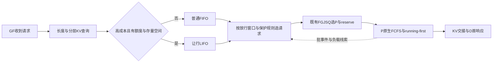

# GF侧super-p95迁移讨论：分类、LIFO与放行预算

日期：2026-10-21；状态：第一版讨论稿，未实施。用户本轮明确主候选为GF路由侧普通FIFO＋让行LIFO；P引擎继续FCFS、running-first及共享token预算，D保持基线。本文直接讨论机制，不重开流量/环境调查。

工程接入、异步处理与测试已另行形成[g5工程设计 v0.1](G5_GF_DUAL_QUEUE_IMPLEMENTATION_DESIGN.md)，供实现agent和同事评审；本文保留算法讨论背景。

## 1. 当前判断与类比

可以将diffusion请求完成延迟类比为LLM请求到首响应的延迟目标：两者都关注目标阶段完成前的等待与执行。但LLM在首响应之后仍有D解码，因此不能把整条请求E2E占用数当成P的工作量，也不能以D完全结束才补充P请求。

建议主结构为：**GF先分类和保留待发请求，在有合适放行机会时按普通FIFO／让行LIFO选请求，再调用现有FGJSQ选择并预留P。** 将候选放在预留之前，可避免长期持有某个P的native名额，也较容易保持现有预留、事件和释放账本。

| super-p95原型 | GF＋XPYD候选映射 | 保留或改变 |
| --- | --- | --- |
| diffusion完成延迟 | 客户端TTFT | 目标阶段类比；D后续解码另受TPOT约束 |
| 服务时间估计 | 请求长度、分层KV覆盖与预计新增工作量 | 接入Motor信息，避免只按prompt长度 |
| 额度内标记昂贵请求 | GF分类credit | 保留“有额度才让行”的主线 |
| 普通FIFO、让行LIFO | GF两条逻辑等待队列 | 保留原型次序作为主候选 |
| 普通任务使已运行让行任务在step处暂停 | GF推迟尚未发给P的请求 | 本轮不迁移运行中暂停；需靠合适的提前放行深度保持选择机会 |
| backend负载折扣 | 继续使用现有FGJSQ | 首版讨论不引入原型alpha折扣，避免同时改变路由目标 |

原型有尾延迟改善的历史结果，是有依据的起点。[已有调研§6](../references/SUPER_P95_RESEARCH_AND_LLM_COMPARISON.md)也记录Qwen一次P95约降21.3%、吞吐约降8.5%，Wan对照同时改变拓扑。因而我们接受“值得优先迁移的原型”，不把历史组合收益等同于GF单独LIFO、吞吐不下降已经得到证明。

## 2. 有效机制：分类、LIFO和调度机会分别起作用

固定原型：`dd9c0895d98a73c760e9ca930d87e03198713ff7`。

1. **分类与额度**决定哪些请求承担延后，限制被标记的数量。[dispatcher](../../upstream/vllm-omni-super-p95/benchmarks/diffusion/super_p95_dispatcher.py)第571—599行在到达时补充credit、判断成本并扣减；第690—697行要求同时接近历史高成本端、明显高于历史低成本端。默认每20次到达补1个额度，阈值分别为历史max的0.8、历史min的1.5倍。
2. **普通优先**把机会倾向普通请求。
3. **LIFO**把让行类内部的等待进一步集中到较老请求。[step scheduler](../../upstream/vllm-omni-super-p95/vllm_omni/diffusion/sched/super_p95_step_scheduler.py)第58—65行明确使用负arrival_seq；源码注释说明意图是让较新让行请求先完成、较老请求承担更高分位代价。
4. **可实际改变执行的边界**使前三者生效。原型在step边界可暂停已运行让行请求；GF方案只有请求派发前的控制权。

这四项组合解释原型的设计意图，尚不是模块级因果消融结果。LIFO尤其不是短作业优先：它可以在同一类里优先一个更新但并不更短的请求，也可能把某个旧请求长期压在队底。

若到达间隔足够大或GF根本没有积压，LIFO无排序机会；若按原型成本规则观察到完全等价的请求，long/min条件不成立，不会因为额度充足就强行标记5%请求。P90目标也不意味着应将额度比例直接从5%改为10%。

公开源码：[原型分类](https://github.com/Lijunzhang0829/vllm-omni/blob/dd9c0895d98a73c760e9ca930d87e03198713ff7/benchmarks/diffusion/super_p95_dispatcher.py#L571)、[LIFO次序](https://github.com/Lijunzhang0829/vllm-omni/blob/dd9c0895d98a73c760e9ca930d87e03198713ff7/vllm_omni/diffusion/sched/super_p95_step_scheduler.py#L58)。

## 3. Motor已有KV感知能力：修正此前对GF的描述

本机确认Motor工作树干净且HEAD为`f203263d9742dd6fa76eaef658e0ff3a0f380301`。以下是固定版本源码能力；按用户本轮说明，业务集群已有Mooncake式KV池化。不将源码能力自动写成当前g5插件已接通所有查询。

| 能力 | 固定版本本地源码 | 语义 |
| --- | --- | --- |
| 获取token IDs | [kv_cache_affinity.py](../../upstream/motor/motor/coordinator/scheduler/policy/kv_cache_affinity.py)第266—325行 | 优先复用engine_token_ids/token_ids；否则chat template或prompt编码，存到req_info |
| 请求级prefix查询 | [conductor_api_client.py](../../upstream/motor/motor/coordinator/api_client/conductor_api_client.py)第411—469行 | POST /query，携带model、block_size、token_ids；返回每实例／DP匹配 |
| 多层覆盖 | [KV Conductor README](../../upstream/motor/motor/kv_conductor/README.md)的“功能”“查询” | NPU/CPU/Disk按连续前缀、互斥覆盖计数，返回matched_tokens与分层blocks |
| 区分原始覆盖与加权分数 | kv_cache_affinity.py第344—385行 | `_weighted_matched_tokens`是加权亲和值；`_tier_hit_tokens`给分层token数，两者不能混成物理命中 |
| 以剩余量记原生工作量 | [workload_calculator.py](../../upstream/motor/motor/coordinator/domain/workload_calculator.py)第45—65行 | affinity路径在最终选择后使用ISL减matched_tokens；说明Motor已有利用该信息的接口 |

因此此前“GF只有body/4”必须限定为**当前自有FGJSQ适配路径**：[bindings.py](../../src/motor_adapter/bindings.py)第117行仍传`estimated_tokens=max(1, req_info.req_len//4)`，不能泛化为Motor能力不足。可以复用tokenize和Conductor查询来服务分类，而不启用Motor另一套affinity路由算法，也不自动改写现有FG账本。

需要保留三个实现事实：

- 匹配来自KV事件索引，属于决策时快照；排队期间可能驱逐/增添。未知或查询失败不能静默按零命中降级为高成本；可以走普通类或保守回退。
- NPU已驻留、CPU池中可加载、Disk可恢复的代价不同。CPU池化降低重复计算，不消除传输/加载、带宽争用或目标NPU资源占用。不同P上的覆盖与位置应保留为向量，不把某一P的最大命中当成全部P都已驻留。
- `query_conductor`目前使用同步HTTP客户端、3s timeout并带熔断。新GF门控不能把这个最坏路径误认为免费操作或在共享调度锁内阻塞调用；已有能力需要合适的异步/缓存/回退接入。此处不重新做现场性能调查。

该能力与用户提出的appid关系相容：appid可作为历史命中先验、置信度和分组损益维度；当当前请求已有可靠的匹配结果时，应优先当前结果，不因某租户历史低命中就固定让行。Conductor的索引tenant_id也不能未经映射就等同业务appid。

## 4. 请求分类建议：新增计算量与加载成本分别保留

对请求r、候选P实例p，保留：prompt长度L、NPU命中h_npu、CPU命中h_cpu、Disk命中h_disk（同一连续前缀的互斥部分）、索引观测时间和可信度。纯计算工作量代理为：

`u(r,p) = max(0, L - h_npu - h_cpu - h_disk)`

该式表示已索引且可用覆盖假设下的新增token代理，不能当作精确NPU服务时间。尤其要保留全命中时的末token/块重算边界、长上下文attention成本和KV加载代价。

一版便于讨论的成本分数可写成：

`c(r,p) = u(r,p) + beta_cpu * h_cpu + beta_disk * h_disk`

这是token等价的分类启发式，不是已标定的时延公式；beta不在本轮指定。若读取成本与计算/传输重叠明显，应由更合适的成本函数取代线性形式。可以只把(u,h_cpu,h_disk,L)作为分档特征，不必立即标定数值模型。

| 例子 | 候选处理 |
| --- | --- |
| 短输入低命中 | 新增计算量小，通常保持普通类 |
| 长输入、目标NPU高命中 | 不因prompt长而让行 |
| 长输入、CPU池高命中 | 新增计算少但有加载量，按组合成本判断 |
| 长输入、全池低覆盖 | 高成本候选；仍需满足额度、存量和年龄条件 |
| 元数据失效或查询失败 | 降低分类置信度，避免当作已确认的高成本 |

可以先借鉴原型“高于低成本基准且接近高成本端”的双条件，再讨论历史min/max是否换成近期稳健统计。后者属于新增设计，不能称原型原样复用。

多P分类有一个耦合：原型用各backend估计的最小值分类，而FGJSQ可能最终选另一个P。首版讨论保留每P成本向量，分类可参考当前可选P中的低成本值或FG预排序候选；放行时仍由FGJSQ决策并必要地刷新过期元数据。不在本轮默默加入一套cache-aware路由。

## 5. GF需确定LIFO何时出队：以P负载作为依据

如果GF把normal和sacrificial都迅速发给P，LIFO只存在很短时间，之后请求进入引擎FCFS，后来的普通请求无法越过它们。若只让normal无限进入引擎、所有tail长留GF，则可能把尾部损害与P内normal积压同时扩大。

这里“提前放行”仅指P还在执行时，GF可以把后续请求发到P的waiting中；不是提前执行、预测未来请求或另一个已存在的算法。上版提出的统一前送窗口是一个可选设计，不是首版必要条件。按用户本轮建议，先讨论更小的改动：普通类沿用现有派发流程；让行类保留在GF，普通候选为空且目标P的FGJSQ压力允许时，取LIFO请求派发。无需等P完全空闲，更不等D的E2E完成。具体压力阈值留待拟合，见第9节。

这张图是讨论候选，未实现。GF持有发生在P预留之前；真正派发后继续原来的FG事件和双释放。客户端TTFT包含GF等待。GF队列自身保留待发数量/工作量，不能把未绑定P的请求硬塞进某个P账本。

放行窗口可用已有FG负载、batch事件和native状态作估计，但三者都不是精确“P空闲”标签。尤其不能将scheduled/remaining=0等同本批已经执行完成，也不能用D整个E2E结束作为唯一补发信号。现有FG释放时点保持不变，门控的放行估计另行定义。batch predictor可帮助解释近期批耗时与前送深度，但它的批级标签不是单请求剩余TTFT，不能直接拿一个batch预测值乘队长来宣称精确排空时间。

## 6. 四类计数器，加一个防饥饿条件

| 状态 | 含义 | 更新与作用 |
| --- | --- | --- |
| A、Q、M | 新请求到达数、可用分类credit、已消耗让行额度 | 参考每m次到达补b额度，高成本请求首次进入让行类扣1；同一逻辑请求重试不反复铸造credit |
| S | 当前让行队列请求数 | 入队+1，派发/取消/晋升后-1；约束即时长度 |
| V | 当前让行队列预计工作量 | 入队累加，离队扣除，过期刷新时保持一致；避免相同S对应完全不同积压 |
| I或G | 已向P前送的工作量／本轮允许放行的窗口 | 决定什么时候从两队列取请求，不等同Q，也不采用引擎max_num_seqs作为天然最佳值 |
| age、bypass | 请求年龄、让行驻留或被越过次数 | 达到保护条件后恢复普通竞争且不反复降级；仍需可执行资源，不能无条件保证硬时限 |

原型未封顶、无退款的分类账本满足`M <= b*floor(A/m)`；它控制的是累计分类次数，不是滑动窗口比例、当前S或当前V。完成/取消释放S和V，不必恢复历史分类credit；是否增加credit上限或按时间窗补给是后续参数设计。

一个候选入队条件可概括为：`高成本 && 特征可信 && Q>0 && S<Smax && V+c<=Vmax && 未触发年龄保护`。条件不满足时保留普通类，不拒绝业务请求。这不是最终公式；重点是LIFO队列预算不能只有一个“已让行百分比”。

普通队列为空而P有放行空间时，应及时从LIFO取请求，不为未来可能到来的短请求持续空等。LIFO长期负担集中在旧请求上的机制可以保留，同时为ToB增加最大驻留/越过保护；保护强弱会改变P90与更高分位的权衡，不能预设没有代价。

计数器和两队列应以集群UUID为作用域并具有一致的序号/去重/取消语义。一个GF进程组可能有多个worker；若每个worker各自LIFO，得到的是多个局部策略。工程候选是集中管理轻量排队票据、worker异步等待放行，HTTP上下文留在原worker，而不是复制大请求正文到中心。具体接入位置留到方案确认后选择。

## 7. 可以收敛的首版讨论范围

- 主线：GF在P预留前保留普通FIFO和让行LIFO，现有FGJSQ选P/账本/事件/释放保持语义；引擎调度和D保持基线。
- 分类：利用Motor现有tokenize与Conductor的分层前缀覆盖，参考super-p95成本双条件和分类额度；appid仅作辅助先验，不固定降级某租户。
- 预算：把分类credit、即时队列长度/工作量、放行窗口和年龄保护分开。先明确变化关系，再选择数值，不把P90的10%直接当让行比例。
- 能力边界：GF没有原型step暂停能力；通过控制过早派发保留更多选择，但不能撤销已发给P的次序。场景收益取决于这一边界，不能复制原型性能数字。
- 当前没有实施代码，也没有新采集/实验。数学会话的动态chunk目标函数仍独立，本文只定义工程分类与入场接口。

下一步聚焦：**利用每个P的FGJSQ负载估计排队压力，决定LIFO何时出队，并约束让行存量。** 原型已有普通优先的出队规则；迁移新增的是GF如何用P压力判断当前派发时机，而不是请用户从头定义出队算法。

## 8. 场景与能力边界

| 流量或系统状态 | 为什么可能有效／失效 | 本方案判断 |
| --- | --- | --- |
| GF同时有不同成本的候选，P前方工作量受控 | 推迟少量昂贵请求，普通请求可在它们之前派发；LIFO进一步集中让行类等待 | 主要候选场景，不要求泊松到达 |
| 稀疏流量、P有余量且GF无积压 | 没有同时竞争的候选；人为等待只增加TTFT | 及时放行，双队列自然退化 |
| 同长度、同命中、同代价的闭环请求 | 原型高低成本双阈值不形成分类；无法靠排序减少相同工作量 | 不强行凑够让行比例 |
| 长请求都已派发并在P持续执行chunk | GF没有step暂停权，新增短请求仍可能受running-first限制 | 提前门控可减少未来发生，不能撤销已有执行 |
| 首次入场等待很少，其他阶段占主导 | 改变派发顺序覆盖不到主要耗时；历史66k_B16仅提供这一可能性的线索 | 收益有限，不能把TTFT残差全部称为入场等待 |
| CPU KV加载成本明显或多P共享带宽竞争 | 命中多不一定成本低；分类和排序可能影响数据移动与计算重叠 | 使用分层信息，不能只看uncached token |
| 普通类持续压满放行机会 | strict priority＋LIFO可能积累旧请求 | 需要年龄/越过保护；本算法不能消除容量不足 |

九字段报告中的同规格长度/命中异质性，以及历史开环仍有入场等待尾部，共同提供研究动机；两者来自不同数据，不能拼成已证明的逐请求阻塞因果。高压闭环同样可能有收益，条件是仍存在可选择且成本不同的请求；不以开环/闭环标签直接判断有效性。

LIFO对分位的目标是重新分配等待，并不直接减少总计算工作。后续比较必须保留所有请求及GF等待，明确超时、未完成、取消的处理；不能只统计已完成的普通类或忽略队底旧请求。工作守恒有助于避免闲置，但不能单独保证吞吐不下降，因为批组成、KV加载/命中演化和额外调度开销仍可能改变执行效率。

## 9. 澄清原型出队规则，采用FGJSQ压力反馈方向

用户本轮提出：按每P的token负载或压力拟合曲线，用于LIFO释放条件与预算。该方向作为后续工程主候选，本轮不指定参数、不编写调度代码、不追加流量采集任务。

### 9.1 原型已经定义了何时取下一条LIFO

[super_p95_step_scheduler.py](../../upstream/vllm-omni-super-p95/vllm_omni/diffusion/sched/super_p95_step_scheduler.py)的调用链：

- schedule()第149—174行：有active工作且没有被普通请求抢占时，继续active；不是每个step都从LIFO换一条。
- 第175—189行：需要选择新active工作时，调用_pop_next_queued()；普通任务另有可选batch2配对。
- 第332—340行：依次检查普通pending、让行pending，跳过已失效/完成项；普通没有有效请求才取让行。
- 第58—65行：让行按负arrival_seq排序，因此取最新的有效等待项。
- 第439—441行：只有普通candidate能够抢占让行incumbent；新的让行请求不会抢占正在执行的旧让行请求。

分类credit只决定到达时是否被标记，不是释放LIFO的许可，也不需要完成20条请求才释放下一条。原型直接掌握active与pending状态，无需用token曲线猜测自身调度位置是否可用。

GF中普通队列排空可能仅表示普通请求已经被发给P；P仍有normal running/waiting。因此迁移应保留普通优先/LIFO次序，再用P压力补足GF与真实执行位置之间的信息差。

### 9.2 FGJSQ已有可拟合的负载状态

[src/fgjsq/policy.py](../../src/fgjsq/policy.py)第39—59、94—97行提供：

| 量 | 当前语义 | 用法 |
| --- | --- | --- |
| W_p=committed_tokens | 按请求预留、remaining与scheduled预测衰减得到的token等价账本量 | 作为负载自变量；不是精确未执行token、已占KV或8192批预算 |
| N_p=requests | 尚未释放的FG预留请求数 | 区分相同W由不同请求组成；不是引擎running gauge |
| score_p | W_p × (ceil(N_p/max_num_seqs_p)+1)/2 | 可用作首版一维压力分数，也可保留(W_p,N_p)拟合 |

收到首次真实prompt事件前，当前绑定用body/4估算；收到事件后可校正original。scheduled部分随predicted_ms与事件接收后时间衰减，保留retention，未调度部分持续计账。这支持压力估计，不支持宣称准确知道每个P瞬时剩余工作。

可先写成 `q_hat_p = f(W_p, N_p)`，或更简化的 `q_hat_p = f(score_p)`。拟合目标应明确为派发时状态对应的后续首次入场等待/选定压力指标，不能把整段TTFT直接称为queue time。现有聚合报告没有给出完整配对样本，本轮不声称已完成拟合，也不要求立即补采；该函数属于后续方案与验证对象。

### 9.3 最小释放规则与预算反馈

无年龄保护例外时，候选规则为：

`普通GF候选为空 && FGJSQ当前选中的可用P满足 q_hat_p <= tau_release -> 取最新LIFO请求并reserve/派发`

P不必完全空闲。每放行一条立即更新原有预留并重算压力，不能拿旧低负载快照连续释放整批。检查的P与实际reserve的P需一致；若候选变化则重评。已有native资源检查、失败/取消清理和FG释放规则保留。年龄保护如何越过上述普通优先/压力条件，仍作为单独保护规则讨论。

预算可分两步演进：先以固定分类credit＋有上限的让行存量配合压力释放；之后让曲线调节分类额度或存量上限。低压时少积压、及时释放；存在竞争时保留部分高成本候选；持续高压不能无限扩大让行队列。动态上限降低时先停止新增让行，不能为满足新上限把已有队列一次性倾倒到P。

压力不能独立决定该请求是否值得让行：仍结合请求成本、当前存量和年龄。正常类保持现有派发为最小改动候选；将全部普通请求也纳入统一窗口属于可选扩展，不作为首版必需前提。
