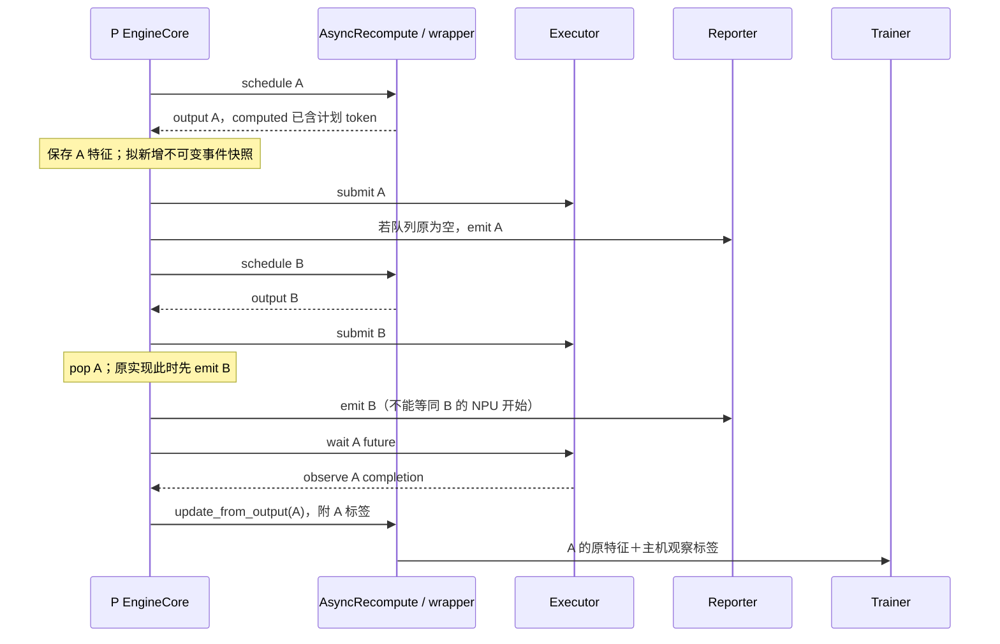
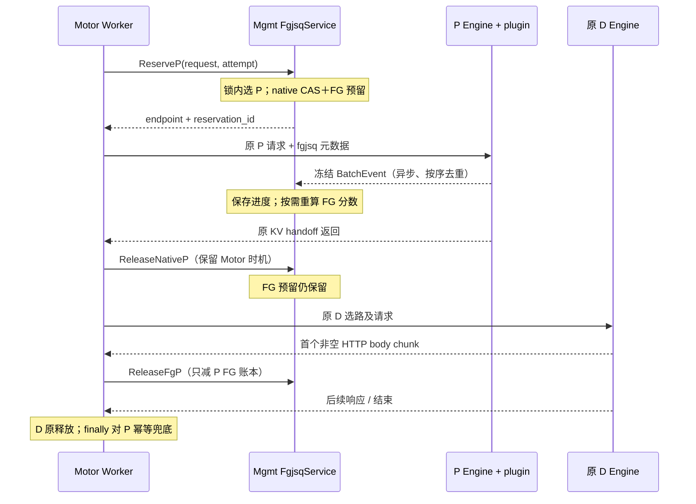

# FGJSQ＋predictor 源码核对与 Motor 适配审批稿

日期：2026-10-19。状态：**用户已批准第 1 节推荐组合；已实现本地适配，现场验证待进行。**

本页保留审批时的源码审查依据；最新落地范围、验证结果和交付入口见 [工程交付说明](FGJSQ_MOTOR_DELIVERY.md)，现场步骤见 [agent prompt](HUAWEI_AGENT_PROMPT_FGJSQ_MOTOR.md)。新目标是用户指定 rc1＋Motor 镜像，不能沿用历史 g4 镜像身份。

本轮核对用户投递的 g4 proxy / slo_patch，并以固定提交的 Motor、vLLM、vLLM-Ascend 作为迁移目标。建议采用“独立 Python 算法包＋Motor 小范围源码补丁＋P 侧 general plugin”，先完成 P 池 FGJSQ 与 predictor 的可验证接入。保持 D 引擎、D 选路及 D 负载记账原路径；不引入让行、waiting 重排、动态 chunk 或 KV 抢占。

## 1. 结论与审批范围

已有代码足以明确算法、特征和标签口径，尚不足以声称现场预测值、事件命中率或性能已经复现。需要在迁移中处理以下接口问题：

| 项目 | 核对结论 | 建议处理 |
| --- | --- | --- |
| FGJSQ | 是剩余 token 负载估计乘请求波次系数；predictor 参与批内进度衰减，不是把预测毫秒逐请求相加 | 保留原公式、0.05 保留比例、max_num_seqs 除数、首次事件校正及同分规则 |
| 请求关联 | 固定版本标准 chat 路径下，原 reporter 的截尾与 proxy 的 ID 匹配不相容 | 新增显式 reservation / attempt 关联；不用字符串猜测映射 |
| 批事件 | 后台线程读取 live Request；一次事件可能读到后续调度的进度，或读不到已移除请求 | 在 schedule 返回后冻结快照，异步线程只负责发送；使用进程 epoch＋批序号 |
| predictor | cache_hit_rate 实际为剩余比例；N_uncached 接近累计已计划 token，非本批 token | 第一阶段保留 v1 特征和现有模型；不偷偷改为真实 APC 特征 |
| 训练标签 | 异步标签是主机观察到的提交至完成或相邻完成间隔 | 保留 v1 标签，明确它不是端到端 TTFT，也不是纯 NPU kernel 时间 |
| P 释放 | proxy 在 D 首个非空 HTTP 数据块释放 FGJSQ；Motor HANDOFF 在 P 返回时释放原生 P workload | 分开管理两个账本与两个释放事件，不能共用一个 released 标记 |
| 多进程 | Motor 的 worker 共用 schema-4 SHM，但没有现成的请求级 FGJSQ 中央预留 RPC | 在 Mgmt 的调度服务维护共享 FGJSQ 状态，增加 P 专用事务接口 |
| 引擎补丁 | SLO=0 不主动过滤 waiting；但整个插件并非字节级原生，EngineCore 副本还删除了一条上游断言 | 保留调度委托；建议恢复容量断言并验证异步路径 |

**已批准的推荐组合：**迁移原公式与 predictor v1；实施显式关联、冻结事件、序号去重、幂等释放、P 角色门控及上游断言恢复；Motor 使用单 Mgmt 权威账本方案；以 vLLM HANDOFF、单 prompt OpenAI 请求为第一阶段验收范围。用户已批准该组合；实际代码及现场未验证项以工程交付说明为准。

## 2. 材料、版本与证据边界

统一根目录：`/home/zhangxiyue/llm-slo-scheduler`。

| 材料 | 本轮状态 |
| --- | --- |
| g4 proxy | 已收到 load_balance_proxy_finegrained_p3d_pdhybrid.py |
| slo_patch | 已收到 9 个包内 Python 文件；setup.py 由用户在本轮消息粘贴，已按原文归档 |
| 入口 | setup.py 显式 packages=[slo_patch, slo_patch.slo]；vllm.general_plugins → slo_patch.activate:activate |
| vLLM | 0fc695fc6d1d82e9a5ac6835ac8e4e1c83703665，v0.23.0 |
| vLLM-Ascend | 5cb98caaadeff42b5b62b996e34bb2aaa29d20fd，v0.23.0 |
| Motor | f203263d9742dd6fa76eaef658e0ff3a0f380301；设计版本，现场 Motor 版本仍待核对 |
| 预训练 model.pkl、依赖 wheels、启动脚本 | 尚未收到；不能比对模型预测值或完整启动参数 |
| 现场环境 | 依据用户提供的历史 g4 取证报告；本机没有访问内网或运行 910B2 |

共 11 个原始代码文件已记录 SHA256，见[接收清单](../../evidence/manifests/g4_source_intake_20261019.json)。除归档用户粘贴的 setup.py 外，未改写投递原件。原目录未见 slo/__init__.py；这不单独证明原安装失败，后续需检查实际 wheel / editable 包内容，可交付副本中明确包边界。

现场报告与本地源码一致的提交身份，不等于事件流、环境变量、模型文件或运行行为已经逐项验证。报告中“事件链完整”“cache hit”等文字需要由下面的代码事实修正或补证。

## 3. FGJSQ 负载的精确定义

来源：[G4 proxy][P]，278–549、883 附近、1446–1475 行。

对请求 r：O_r 是 original_load，L_r 是最近提交的 committed_load。对 P 实例 i：n_i 是尚未释放的请求数，W_i 是这些请求 committed_load 的和，b_i 是配置的 max_num_seqs。

### 3.1 到达与选路

1. 初始负载为 `max(1, request_body_bytes // 4)`，不是 tokenizer 的精确 token 数。
2. 派发前，用当前时间重新计算已接收批事件的请求负载，并把差量提交到实例账本。
3. 计算实例分数：

\[
S_i = W_i\frac{\lceil n_i/b_i\rceil+1}{2}.
\]

4. 取分数最小的可用实例并立即登记预留。排序稳定；同分时沿实例插入顺序选择，不是轮询或随机。
5. 外层 SharedProxyScheduler 的锁覆盖选路和记账。不能在 Motor 每个 worker 各自复制一份状态。

b_i 是上限配置，g4 为 24，既不是本次真实 batch size，也不是 8192 的 token budget。n≤24 且 n>0 时系数为 1，n=25 时为 1.5。该分数是启发式路由负载，不具有毫秒或 TTFT 的直接含义。

Motor 的 `RequestInfo.req_len` 来自入口 HTTP 原始 body 长度，可保留此估计口径，而不是悄悄换成 Render token 数；见 [dispatch.py](../../upstream/motor/motor/coordinator/router/dispatch.py) 519–552 行。

### 3.2 批事件与衰减

批事件给出 prompt 总长 P_r、本批 scheduled tokens Q_r、remaining tokens R_r、整批预测时间 T_hat（毫秒）。首次有效事件把 O_r 从 body/4 校正为 P_r，同时修正已提交负载。

\[
w_r=O_r R_r/P_r,\quad a_r=O_r Q_r/P_r,
\]
\[
u_r(t)=\begin{cases}
\min((t-t_{recv})/\hat T,0.95),&\hat T>0,\ t>t_{recv},\\
0,&\text{其他情况},
\end{cases}
\]
\[
L_r(t)=\operatorname{round}\left(w_r+a_r(1-u_r(t))\right).
\]

- t_recv 是 proxy **接收到事件的本地时间**，不是 NPU 真正开始执行的时间。原实现使用 wall clock 毫秒。
- 0.05 是本批 running 部分的保留比例，不是整个请求负载恒定保留 5%。整数 round 后也不保证严格大于零。
- 同一批的 T_hat 被写入批内每个请求，用作相同的进度时间尺度；不能将这些 T_hat 求和解释为实例执行时间。
- `num_computed_tokens` 被存储，但上述公式没有直接使用它。
- 未见事件或 prompt≤0 时使用 original_load；不能把没有上报解释为请求已完成。
- 事件处理检查 request ID、实例身份和源 timestamp 单调性。接受事件时保存快照并重置接收时钟；除首次校正外，负载差量在下次 dispatch / report_loads 时才提交。
- event_count 累加收到的条数，不等于成功关联的条数；HTTP 200 也不代表 updated>0。

例：首次校正后 O=P=1000，Q=200，R=600，T_hat=100ms，则接收时 L=800，50ms 后 L=700，充分久后 L=610。本轮直接执行原函数验证了这些值。

### 3.3 释放与异常路径

`reduce_load` 按 request ID pop 记录，减去最近 committed_load，并减少请求数；同一 ID 重复释放返回 False，不会再次减账。释放后迟到事件找不到请求，不会复活预留。

g4 的释放点在 proxy 1630–1631 行：**D 首个非空 HTTP bytes chunk，早于 SSE 解析**。它不保证是首个有效内容 token，也不是物理 KV 释放的直接证据。正常结束或异常走 finally 兜底；重算前释放旧 P 预留，再以新 UUID 重新派发。

原 proxy 的两类账本不能混为一谈：P 请求级 reduce_load 幂等；`request_num` 与 `_pd_initial_reqs` 是另一个统计登记。`reassign_instances` 1557–1561 行换 UUID，而 `pd_finish_request` 927–946 行按新 UUID 查 initial 集合，存在旧登记残留的静态风险。取消发生在 P 派发后、InstanceInfo 返回前的清理也需单独覆盖。没有现场 trace，本文不把这些风险表述为已发生的实验故障；迁移使用 Motor attempt 级生命周期，不照搬 proxy 的全局统计集合。

## 4. 事件链中已确认的两个问题

### 4.1 截尾不能剥离 chat 前缀

以下是固定提交的标准 chat 请求路径：

```text
proxy 预留 ID：                 uuid
X-Request-Id：                 uuid
vLLM chat serving：            chatcmpl-uuid
vLLM 内部随机化 ID：            chatcmpl-uuid-xxxxxxxx
原 reporter 的 req_id[:-9]：   chatcmpl-uuid
proxy exact / startswith：     uuid 不能匹配 chatcmpl-uuid
```

证据：[proxy][P] 458–469、1313 附近；[reporter][R] 72 行；[chat serving](../../upstream/vllm-v0.23.0/vllm/entrypoints/openai/chat_completion/serving.py) 256–258 行；[base_request_id](../../upstream/vllm-v0.23.0/vllm/entrypoints/openai/engine/serving.py) 387–396 行；[input_processor](../../upstream/vllm-v0.23.0/vllm/v1/engine/input_processor.py) 223–240 行。

proxy 注释把 `[:-9]` 描述为剥前缀，与 Python 切片及上述路径不符。若关闭随机化，固定截尾还可能损坏 ID。**这证明提供代码与标准路径的组合不相容；不能仅据此断言历史 g4 所有事件都未命中**，仍需现场原始 payload、派发 ID 和 updated/matched 日志排除未披露的路径差异。

迁移建议：Motor 分配不可复用的 reservation_id，在 P 请求的 `kv_transfer_params` 中放入命名空间字段 `fgjsq`，包括 schema_version、reservation_id、attempt_seq、P 实例/endpoint 身份及 event_url。reporter 原样携带；引擎内部 request ID 只作诊断。客户端提供的同名字段必须由 Coordinator 覆盖，不作为关联权威。

### 4.2 后台线程看到的 Request 不一定属于该批时刻

[reporter][R] 38–43 行将 scheduler_output 和 live requests 字典交给线程池；55–64 行才读取 Request：

```text
computed_before = req.num_computed_tokens - this_batch_scheduled
remaining       = max(req.num_tokens - req.num_computed_tokens, 0)
```

如果后续批已推进同一 Request，而旧事件线程尚未读取，则旧批配上新进度；若 Request 已移除，事件被跳过。timestamp 在后台序列化时生成，不能可靠代表原批次顺序。原实现也无发送重试或有界排队保证。

本轮用同一原 reporter 方法、同一旧 SchedulerOutput（Q=200），把 Request.computed 从 400 改为 600：事件从 computed=200 / remaining=600 变为 computed=400 / remaining=400。这是可重复的代码敏感性检查，不是对现场竞态概率的测量。

建议在 **schedule 返回后、再次推进该 Request 前**冻结该批的数字与关联信息，附着于 SchedulerOutput。沿用原 emit 阶段交给发送器；后台不再读 Request。源批序号在引擎主线程分配，接收端按 engine_epoch＋batch_seq 去重/拒旧，记录 received、matched、stale、unknown、wrong_instance、dropped、send_failed 各自计数。

冻结快照和显式顺序会修正原实现的非确定行为，可能改变路由结果。因此它们列为审批修正，不能标称“和历史竞态行为逐字节相同”。原始实现保留为离线对照，兼容性验证在相同、确定的规范事件序列上进行。

## 5. predictor 的特征、标签与训练

### 5.1 实际输入不是 APC 命中率或当前 chunk 的精确算量

[patch_core][C] 22–54 行在 `scheduler.schedule()` 返回后读取本批 scheduled requests，设：

\[
B=|\mathcal B|,\quad L=\sum_{r\in\mathcal B}prompt_r,\quad
K=\sum_{r\in\mathcal B}computed_r,\quad \bar L=L/B,\quad h=(L-K)/L.
\]

上游 Scheduler 在 `_update_after_schedule` 中已经把本批计划 token 加入 computed；Ascend RecomputeScheduler 返回前调用此逻辑。异步路径还可能包含在途批进度。因此 K 不是仅包含已完成计算或 prefix-cache hit 的量。来源：[Scheduler](../../upstream/vllm-v0.23.0/vllm/v1/core/sched/scheduler.py) 997–1010 行；[Ascend RecomputeScheduler](../../upstream/vllm-ascend-v0.23.0/vllm_ascend/core/recompute_scheduler.py) 823 附近。

[predictor_impl][F] 141–176、258–306 行构造特征，记：

\[
N_c=\lfloor B\bar L\operatorname{clip}(h,0,1)\rfloor,\qquad
N_u=\lfloor B\bar L-N_c\rfloor.
\]

| 模型列（顺序固定） | 实际表达式 |
| --- | --- |
| N_uncached | N_u，通常接近 K |
| B | 本批参与请求数 |
| L_avg | 本批请求平均完整 prompt 长度 |
| cache_hit_rate | h，即剩余比例 |
| prefill_intensity | N_u/(B+1e-6) |
| N_cached | N_c，通常接近 L−K |
| Cross_Attention_Proxy | N_u N_c/max(B,1) |
| Self_Attention_Proxy | N_u²/max(B,1) |

例如一个 1000-token prompt，schedule 后 computed=400，本批只计划 200 tokens：h=0.6，N_uncached=400，N_cached=600。本轮执行原特征函数已确认。列名中的 cached / uncached 不应按字面解释为真实 KV 命中与本批未命中 token。

第一阶段采用 `feature_schema=g4_legacy_v1`，保持数值与模型兼容，在说明和观测字段中注明真实含义。若未来改为本批 scheduled、历史 context、真实 APC 命中、外部 KV 命中等，需要新 schema、重新训练与单独实验；这不是本轮迁移的一部分。

### 5.2 标签的时序

[patch_core][C] 107–145、148–269 行：

- 同步路径：从 execute_model 提交前到 future.result 返回的主机时长；若后续另行 sample_tokens，该部分不在此前采样的时间内。
- 异步路径：schedule / predict 后提交并记录 t_submit；若提交时 batch_queue 为空，则 y=(t_observed_finish−t_submit)×1000；否则使用上一批主机观察完成时刻作为起点，y=(t_observed_finish−t_previous_observed_finish)×1000。
- 特征保存在 SchedulerOutput，完成时从队列取出的也是该 output；[scheduler wrapper][S] 126–153 行把其中的标量放入训练队列。正常路径下没有发现“拿另一批特征训练本批标签”的直接证据。
- y 的正式目标列为 `execute_time_ms`。它是主机观察的流水线服务间隔/驻留时间代理量，含主机观察和调度时序影响；不是整条请求 TTFT，也不是严格的 NPU 计算耗时。
- 原 async emit 还有一个边界：pop 当前批后，**在等待当前批 future.result 前**上报队列中下一批。它不是硬件执行开始通知。快照修正不会自动解决多在途批的真实剩余算量建模。

本轮保留 `label_schema=g4_host_observed_v1` 及 emit 阶段，新增 batch_id / epoch / submit / observe / emit_phase 的可关联记录。是否改变 label 或用硬件事件计时，后续单独讨论，避免使已有 warm model 与新标签混用。



### 5.3 训练与精度声明的边界

[S] 415–420 行过滤 B≤0、平均长度≤0、h<0 或 h>1、实际时间<0 或>100000ms；**h=0 是合法样本**。当前过滤未显式处理 NaN/Inf，建议对外事件协议先严格拒绝非有限值；模型训练过滤规则若调整需独立记录。

[F] 42–76、86–139、309–385、466–539 行：按平均长度（1000）和 h（0.2）分桶，每桶滑窗上限 100；warmup_batches=2，但至少需要 50 样本才能训练，并非第 2 批一定完成训练；后续触发间隔 100 批。StandardScaler＋LightGBM，n_jobs=1，后台训练后替换快照；模型文件保存 scaler/gbr。超过 60s 清除 training Event 不会停止旧线程，存在重叠训练的潜在边界，先列入后续可靠性项。

训练输出的 r2/MAE/MAPE/分位误差由同一训练集 X_scaled/y_train 计算，**不是独立测试集或未来在线精度**。prediction_history 另存训练前预测误差，可用于未来按时间验证。模型未就绪时 fallback=`B*L_avg*(1-h)*0.01`；模型输出仅负值被置 0.001、>60000 被截断，零值原样保留，fallback 不走同一截断。现场报告中更强的精度或统一 clamp 描述不能直接沿用。

## 6. 调度与插件边界

[setup.py](../../evidence/source_drops/slo_patch/g4-20261015/setup.py) 保留 general_plugins 入口，避免与 Ascend 的平台插件冲突。[activate.py](../../evidence/source_drops/slo_patch/g4-20261015/slo_patch/activate.py) 和 [patch_runtime][H] 存在捕获异常后仅记录日志的路径；“已安装”不等于“所有 Hook 已启用”。后续交付须验证实际类、配置、Hook 版本及 reporter 活性，不能只 grep 安装成功。

[S] 213–229、309–311、472–486 行：SLO=0 时 prefilter 返回 None，schedule 委托父类；异步 MRO 为 SWPAsync → SWP → AsyncRecomputeScheduler → AsyncScheduler → RecomputeScheduler → Scheduler。保持异步、MTP 记账和原生 FCFS/running-first/共享 token 决策；不因 P 未显式传 async CLI 就把 P 改为同步。

[H] apply_all 实际有 5 类 Hook：调度器、EngineCore 打点、chat_utils 兼容、KV debug、MultiConnector KV events。后两者有独立环境开关；本地仅看到代码存在，不证明现场启用了它们。D 已有 Hook3 按现场基线保留，既不移除，也不为 D 注入 predictor/reporter。

另对两份 EngineCore 方法做了 AST 展示级 diff：打点副本除插入预测/日志/事件/计时外，async 副本删掉了上游 `assert len(batch_queue) < self.batch_queue_size`。因此不能说完整插件与原生“逐字节一致”。建议在交付副本恢复断言，改正“P 同步 / D 异步”的旧注释；这是独立可审阅修正，不能掩盖为单纯路径适配。

## 7. Motor 的适配架构

### 7.1 为什么不能只增加一个 policy factory

Motor f203263d 的 `AsyncSchedulerClient.select_and_allocate` 在 worker 内选候选、通过 schema-4 SHM 的 CAS 预留；`update_workload` 用 cas_sub_floor0 释放。Mgmt 的 `AsyncSchedulerServer` 管理实例快照和 SHM，但现有 ZMQ 协议没有请求级 FGJSQ 预留/事件/释放接口。其请求处理可并发，不自动提供算法事务锁。

证据：[scheduler_client][MC] 959–1216、1396–1454、1757 附近；[scheduler_server][MS] 89–160、658、884 附近；[zmq_protocol](../../upstream/motor/motor/coordinator/scheduler/runtime/zmq_protocol.py)；[workload writer](../../upstream/motor/motor/coordinator/scheduler/runtime/workload_shm/writer.py) 111–113 行提供现有 native CAS handle。

推荐在现有 Mgmt 进程维护一个 P 专用 FgjsqService，经现有控制 RPC 和 Mgmt HTTP 事件入口访问。先不改 Rust / SHM schema，也不增加独立 sidecar。P-only 开关先于全局 policy 分支判断；D 继续原分支，不把全局 scheduler_type 改成同时影响 P/D 的 FGJSQ。

### 7.2 两份账本，两种释放

| 账本 | 用途与数量 | 正常释放 |
| --- | --- | --- |
| Motor 原生 P workload | 维持 native allocation/释放、endpoint generation、观测和故障清理；记录原始分配量 | 保留 HANDOFF 的 P 返回释放时机 |
| FGJSQ P reservation | 请求数与可衰减 committed token，决定 P 选路 | D 首个非空 HTTP 数据块；失败/取消/finally 兜底 |
| Motor D workload | 原有 D 路由与资源生命周期 | 完全沿用原路径 |

FGJSQ 分数不能写回原生 active_tokens 后再让现有负数 delta 释放；这样会混淆会衰减的量与固定分配量。

启用时的 P 分配由 Mgmt 在同一事务锁中选择可用实例、按 generation 校验并 CAS 预留原生 P workload，再登记 FGJSQ 预留。P 的原生释放也经此服务幂等化，保持原来触发时机；D 的 CAS 留在现有 worker 路径。失败回滚与未知 RPC 结果必须有明确状态，不能在“可能已预留”的超时后盲目再选一个实例。

同一 reservation 至少区分 native_p_released 与 fg_p_released；二者都结束后保留有限期 tombstone 用于重复消息去重。路由资格仍受 Motor 的 blocked、健康、target_instance、engine_type 和 dispatch_capability 约束。FGJSQ 默认以实例聚合负载；首阶段对应每个 TP4 P 实例一个 endpoint，不能把 TP rank 当成独立实例增加容量。多 DP endpoint 的分配语义以后单独验证。

### 7.3 请求与事件协议（拟定）

- Reserve：schema_version、coordinator_epoch、root_request_id、attempt_seq、操作幂等键、请求估计 token、候选约束。
- ReserveAck：reservation_id、instance/endpoint/generation、原生 P 分配量、算法版本；重复 Reserve 返回同一结果。
- P 请求元数据：仅 P 请求注入 fgjsq 命名空间。必要时同时覆盖 token-only sampling_params.extra_args 的透传路径，验证到达 Request.kv_transfer_params。
- BatchEvent：schema_version、reservation_id、engine_epoch、batch_seq、instance/endpoint、prompt/computed/scheduled/remaining、predicted_exec_ms、emit_phase；时钟与顺序字段区分。输入必须有限、非负且可关联。
- ReleaseNativeP / ReleaseFgP / AbortAttempt / QueryReservation：独立、幂等、可重试，携带 reservation_id 和明确 reason。
- 关联既不依赖 `chatcmpl-` / `cmpl-`，也不依赖随机后缀、`#aN` 字符串解析或模糊前缀匹配。
- 不复用 `metaserver`：Motor TRIGGER 中它是 KV 协调接口；原 reporter 还会丢弃 URL path 并拼 `/update_batch_event`。新 event_url 使用明确完整路径。HANDOFF 的 D KV ticket 只去除新增 fgjsq 私有字段，保留原 KV 字段及 D payload。

### 7.4 时序与关闭行为



Motor [unified_pd][MU] 1579–1591、1764–1773 行的早期 P 释放不能直接承担 ReleaseFgP；1017–1105 行面向解析后 stream queue 的回调也不完全等于原 proxy 的原始 bytes 边界。建议在 [base router][MB] 547–608 行的 response.aiter_bytes 边界增加可选 P 账本观察器，只在已绑定 FGJSQ reservation 的 D leg 使用。非流式路径已通过 `_open_nonstream_response` 打开流再 aread（695–728 行），可包装 response byte stream 观察第一非空 body 数据，保持响应缓存/解析行为。若某个测试或 transport 只能在完整 response 后通知，明确标记降级边界，不能算严格 g4 首字节对照。

所有异常、取消、重试、局部登记失败、fallback 与 residual cleanup 都须携带同一 reservation / attempt；不能只修改正常 stream 分支。P 释放失败不应改变 D 的输出内容，但必须有可观测重试和最终未清账告警。

第一阶段按单 Mgmt 权威进程设计，不宣称 HA 无损重启。Mgmt 重启或 worker 失联的未知事务要拒绝盲目重分配，进入查询/协调清理；超时本身不能证明引擎已停止，也不能直接将所有在途负载置零。部署/回退使用停流、排空、核对账本，再重启 Coordinator/P；不承诺热切换中保持账本连续。

## 8. 文件级实施清单（全部待审批）

### 8.1 新项目维护的代码

以下为拟创建路径，当前 src 仍为占位目录。`src/slo_patch` 沿用现有包身份，避免同时安装两份同名 general plugin。

| 路径（相对项目根） | 内容 |
| --- | --- |
| src/fgjsq/policy.py、state.py | 原公式、时间注入、实例顺序、请求/实例状态；与原类做确定性对照 |
| src/fgjsq/events.py | 不依赖 Motor/vLLM 的规范事件与输入校验 |
| src/motor_adapter/service.py | P 权威账本、锁内 reserve、两种 release、去重、查询及故障状态 |
| src/motor_adapter/protocol.py | RPC/event schema、reservation 标识、版本协商 |
| src/motor_adapter/prefill_adapter.py | Worker 与 service 接线、P 元数据、attempt 生命周期 |
| src/motor_adapter/body_observer.py | D 响应 bytes 的可选观察器，只触发 P FG 释放 |
| src/slo_patch/activate.py、patch_runtime.py | 原 Hook 挂载、P-only gate、实际启用状态检查；保持 general_plugins |
| src/slo_patch/patch_core.py | 保留 predictor/标签/emit 阶段；冻结快照、批序号；拟恢复上游队列断言 |
| src/slo_patch/slo/batch_event_reporter.py | 显式 reservation、不可变 payload、完整 callback URL、有界发送、重复安全重试与计数 |
| src/slo_patch/slo/scheduler_with_predictor.py | 保留异步继承与 SLO=0 委托；只补关联观测/初始化所需接线 |
| src/slo_patch/slo/predictor_impl.py、predictor.py、batch_reporter.py | 第一阶段迁入维护副本；保持公式、模型列、在线训练标签与参数，不做 APC 数学重构 |
| pyproject.toml / packaging 配置、必要 __init__.py | 明确可安装包及入口、依赖清单；使用现场兼容 wheel，不在本机编译 aarch64 原生依赖 |

有界发送队列满时记录丢弃，不能静默；旧算法保留剩余负载可能导致保守选路，这是通信故障状态，需按事件龄期单列统计。暂不在此引入未经验证的自动负载清零策略。

### 8.2 Motor f203263d 的最小接线补丁

保存为 `patches/motor/f203263d-p-fgjsq.patch`；批准后在对应工作副本实施并生成补丁。表中路径均相对 upstream/motor。

| 上游文件 | 必要修改与原因 |
| --- | --- |
| motor/config/coordinator.py | P-only 开关、callback 地址、每实例 max_num_seqs、服务超时/模式配置；同步解析、验证、to_dict，默认关闭 |
| motor/coordinator/domain/scheduling.py | select_and_allocate / release 参数显式携带 attempt/reservation；保留旧调用方默认行为 |
| motor/coordinator/scheduler/runtime/zmq_protocol.py | 新增 P Reserve / Query / Release 类消息及响应，不重定义 D 消息 |
| motor/coordinator/scheduler/runtime/scheduler_server.py | 在 Mgmt 接入服务和锁；与实例刷新/generation/blocked 状态协调 |
| motor/coordinator/scheduler/runtime/scheduler_client.py | 仅 role=P 且开关开启走新 RPC；D/关闭分支保留原选择与 CAS；未知结果先查询 |
| motor/coordinator/api_server/management_server.py | 注册 FG 事件与只读账本诊断端点；生命周期绑定现有 control_plane |
| motor/coordinator/router/adapters/pd_protocol.py | P 元数据透传；token-only 的 extra_args 对应路径；不覆盖 metaserver；D ticket 去除新增私有字段 |
| motor/coordinator/router/strategies/unified_pd.py | reserve 的 attempt 接线；独立 native-P / FG-P 状态；绑定首 bytes 观察；取消/重试/finally 处理 |
| motor/coordinator/router/strategies/base.py | 可选 body observer；rollback 和 residual cleanup 传完整关联，默认路径行为保持 |
| motor/coordinator/domain/request_manager.py | 保存/查询 reservation 与 attempt；native P workload 先释放后仍保留 FG reservation，不提前丢身份 |
| motor/coordinator/router/workload.py | release 准备/ACK/本地清理与新增关联协调；D 工作量计算保持 |
| 对应 tests/coordinator/config、scheduler、router、domain 测试 | 增加 P 行为及关闭/D 不变的回归覆盖，具体文件按现有测试组织 |

预计不修改：vLLM / vLLM-Ascend upstream 核心源码、Motor Rust SHM ABI、D predictor/reporter、D 路由策略、MTP、KV connector 的传输语义。workload_shm/writer.py 现有 native handle 可复用；若实现时发现必须新增 writer facade，单列扩展 diff，不能隐含改 schema。

首阶段支持范围：vLLM HANDOFF、单 prompt chat/scalar completion，覆盖 stream 与 nonstream，以及这些路径自身的 retry/cancel。TRIGGER、BOOTSTRAP、PD hybrid fallback、多 prompt batch、HA、多 DP endpoint 必须另行确认；开启 FGJSQ 但不受支持的组合应在启动校验中明确拒绝，不悄悄走半套状态机。单 prompt token-only 若实际启用，应验证同一 reservation 的透传与 transport fallback，不能默认生产已经走这条路径。

### 8.3 配置、验证、交付与文档

| 路径 | 计划 |
| --- | --- |
| configs/baseline/motor-fgjsq-p.json、p-engine.env | 完整 baseline 配置，D 配置继承现场；不通过全局环境误启用 D Hook2 |
| scripts/validate/preflight.py | 校验 commits/文件哈希、入口唯一、P 类/MRO、异步/SLO0、模型列与模型 SHA、事件关联 |
| tests/unit、tests/replay、tests/integration | 原函数 oracle、乱序/重放、协议与 Motor/P 假引擎集成 |
| scripts/package、artifacts/releases | 离线包、patch、manifest、应用与撤销脚本；版本不符拒绝模糊应用 |
| docs/engineering | 安装、回退、已知差异、实验机执行 prompt 与验收报告模板 |
| Motor 配套文档与 .agents/skills/motor-dev 引用 | 实施时同步实际改动的配置/接口说明；本轮不修改 upstream 技能文件 |

本轮已按 Motor motor-dev 技能阅读 Coordinator 开发约定。实施后通过 `bash tests/run_tests.sh` 选择并运行相应测试，不使用裸 pytest 替代 Motor 规定流程。计划中的测试不是本轮已经运行的测试。

## 9. 验证与交付门槛

### 9.1 本轮已经完成

[probe_original_sources.py](../../evidence/analysis/2026-10-19-fgjsq-audit/probe_original_sources.py) 从投递文件 AST 提取原类/函数执行，未 import 整个 proxy、Motor、vLLM 或模型；无网络发送。使用合成时钟与请求，全部断言通过，结果见 [probe_results.json](../../evidence/analysis/2026-10-19-fgjsq-audit/probe_results.json)。

覆盖：同分顺序、24/25 请求波次、首次 token 校正、0/50/1000ms 衰减、stale/wrong-instance/late 事件、重复释放、标准 chat ID 匹配失败、可变 Request 对旧 reporter 输出的影响、实际特征代数。np.clip 仅用标量等价 stub，不加载/测试 LightGBM。两份 EngineCore 方法的 AST diff 另存证据。

这些结果只证明上述函数在给定输入下的行为，不证明完整取消路径、Motor 跨进程事务、NPU 时序或预测精度通过。

### 9.2 审批后本地验证

1. 相同规范事件序列下，原 FGJSQ 与移植 policy 的每次选路、original/committed/n/W/S 一致；实例同分顺序、首事件校正、源过期/重复事件单列。
2. 两个以上模拟 worker 同时预留，不重复扣款、不丢请求；ACK 丢失、超时查询、重复释放、旧 attempt 迟到、instance generation 更换可解释。
3. native P 先释放时 FG P 仍存在；首 bytes 只释放 FG P；异常/finally 不重复减账。rollback、residual cleanup 和取消涵盖 await 边界。
4. 事件快照在后续 schedule / Request 删除后仍不变；批序号与 label 能关联。加入明显不同大小的连续批，验证训练特征和标签属于同一 output。
5. 关闭开关，以及 D 路径：选路、分配量、请求体、KV 字段、MTP/调度配置与原版一致；新观察器不改变 D 响应 bytes 和异常传播。
6. SLO=0 下原生 Ascend 与 wrapper 的 schedule 输出序列、waiting/running 及 token 分配相同；恢复断言后的 async 队列边界按上游契约测试。
7. 模型到达后核验 SHA 与软件版本，再比对同一输入的原/新预测值、标签和更新触发；此前不称数值复现完成。

### 9.3 实验机验收

先小流量检查 P 三实例的事件 matched 比例、未关联原因、预测单位、请求/批 ID 链、两类账本释放和 plugin 实际类；再做压力对照。必须同时报告 HTTP 成功和有效事件匹配数量，不能只给 POST 200。

测量新增 Mgmt RPC、事件序列化、reporter 队列、在线训练及日志的 CPU/延迟开销；中央化正确性不自动意味着吞吐无损。吞吐提升/不下降和 P90 TTFT 是实验结果，不是本文保证。

分档 SLO 沿用用户承诺：64K P90 TTFT≤27s、P90 TPOT≤30ms；128K P90 TTFT≤30s、P90 TPOT≤45ms。AISBench 参数按现场 concurrency=1/4/8/16、request_rate=1、pressure_time=900；精确 0630 commit 与发压语义仍应留档。不得据平均吞吐直接宣称当前接近硬件容量。

Motor baseline → Motor＋P FGJSQ 的对照应使用相同 D 策略和配置。原 proxy 与 Motor 的性能差异单列，不能把代理/协议/测量位置差异全部归因于 P 算法。

回退顺序：停止新流量 → 等在途完成/确认取消 → 核对两类 P 账本清空 → 关闭 P-only 开关并重启相关 Coordinator/P → 校验 D 配置与插件保持原样。应有版本精确匹配的反向 patch 或原文件恢复，避免在线混用新旧 release 协议。

## 10. 仍需现场补充，但不阻塞本次方案审批

- 启动脚本与完整 P 环境：明确 5 类 Hook 的开关、实际 async 与 MTP、max_num_seqs=24、max_num_batched_tokens=8192 是否仍成立。
- model.pkl 和对应依赖版本；预期模型 SHA256 为 `142f3364e8d7d8de58da62477b3fe852a797aa4cc8c79c582dda985853b54c9c`。
- 一条脱敏请求的完整证据链：proxy 派发 ID、发往 P 的 X-Request-Id、引擎内部 ID、原 batch payload、proxy updated 计数、首 D bytes 与最终释放。用于解释历史 g4 与本次 ID 推导的差异。
- Motor 实际 commit、配置、启动方式、Mgmt/Worker 数量、HANDOFF/其他协议及 Render 使用情况；目前只能按 f203263d 设计。
- Python、CANN、TorchNPU、Mooncake 和数值依赖精确版本；这决定交付包是否能在镜像中直接使用。

审批通过后先实现与验证迁移基线，再输出实验机可执行的安装/取证 prompt。让行预算、入队条件、waiting 重排与 KV 抢占均不在本次改动范围。

## 源码引用

正文中的行号对应本次已哈希的原件和固定 checkout。

[P]: ../../evidence/source_drops/proxy/g4-20261015/load_balance_proxy_finegrained_p3d_pdhybrid.py
[R]: ../../evidence/source_drops/slo_patch/g4-20261015/slo_patch/slo/batch_event_reporter.py
[C]: ../../evidence/source_drops/slo_patch/g4-20261015/slo_patch/patch_core.py
[S]: ../../evidence/source_drops/slo_patch/g4-20261015/slo_patch/slo/scheduler_with_predictor.py
[F]: ../../evidence/source_drops/slo_patch/g4-20261015/slo_patch/slo/predictor_impl.py
[H]: ../../evidence/source_drops/slo_patch/g4-20261015/slo_patch/patch_runtime.py
[MC]: ../../upstream/motor/motor/coordinator/scheduler/runtime/scheduler_client.py
[MS]: ../../upstream/motor/motor/coordinator/scheduler/runtime/scheduler_server.py
[MU]: ../../upstream/motor/motor/coordinator/router/strategies/unified_pd.py
[MB]: ../../upstream/motor/motor/coordinator/router/strategies/base.py