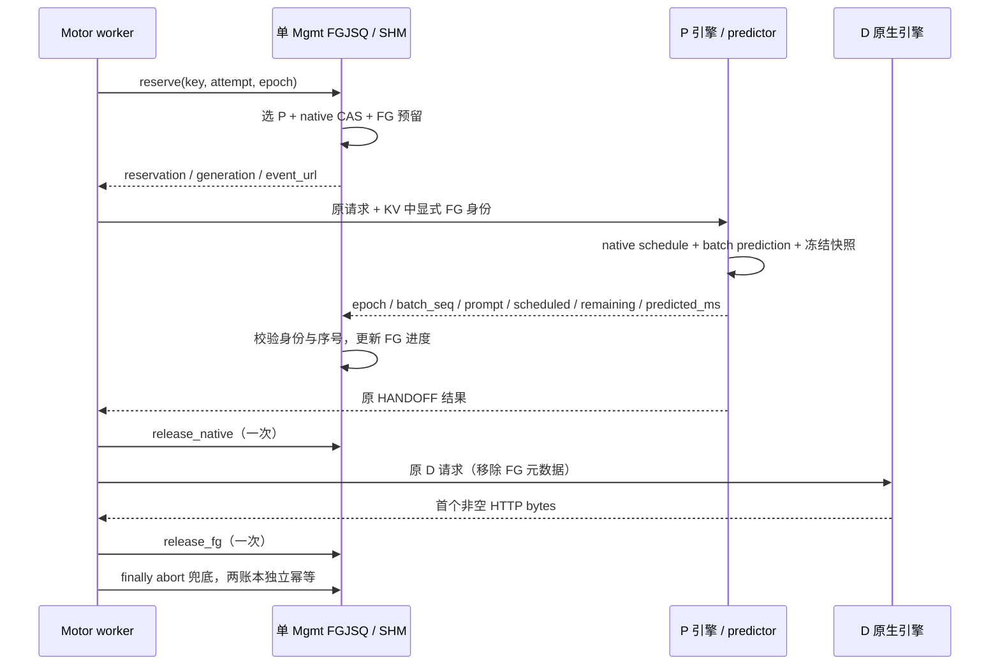

# FGJSQ＋predictor＋Motor 首轮工程交付

日期：2026-10-19；版本：0.2.0；用户已批准适配审查文档第 1 节的推荐组合。

本轮交付 Python 代码、Motor 补丁、安装/回退/核验脚本、测试及实验机 agent prompt。实验机使用自有镜像与权重尝试启动 3P3D Qwen3.6-27B，核验 FGJSQ＋predictor＋Motor 链路和效果。链路通过并回传证据后，才进入入场条件与让行预算研究。未实施 waiting 重排、动态 chunk、KV 保留/释放抢占。

## 1. 交付入口和真实状态

- [实验机 agent prompt](HUAWEI_AGENT_PROMPT_FGJSQ_MOTOR.md)：可直接复制给实验机 agent。
- [源码审查与批准范围](FGJSQ_MOTOR_ADAPTATION_REVIEW.md)：保留公式、特征、标签与接口依据。
- `artifacts/releases/fgjsq-motor-p-0.2.0-20261019.tar.gz`：完整轻量交付包；旁边是 SHA256。
- 包内 `dist/slo_patch-0.2.0-py3-none-any.whl`：纯 Python overlay，不是 Motor wheel，不包含 NPU/Rust/SHM 二进制。
- 包内 `MANIFEST.sha256`、`RELEASE.json`、`validation/`：内容完整性、版本及本地验证记录。

**本机已完成逻辑与接口验证，尚未验证目标镜像或 NPU 链路。** 新指定镜像文件名是 `vllm-ascend:v0.23.0rc1-mindie-motor-3.1.0-main-0917.tar.gz`，不能据名字认定其内部源码与本机 v0.23.0 / Motor f203263d 一致。安装器严格核对 Motor 7 个文件，P 插件严格核对 3 个引擎文件；不匹配时必须根据现场源码移植及验证，然后生成新的版本清单。不能只改 hash 让检查通过。

本机未收到原 `model.pkl`，不能宣称 warm predictor 数值一致。缺模型时可运行冷启动链路检查，但须单独标识，不能当作 g4 性能复现。

## 2. 算法和生命周期

`src/fgjsq/policy.py` 保留 g4 初值 body_bytes/4、首次 prompt 校正、剩余量＋本批执行衰减、0.05 保留比例、波次系数及幂等减账。Motor 同分按实例 ID 固定排序，原 proxy 则按其注册插入序；实例注册顺序固定后才可逐条比较跨实现同分选择。predictor_impl、predictor、batch_reporter 三文件与用户投递原件逐字节一致；8 维特征及异步训练标签口径沿用 v1。

FG 释放时机是首个非空 HTTP bytes，可能是 role/metadata，不能叫首个内容 token。native P workload 保持 HANDOFF 结束时释放。事件到达时间仍是估算执行进度的起点，不是 NPU 真正执行时刻。训练 label 是原异步主机观察间隔，不是完整 TTFT，也不是纯 kernel 时间。

## 3. 文件边界

| 位置 | 职责 |
| --- | --- |
| src/fgjsq | FGJSQ 公式、请求预留记录、不可变批快照 |
| src/motor_adapter | Mgmt 权威账本、幂等 RPC、schema-4 native CAS 桥接、HTTP 首包观察 |
| src/slo_patch | P general plugin、原 predictor、冻结事件传输、EngineCore 打点 |
| patches/motor/f203263d-p-fgjsq.patch | 7 个 Motor Python 文件的明确 hook；不改 Rust/SHM 布局 |
| patches/motor/f203263d-files.json | 7 文件修改前后 SHA256 |
| scripts/collect / deploy / validate | 现场取证、补丁安装/回退、显式启动计划、预检、HTTP smoke |
| configs/baseline | FG 开关配置与需现场填写的启动计划模板 |
| tests | 原算法对照、并发/重试/取消、批次配对、实际 Motor HTTP 接线测试 |

Motor 7 文件：`models/request.py` 存 PrivateAttr；`domain/scheduling.py` 加 attempt/释放身份；`scheduler/runtime/scheduler_client.py` 接 P RPC；`scheduler_server.py` 接权威服务；`api_server/management_server.py` 接受鉴权的事件/负载查询；`router/strategies/unified_pd.py` 绑定 attempt 与 P/D 身份边界；`router/strategies/base.py` 观察 D 原始响应及 finally 清理。均相对于 `motor/coordinator/`。

相对于审批稿的落地细化：不修改 Motor 配置 schema，使用进程启动时共享的 `FGJSQ_CONFIG` JSON；不扩张 RequestManager，使用 RequestInfo 私有字段；同分选择明确固定 ID 序；第一版仅 native OpenAI HANDOFF，Render/tokenized/多 prompt/HA/TRIGGER/hybrid fallback 显式拒绝，不默默回退。D 的选路、CAS、引擎调度和 HTTP body 保持原路径。

## 4. 启用、安装与回退

1. 实验容器内运行 `scripts/collect/collect_runtime.py --output <取证目录> --include-source`。无须加载模型，保存选定源码、版本、SHA256。
2. 对匹配版本：`scripts/deploy/install_motor_patch.py --motor-root <包含motor包的目录> --state-dir <新的备份目录> --action check`；通过后 `--action apply`。安装 overlay wheel：`python -m pip install --no-deps --force-reinstall dist/slo_patch-0.2.0-py3-none-any.whl`。不在运行中的服务热替换。
3. Coordinator 全部子进程使用同一 `FGJSQ_CONFIG`。P 设置 `SLO_PATCH_ROLE=prefill`、`ENABLE_BATCH_REPORTER=1`、`ENABLE_VLLM_TTFT_SLO_MS=0`、现场 warm 模型路径。D 不设置 P 开关；既有 D Hook3 如果原来需要则保持，不能误删原有兼容修复。
4. FG 管理 HTTP API 沿用 Motor `_verify_mgmt_api_key`。P reporter 通过 `FGJSQ_MGMT_API_KEY_FILE` 读取 key，只在 header 发送，勿写入文档或日志。HTTPS 使用可信 CA（可配置 `SSL_CERT_FILE`）；当前代码没有自定义 mTLS 客户端证书接口，若现场要求 mTLS，须先适配并测试，不得关闭现场安全配置来迁就 overlay。
5. 用 `scripts/validate/preflight.py --role coordinator|prefill|decode` 分角色检查；P 传 `--model` 仅校验文件/哈希，仍须从实际启动日志确认模型加载成功及 warmup_done。
6. 按现场原启动方式填写 `configs/baseline/deployment.example.json`。`launch_local.py` 默认只输出计划，`--execute` 才 exec；它不是集群管理器，NodeManager/Controller 仍使用现场 Motor 正确部署方式。
7. 停止发压并排空实验栈后，先保存日志/账本，`--action revert` 恢复 Motor 原件；重建原镜像容器或恢复原 overlay 安装状态。所有实验进程统一停用 FG 开关并重启。不要在不同 worker 间混用启用/停用状态。

补丁关闭后 Motor 仍 import overlay 模块，故仅取消环境变量不足以卸载包。先恢复 Motor 7 文件，才可卸载 overlay；如果 D 原本使用旧 slo_patch 的 Hook3，恢复原安装而非简单 uninstall。

## 5. 验证结果与限制

本地 `bash tests/run_tests.sh`：新增 20 项通过；选定 Motor 原有回归 169 项通过、8 项跳过、0 失败。8 项中 7 项因缺 `libmindie_workload_shm.so`，1 项为上游已标记的 Endpoint model_validate 调查项。schema-4 桥接本地用 FakeNative 测试，不能据此声称 native Rust CAS、跨进程 mmap 或 aarch64 ABI 已验证。EngineCore 对照用 CPU fakes 检查提交/完成顺序与批次配对，不能代替 NPU 输出正确性。

本地明确覆盖：200 请求原 FGJSQ 函数事件重放；并发中央预留；丢 reserve ACK 后查询；取消发生在提交后；迟到/重复/错误身份事件；两个释放点独立；旧 generation 不减新实例负载；P blocked/paused 排除；流式和非流式、缓存和未缓存 HTTPX 响应；新管理接口 401/403/成功关联；原生异步容量断言恢复。

局限：单 Mgmt 内存状态，无 HA 持久化恢复；Mgmt 重启、worker 被强杀、持续控制通道故障可能留下未清预留，不能当作完备故障恢复方案。第一阶段禁止压测中滚动重启，出现这类故障先停流量并对账，再重新建立实验栈。不能用短 TTL 删除仍在执行的长请求。Reporter 队列有界，失败/丢事件有计数；无事件时继续使用已知负载，不自动标为完成。

本机仅交付纯 Python wheel，继续使用现场镜像的 `.so`/NPU依赖；若需重新构建 Motor wheel，应在目标镜像同 ABI 环境按上游 build.sh 构建并确认包含 libmindie_workload_shm.so。

## 6. 现场完成条件

交付包可安装不等于链路成功。至少需要 3P3D 全部注册、三路 P 都有 matched 事件、predictor 加载/预测/在线标签更新有证据、串流和非串流请求正常、请求结束后两个账本归零、D 无 P 补丁开关、KV 交接和输出正确性通过。满足这些后再进行 AISBench 对照，报告 P90/P95 TTFT、P90 TPOT、吞吐、错误率及每 P 排队/执行分解。没有数据之前不宣称吞吐改善，也不假设平均负载接近容量。
