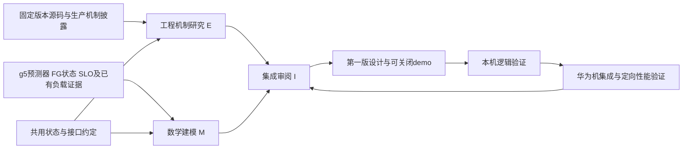

# 动态 chunk：工程机制、数学建模与集成验证分工

2026-10-29；Session 3。用户已认可“从DeepInfer等运行时工程机制出发，设计多项式如何获得时间预算，并低成本约束累计TTFT”的研究方向。本稿给出建议分工与交接约定，供用户fork/创建会话后使用；本轮不创建会话、不发送跨会话消息、不修改运行实现、不执行NPU实验。

Fork 前先读[当前研究索引与交接记忆](README.md)，再使用本文第 8 节对应提示。已有成果与拟新增产物分开记录；本稿不是两份专题交接已经完成的证明。

## 1. 可行性与优化后的工作链

方向可行，关键是把成本预测、时间预算决策、原生组批执行分开，又通过同一状态/时间语义连接。

这是计划流程图，不是现有运行架构。E/M并行研究，先对齐接口，再由I做设计收敛与实现；不要求先完成大规模静态扫描，不以完整KV微分方程为前置条件。

核心控制对象仍为P的批总token预算c；单请求分配u_i由原生顺序与资源约束产生。为了实现求解可将最后一个请求的分配量当局部变量，但不能悄悄把全批预算研究替换成重排、逐请求优先级或抢占算法。

## 2. 相似研究与工程线索

| 来源 | 与本方向的相似点 | 证据等级与使用边界 |
| --- | --- | --- |
| [DeepInfer官方部署Q&A](https://github.com/deepseek-ai/DeepInfer/blob/main/doc/inference_deployment_qa.md) | FIFO、每步时间预算、二次成本模型反求chunk、token上限 | 生产机制披露；完整内部quota实现及单项收益不能凭公开通用scheduler补齐 |
| [Ascend Dynamic CPP固定代码](https://github.com/vllm-project/vllm-ascend/blob/5cb98caaadeff42b5b62b996e34bb2aaa29d20fd/vllm_ascend/core/profiling_chunk_predictor.py) | profile/历史反馈、预测时间、反求工作量 | 可核查源码；当前特性要求PP>1，借鉴机制不直接替换g5调度器 |
| [Ascend Dynamic Batch固定代码](https://github.com/vllm-project/vllm-ascend/blob/5cb98caaadeff42b5b62b996e34bb2aaa29d20fd/vllm_ascend/core/scheduler_dynamic_batch.py) | SLO成本表映射到批token预算 | 实现存在；依赖decode状态，无decode返回原预算，且会调整running中的decode/prefill顺序 |
| [QoServe ASPLOS’26](https://www.microsoft.com/en-us/research/wp-content/uploads/2025/10/QoServe_CC_final_v2.pdf) | 轻量batch predictor、利用deadline slack动态chunk | 工业研究；混部decode约束不能直接移植P-only，排序/relegation收益分开 |
| [SlidingServe arXiv:2606.05933v1](https://arxiv.org/html/2606.05933v1) | batch predictor＋当前/下一轮联合考虑，针对单步贪心 | 研究对照；本文核读§3.2、§3.4，尚未核验可复现artifact，不称成熟工业部署；不引入其排序和DP选请求机制 |
| [Ascend RFC #14183](https://github.com/vllm-project/vllm-ascend/issues/14183) | profiling生命周期hook与patch集成问题 | 工程接口讨论，不当已合入能力；E会话继续核对状态和关联实现 |
| [vLLM RFC #33914](https://github.com/vllm-project/vllm/issues/33914)及[PR #20359](https://github.com/vllm-project/vllm/pull/20359)、[PR #23545](https://github.com/vllm-project/vllm/pull/23545) | 时间/计算预算、PP动态分块探索 | 10月28日核验两PR关闭未合入；只能作设计轨迹，实施前重核状态；不把其它PR是否有等价能力一概而论 |

相关实验的可比边界：Ascend固定特性文档报告A3上的DeepSeek-V3.1-W8A8、128K、并发1，dynamic CPP TTFT22.5s与static27.0s；这是PP及其硬件场景，不是当前910B2 TP4收益。[原表](https://github.com/vllm-project/vllm-ascend/blob/5cb98caaadeff42b5b62b996e34bb2aaa29d20fd/docs/source/user_guide/feature_guide/dynamic_chunk_pipeline_parallel.md)

本项目已有g5 B1扫描是更贴近部署的实测基线：128K32K相对8K，P90 TTFT下降4.72%、QPS上升2.03%；66K64K明显退化。它证明预算影响与输入相关，不证明动态方案或高并发收益。完整来源、单位和样本边界见[MaaS实践与现场结果](MAAS_TOKEN_LIMIT_PRACTICES_AND_G5_EXPERIMENT.md)。

目前未找到已经验证“相同g5＋FGJSQ＋910B2＋本目标函数”端到端收益的公开方案。相似机制已有先例，我们的潜在贡献是与现有预测/路由状态及P90目标的结合；不预先宣称预测精度或效果优于DeepInfer。

## 3. 两条研究线共用的最小约定

以下为拟定的数据/功能契约，不声称接口已实现或字段已全部可得。

| 项目 | 约定 | 需要共同确认的边界 |
| --- | --- | --- |
| RequestState | 稳定请求ID、SLO档、年龄、剩余prompt、新块起点历史h | AISBench起点在引擎是否可得；若只有P入口时间，标记局部年龄或给出上游耗时估计，不能冒充E2E年龄 |
| EngineState | batch身份、running/waiting顺序、已提交计划、已完成进展、KV/seq/token限制 | computed提前推进与物理完成分开，纯计算读取一致快照 |
| PressureSnapshot | 每P FG score/committed量、时间戳和有效性 | score不是秒、不是准确剩余服务量；不能无量纲映射成时间；必须说明滞后/未知处理 |
| CandidatePlan | 实际分配u_i、历史h_i、Q/B/S2/H、完成边界 | c只是上限，Q<=c；不能反复真实schedule或申请KV来试候选 |
| BatchCostModel | 对计划输出时延、label_kind、适用域与可选误差裕量 | 旧LightGBM主机观察标签与纯服务时延不同；现有8K样本准确不保证反事实预算准确 |
| RemainingCost | 候选执行后每请求的剩余P服务/等待与后续阶段估计 | 多步TTFT尚无现成真值；区分一步、有限前瞻与剩余代理，不双计共享服务 |
| BudgetController | 根据年龄/SLO/压力与候选后状态形成可行时间约束 | 不必强行产一个与候选无关的tau；可先形成候选相关的可行性判定 |
| ChunkSolver | 用多项式分段反求/少量边界比较输出预算与原因 | 对齐后重判；无可行解时明确回退/尽力策略，不因一条已超时请求停摆 |
| ExecutionAdapter | 保留g5 async/predictor/reporter路径，真实提交一次 | 可关闭回完整g5；D、GF路由和入场策略版本在一次归因实验中固定 |

FG压力数据能否低成本到达P、何时刷新，由E核查，不默认每批增加同步RPC。已有batch事件主要是P向GF反馈，不能把这条链想当然当成GF压力已经在P本地可读。

模型中若候选工作已体现在FG committed量，再计算未来队列成本时要去重。预算变化还会改变事件频率、预测误差和路由账本的演进；第一版保持FG公式不变，观测这种耦合，不同时重调路由系数。

## 4. M：数学建模会话（建议本会话继续）

**主要问题：本批允许做多少工作，才能兼顾效率、单步阻塞和请求累计TTFT？**

职责：

1. 在已批准多项式上明确批时间的含义、特征单位及适用区间，保留结构约束/自由拟合两种解释。
2. 构造候选后状态s'，给出剩余完成时间的最低可用近似；先一步＋剩余成本或有限两步，不要求全队列最优解。
3. 将请求已等待时间、SLO档、P局部状态与可得FG压力用于时间约束；压力不能默认越高tau越小，应分别分析效率摊销和阻塞成本。
4. 区分step上限和累计TTFT约束；P90约束不等于所有请求硬deadline，不将固定10%请求作为可牺牲集。
5. 推导解析/分段求解及不可行处理，验证单位、边界和反例；单次求值和完整决策开销分开，不预设几十ns已达成。
6. 阅读QoServe及SlidingServe作为相似机制；不导入未批准的队列重排、抢占或D侧改动。

产物（拟新增）：

- `docs/modeling/CHUNK_TIME_BUDGET_MODEL_V1.md`：状态、目标、约束、推导、近似和反例。
- `docs/modeling/CHUNK_MODEL_HANDOFF.md`：最少必需字段、缺失字段的降级、待解项、伪代码与接口需求。

完成条件：对一个正常例、一个局部吞吐更优但整prompt更晚的例、一个预算不可行例，能说明算法输出和理由；不能用未定义的“高精度剩余TTFT预测器”填空。不修改运行实现。

## 5. E：工程机制调研会话（由用户fork）

**主要问题：成熟系统在何时、根据什么状态、通过哪些对象算出并执行chunk？**

优先DeepInfer与Ascend的两条不同机制，TensorRT-LLM用于对照。阅读最新公开资料，同时将引用源码固定到明确commit；已有upstream不随意checkout或改sources.lock，必要参考副本另存。

每项机制的交付必须包含：

- 来源/版本/公开范围；真实类图与组件职责。生产披露中的概念组件与代码类要标明，缺少源码不能编造类名。
- 启动profile→拟合/加载→在线调度→执行→结果反馈的时序图。分别画同步调用、异步提交及状态生效点。
- 活动图/伪代码：预算产生、扣减、反求、token/KV/对齐裁剪、预测失败和资源失败路径。
- time quota来自何处、是否与请求SLO或实例压力相关；哪些量只是固定配置；预测标签、统计更新与线程/进程边界。
- 实践效果证据卡：模型、硬件、TP/PP/DP、输入/输出、并发/到达、cache、基线、指标、单项消融。未披露单项效果就写未披露，不用整体服务量替代。
- g5接入映射：可复用的纯算法、必须适配的生命周期/状态，能否维持AsyncRecomputeScheduler继承链。

产物（拟新增）：

- `docs/modeling/engineering/DEEPINFER_RUNTIME_CHUNK_MECHANISM.md`
- `docs/modeling/engineering/ASCEND_DYNAMIC_BUDGET_MECHANISMS.md`
- `docs/modeling/engineering/CHUNK_ENGINEERING_HANDOFF.md`

完成条件：能回答“把这个机制接入现有P，需要哪些输入、在何时修改哪个输出、哪些副作用必须避免”。不要求复现NPU或完整DeepInfer服务栈，不修改g5运行代码。

## 6. I：集成审阅、第一版设计与demo会话（用户后续新建）

**主要问题：两条研究线哪些部分能组合成最小、可验证、可关闭的算法？**

I先审阅后编码，按用户提供的启动任务承接实施；本稿不是要求本会话现在编写demo。I不只是拼接两份报告：需要独立核对关键公式、代码锚点、状态可得性和假设冲突，明确不采用哪些复杂部件。

阶段I-1：收敛第一版设计，至少含：

- 统一架构、组件接口、状态/时序图和算法；运行时约束与完整TTFT保护的承诺边界。
- 是直接预测、拟合多项式、还是从旧模型蒸馏：说明数据支持，不能默认LightGBM旧特征可无损转换。
- 本机接入位置、g5兼容、版本检查、启用与关闭、异常回退、字段/日志最小集合。
- 必要消融与验收口径，以及尚未具备条件的项目。未知字段可以明确降级，不无限扩大采集任务。

阶段I-2：实现最小demo与逻辑验证。建议独立预算策略模块＋窄适配点，具体形式由代码核查决定，不预先指定替换整个scheduler。候选求解不产生KV分配、事件、计数或日志副作用；真实批只提交一次。

阶段I-3：准备华为交付，由华为机做真实栈debug和NPU压测；现场修复和结果以单份自包含Markdown回传，本机吸收迭代。包按项目约定先在WSL准备校验，再移动桌面。共享仓库不自动commit/push。

产物（拟新增）：`docs/modeling/integration/CHUNK_OPTIMIZER_V1_DESIGN.md`，后续实现、测试和交付记录按项目工程规范落位。若设计还存在必须由用户决定的算法取舍，先给具体可评审方案；不把所有实现细节都作为审批问题。

## 7. 最小对照链：让工程与模型贡献能分开

建议在相同g5/候选上限/成本模型与请求顺序下逐步比较：

- A：原生固定预算（含既有8K基线及必要静态参考）。
- B：工程基线——固定step时间预算＋多项式反求。类似DeepInfer披露的局部机制，**只是适配对照，不称完整DeepInfer复现**。
- C：B＋请求剩余TTFT预算/有限前瞻；先不引入FG压力反馈。
- D：C＋具有明确单位映射与新鲜度控制的FG压力；检查是否有额外收益和反馈振荡。

这不是要求每轮把所有格子跑满；先通过本机反例/重放和最小现场验证，再选择能区分当前假设的配对。模型比较与控制策略比较分开，不同时改变预测器、GF admission、路由参数和D配置。

主结果始终为全体P90 TTFT、吞吐提升或不下降、分档P90 TPOT；批效率和决策开销是解释指标。包括失败/取消、状态过期、不可行和回退；B=1测低负载，目标高并发验证不能省略。使用已有流量/等待报告，不重开GB研究或完整负载模型采集。

## 8. 会话启动提示（可复制）

### M会话

你负责chunk时间预算数学建模，工作区为/home/zhangxiyue/llm-slo-scheduler。先读AGENTS.md与docs/modeling/README.md，再按入口阅读CHUNK_RESEARCH_WORKSTREAMS_20261029.md、RUNTIME_CHUNK_TIME_CONSTRAINT_CORRECTION.md及已有模型设计，最新方向覆盖10月28日静态优先表述。围绕用户多项式，研究候选后剩余完成时间、请求TTFT余量、实例压力的作用及低成本分段求解。与工程线共用第3节契约，不假设缺失字段已可得，不声称旧predictor直接预测完整TTFT。提交第4节两份产物，只改自己负责的研究文档与必要数学验证材料，不修改运行代码、不自动启动现场实验或消息其它会话。

### E会话

你负责有工程支撑的运行时chunk机制调研，工作区为/home/zhangxiyue/llm-slo-scheduler。先读AGENTS.md与docs/modeling/README.md，再按入口阅读CHUNK_RESEARCH_WORKSTREAMS_20261029.md及方向纠正文档。主要研究deepseek-ai/DeepInfer、固定vllm-ascend v0.23.0的Dynamic Batch和Dynamic CPP，按需对照最新实现、TensorRT-LLM与关联issue/PR。交付真实类图、时序图、活动图/伪代码、组件设计、性能证据及g5迁移边界，图中区分公开源码、生产披露与推断。给数学线明确字段与接口约束，按第5节产物落盘。不修改g5运行实现或覆盖其它会话文档，不运行NPU实验、不自动向其它会话发送消息。

### I会话（两份交接完成后使用）

你负责集成审阅和chunk优化demo，工作区为/home/zhangxiyue/llm-slo-scheduler。先读AGENTS.md与docs/modeling/README.md，再读CHUNK_RESEARCH_WORKSTREAMS_20261029.md、已完成的数学及工程交接文档、最新g5对齐与工程状态。独立审查证据/公式/状态与时序，形成第6节约定的integration/CHUNK_OPTIMIZER_V1_DESIGN.md，明确第一版能实现与不能承诺的内容；依据用户本会话启动任务推进demo、必要逻辑测试、可关闭交付和华为机验证契约。固定GF/D版本，不借chunk任务引入waiting重排或抢占。保留现场修复、原件和其它会话修改；现场不可见数据不猜写，性能收益以华为回传为准。

## 9. 共享工作区规则与当前状态

沿用同一project，共享工作树。M写数学目录既定文件，E写engineering子目录，I后续拥有集成设计和运行实现；不同时修改同一运行文件。共享入口仅追加精简索引/勘误并先读最新内容，原始报告不改。

现有“总工程师”会话继续负责全项目协调；I负责chunk模块的集成评审与实现，不替代GF admission或Motor基线负责人。三个新工作标签M/E/I不重编号原Session1/2/3。

本轮完成：方向和分工建议、相似来源定位、拟定接口与启动提示。未完成：两条新专题交接、最终算法设计、demo、NPU验证。用户自行fork/创建后再分发提示，本轮未创建或向任何会话发送消息。

同日整理更新：已建立docs/modeling/README.md统一索引，并同步AGENTS、项目索引、研究指南与协作/总览中的chunk方向。历史报告、CSV及运行代码保留；本次文档整理不改变上述研究完成状态。
